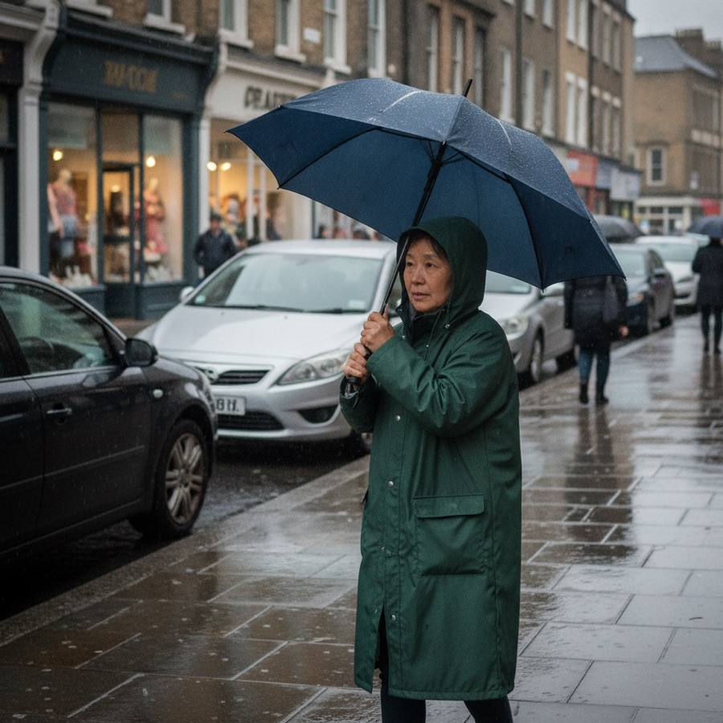

# TOEIC® Listening Practice Test 01

> 100 题 · Part 1（6）+ Part 2（25）+ Part 3（39）+ Part 4（30）· 约 45 分钟
> 音频为电脑合成（TTS），非真人录音。音频文件见 `audio/m1/`。

## PART 1 — Photographs（1–6）

For each question, you will listen to four short statements about a photograph. Select the statement that best describes what is happening in the picture.

### Q1

*照片内容*：A man in a hard hat and safety vest stands on a construction site, holding a set of rolled-up blueprints under one arm while looking up at a partially built structure.

音频：`audio/m1/p1-1.mp3`

- (A) He's putting on a safety vest.
- (B) He's climbing a ladder to the roof.
- (C) He's repairing a piece of equipment.
- (D) He's holding some rolled-up documents.

**答案：D**

解析：He is holding rolled-up blueprints, so (D) is correct. He is already wearing the vest, not putting it on, and he is neither climbing nor repairing anything.

### Q2

*照片内容*：Inside a busy cafe, a barista behind the counter hands a paper cup to a customer, while a display case of pastries sits in the foreground.

音频：`audio/m1/p1-2.mp3`

- (A) The barista is wiping down the counter.
- (B) A customer is paying at the register.
- (C) The barista is handing a cup to a customer.
- (D) The pastries are being placed in the case.

**答案：C**

解析：The barista is passing a cup to the customer, so (C) is correct. No one is wiping the counter, and the payment and restocking actions are not shown.

### Q3

*照片内容*：An airport waiting area where several travelers sit in rows of chairs; one woman checks her phone while a rolling suitcase stands beside her.

音频：`audio/m1/p1-3.mp3`

- (A) The travelers are boarding the plane.
- (B) The passengers are retrieving their luggage.
- (C) An agent is scanning boarding passes.
- (D) A suitcase has been placed next to a chair.

**答案：D**

解析：A suitcase is positioned beside a chair, so (D) is correct. Nobody is boarding, scanning passes, or picking up luggage in the waiting area.

### Q4

*照片内容*：In a warehouse, a worker operates a forklift to lift a wooden pallet stacked with cardboard boxes onto a tall metal shelf.

音频：`audio/m1/p1-4.mp3`

- (A) Boxes are being loaded onto a truck.
- (B) A worker is stacking boxes by hand.
- (C) A forklift is lifting a loaded pallet.
- (D) The shelves have been left empty.

**答案：C**

解析：The forklift is raising a pallet of boxes, so (C) is correct. The boxes are not being loaded onto a truck or stacked by hand, and the shelves are not empty.

### Q5

*照片内容*：A group of four colleagues sits around a restaurant table with menus open; a waiter stands beside them holding a notepad, ready to take their order.

音频：`audio/m1/p1-5.mp3`

- (A) They're studying the menus.
- (B) The waiter is clearing the plates.
- (C) They're paying the bill.
- (D) The table is being set with silverware.

**答案：A**

解析：The diners are looking at open menus, so (A) is correct. No plates are being cleared, no bill is being paid, and the table is already set.

### Q6

*照片内容*：On a city sidewalk, a woman in a raincoat opens an umbrella as light rain falls; parked cars and a row of shops line the street behind her.

音频：`audio/m1/p1-6.mp3`

- (A) She's crossing the street at the corner.
- (B) She's opening an umbrella.
- (C) She's getting into a parked car.
- (D) She's shopping inside a store.

**答案：B**

解析：She is opening an umbrella against the rain, so (B) is correct. She is not crossing the street, entering a car, or inside a shop.

## PART 2 — Question-Response（7–31）

You will hear a question or statement followed by three responses. Select the best response to the question or statement.

### Q7

问句/陈述：Where did you put the quarterly report?

音频：`audio/m1/p2-1.mp3`

- (A) By next Friday.
- (B) Yes, I read it.
- (C) It's on your desk.

**答案：C**

解析：The question asks 'where', so 'It's on your desk' (C) is correct. (A) answers 'when' and (B) answers a yes/no question.

### Q8

问句/陈述：When does the shipment arrive?

音频：`audio/m1/p2-2.mp3`

- (A) At the loading dock.
- (B) Sometime tomorrow morning.
- (C) Three large crates.

**答案：B**

解析：'When' calls for a time, so 'Sometime tomorrow morning' (B) is correct. (A) gives a place and (C) gives a quantity.

### Q9

问句/陈述：Who's leading the training session this afternoon?

音频：`audio/m1/p2-3.mp3`

- (A) Marcus from the HR team.
- (B) In the main conference room.
- (C) It went really well.

**答案：A**

解析：'Who' asks for a person, so 'Marcus from the HR team' (A) is correct. (B) answers 'where' and (C) refers to a past event.

### Q10

问句/陈述：Why was the flight delayed?

音频：`audio/m1/p2-4.mp3`

- (A) To gate twenty-two.
- (B) For about two hours.
- (C) Because of the bad weather.

**答案：C**

解析：'Why' asks for a reason, so 'Because of the bad weather' (C) is correct. (A) gives a destination and (B) gives a duration.

### Q11

问句/陈述：How do I get to the downtown office from here?

音频：`audio/m1/p2-5.mp3`

- (A) It's a brand-new building.
- (B) Take the number 4 bus.
- (C) About twice a week.

**答案：B**

解析：'How do I get to' asks for directions, so 'Take the number 4 bus' (B) is correct. (A) describes the building and (C) states a frequency.

### Q12

问句/陈述：Would you like a receipt with your purchase?

音频：`audio/m1/p2-6.mp3`

- (A) It was on sale.
- (B) The store closes at nine.
- (C) No, thanks, I don't need one.

**答案：C**

解析：The yes/no offer is best answered by declining, so 'No, thanks, I don't need one' (C) is correct. (A) and (B) ignore the offer.

### Q13

问句/陈述：You've already booked the venue for the conference, haven't you?

音频：`audio/m1/p2-7.mp3`

- (A) Yes, I confirmed it last week.
- (B) The keynote speaker.
- (C) On the fifth floor.

**答案：A**

解析：The tag question checks whether the booking is done, so 'Yes, I confirmed it last week' (A) is correct. (B) and (C) don't address the booking.

### Q14

问句/陈述：Could you send me the updated budget spreadsheet?

音频：`audio/m1/p2-8.mp3`

- (A) Sure, I'll email it right away.
- (B) It's a reasonable price.
- (C) In the top drawer.

**答案：A**

解析：The request is best met with agreement, so 'Sure, I'll email it right away' (A) is correct. (B) plays on 'budget' and (C) gives an unrelated location.

### Q15

问句/陈述：Should we take the train or drive to the trade show?

音频：`audio/m1/p2-9.mp3`

- (A) At the exhibition hall.
- (B) They showed us the samples.
- (C) The train would be faster.

**答案：C**

解析：The choice question is answered by picking the train, so 'The train would be faster' (C) is correct. (A) gives a place and (B) repeats the 'show' sound without answering.

### Q16

问句/陈述：What time does the pharmacy open on Sundays?

音频：`audio/m1/p2-10.mp3`

- (A) On Main Street.
- (B) Not until ten o'clock.
- (C) A bottle of vitamins.

**答案：B**

解析：'What time' asks for an opening time, so 'Not until ten o'clock' (B) is correct. (A) gives a location and (C) names a product.

### Q17

问句/陈述：How much will it cost to repair the copier?

音频：`audio/m1/p2-11.mp3`

- (A) The technician is coming.
- (B) Around two hundred dollars.
- (C) It broke this morning.

**答案：B**

解析：'How much' asks for a price, so 'Around two hundred dollars' (B) is correct. (A) and (C) give related but non-price information.

### Q18

问句/陈述：Isn't the new marketing manager starting today?

音频：`audio/m1/p2-12.mp3`

- (A) A great advertising campaign.
- (B) In the corner office.
- (C) Actually, she starts on Monday.

**答案：C**

解析：The negative question checks the start date, so 'Actually, she starts on Monday' (C) is correct. (A) and (B) don't address the timing.

### Q19

问句/陈述：Do you know if the elevator is working again?

音频：`audio/m1/p2-13.mp3`

- (A) Yes, they fixed it yesterday.
- (B) On the ground floor.
- (C) It's a tall building.

**答案：A**

解析：The embedded yes/no question is answered by confirming the repair, so 'Yes, they fixed it yesterday' (A) is correct. (B) and (C) mention the building but not the elevator's status.

### Q20

问句/陈述：Let's review the contract before the client meeting.

音频：`audio/m1/p2-14.mp3`

- (A) She signed it already.
- (B) Good idea, I have it right here.
- (C) The meeting room is booked.

**答案：B**

解析：The suggestion is best met with agreement, so 'Good idea, I have it right here' (B) is correct. (A) and (C) don't respond to reviewing it together.

### Q21

问句/陈述：Which supplier gave us the better quote?

音频：`audio/m1/p2-15.mp3`

- (A) We need more inventory.
- (B) Last Thursday.
- (C) The one in Chicago.

**答案：C**

解析：'Which supplier' asks you to identify one, so 'The one in Chicago' (C) is correct. (A) is off-topic and (B) gives a time.

### Q22

问句/陈述：I can't find the key to the supply closet.

音频：`audio/m1/p2-16.mp3`

- (A) It's a spacious closet.
- (B) Try asking the receptionist.
- (C) We're low on paper.

**答案：B**

解析：The problem statement invites a helpful suggestion, so 'Try asking the receptionist' (B) is correct. (A) and (C) mention the office but don't help find the key.

### Q23

问句/陈述：Has the invoice been sent to accounting yet?

音频：`audio/m1/p2-17.mp3`

- (A) No, I'll do it this afternoon.
- (B) The account is overdrawn.
- (C) It's a fair amount.

**答案：A**

解析：The yes/no question about the invoice is answered by 'No, I'll do it this afternoon' (A), so it is correct. (B) plays on 'account' and (C) is vague.

### Q24

问句/陈述：Where should I leave the visitor badges?

音频：`audio/m1/p2-18.mp3`

- (A) They expire at noon.
- (B) About twenty guests.
- (C) With the security guard.

**答案：C**

解析：'Where' asks for a place to leave them, so 'With the security guard' (C) is correct. (A) gives a time and (B) gives a number.

### Q25

问句/陈述：The projector in room B keeps shutting off, doesn't it?

音频：`audio/m1/p2-19.mp3`

- (A) Yes, we should report it.
- (B) In about ten minutes.
- (C) A very clear picture.

**答案：A**

解析：The tag question seeks agreement about the fault, so 'Yes, we should report it' (A) is correct. (B) gives a time and (C) contradicts the problem.

### Q26

问句/陈述：Are you attending the workshop in person or joining online?

音频：`audio/m1/p2-20.mp3`

- (A) It was very informative.
- (B) I'll be there in person.
- (C) The registration desk.

**答案：B**

解析：The choice question is answered by picking one option, so 'I'll be there in person' (B) is correct. (A) refers to a past event and (C) gives a place.

### Q27

问句/陈述：Why don't we reschedule the call for later this week?

音频：`audio/m1/p2-21.mp3`

- (A) He called twice.
- (B) A conference line.
- (C) That works for me.

**答案：C**

解析：'Why don't we' is a suggestion, so 'That works for me' (C) is correct. (A) repeats 'call' without answering and (B) is unrelated.

### Q28

问句/陈述：How was your business trip to Toronto?

音频：`audio/m1/p2-22.mp3`

- (A) Very productive, thanks.
- (B) By plane, of course.
- (C) Next quarter, I hope.

**答案：A**

解析：'How was' asks for an evaluation, so 'Very productive, thanks' (A) is correct. (B) answers 'how did you travel' and (C) gives a future time.

### Q29

问句/陈述：Didn't we order more printer toner last month?

音频：`audio/m1/p2-23.mp3`

- (A) The printout looks great.
- (B) I think it's still on backorder.
- (C) In the storage room.

**答案：B**

解析：The negative question about the order is answered by 'I think it's still on backorder' (B), so it is correct. (A) plays on 'print' and (C) is a location.

### Q30

问句/陈述：Who approved this expense report?

音频：`audio/m1/p2-24.mp3`

- (A) The finance director did.
- (B) It was quite expensive.
- (C) Sometime last week.

**答案：A**

解析：'Who' asks for the approver, so 'The finance director did' (A) is correct. (B) echoes 'expense' and (C) gives a time instead of a person.

### Q31

问句/陈述：I'd be happy to show you around the new facility.

音频：`audio/m1/p2-25.mp3`

- (A) It's for sale now.
- (B) She showed up late.
- (C) That would be great, thank you.

**答案：C**

解析：The friendly offer is best accepted, so 'That would be great, thank you' (C) is correct. (A) is unrelated and (B) reuses 'show' without answering.

## PART 3 — Conversations（32–70）

You will hear several conversations between two or more people. You will be asked to answer three questions about what the speakers say. Select the best response.

### Questions 32–34

音频：`audio/m1/p3-1.mp3`

**Supplier price list**：Screen size Price each 21 inches $180 24 inches $240 27 inches $310 32 inches $420

**录音原文：**

> M: Priya, we've finally been approved to buy new monitors for the design team. I'm looking at the supplier's price list right now.
> W: That's great news — the designers really need bigger screens. What's our budget for each one?
> M: Three hundred dollars per monitor. I'd like to get the largest screen we can without going over that.
> W: Sounds good. Go with the biggest one that still fits the budget, and I'll approve the order this afternoon.

**Q32.** What does the man want to buy?
- (A) New monitors
- (B) New office chairs
- (C) New laptops
- (D) New printers

答案：**A**　解析：He says they were approved 'to buy new monitors for the design team'.

**Q33.** What is the budget for each monitor?
- (A) $180
- (B) $240
- (C) $300
- (D) $420

答案：**C**　解析：The man says the budget is 'three hundred dollars per monitor'.

**Q34.** Look at the graphic. Which screen size will they most likely order?
- (A) 21 inches
- (B) 32 inches
- (C) 27 inches
- (D) 24 inches

答案：**D**　解析：They want the largest screen within a $300 budget. The 24-inch ($240) is the biggest that stays under $300 — the 27-inch is $310, just over.

### Questions 35–37

音频：`audio/m1/p3-2.mp3`

**录音原文：**

> W: Hello, I'm calling about the lunch order for our staff training tomorrow — order number four-one-nine. I requested thirty vegetarian meals, but the confirmation email lists only twenty.
> M: Let me pull that up. You're right, and I'm very sorry. It looks like ten were entered as the standard menu by mistake.
> W: I really need all thirty to be vegetarian. Several of our guests have dietary restrictions, so the standard meals won't work.
> M: Understood. I'll correct the order now and resend the confirmation within the hour. There's no extra charge, and I'll add a tray of fruit to make up for the mix-up.
> W: Thank you. As long as it arrives by eleven, we'll be fine.

**Q35.** What problem does the woman mention?
- (A) An order arrived late
- (B) No confirmation email was ever sent
- (C) She was charged the wrong price
- (D) The wrong number of vegetarian meals was booked

答案：**D**　解析：She ordered thirty vegetarian meals, but the confirmation lists only twenty.

**Q36.** What does the man offer to provide at no charge?
- (A) A tray of fruit
- (B) Free delivery
- (C) A discount coupon
- (D) Extra serving staff

答案：**A**　解析：He offers to 'add a tray of fruit to make up for the mix-up.'

**Q37.** What does the woman imply when she says, "As long as it arrives by eleven, we'll be fine"?
- (A) She wants to cancel the order
- (B) She thinks eleven o'clock is too late
- (C) She will accept the correction if the timing works
- (D) She needs the food much earlier than planned

答案：**C**　解析：She accepts his solution on the condition that the corrected order arrives by eleven.

### Questions 38–40

音频：`audio/m1/p3-3.mp3`

**录音原文：**

> M: Good afternoon. I have a reservation for two nights starting this Friday, but my plans have changed and I'd like to extend it to four nights if that's possible.
> W: Let me check availability. Yes, we can extend your stay through Tuesday morning, and the room rate stays the same on those extra nights.
> M: Great. One more thing — could I have a room on a higher floor? The street noise last time made it hard to sleep.
> W: Of course. I'll move you to a room on the ninth floor, away from the main road, and I'll note the preference on your account for future stays.
> M: Perfect, thank you. I'll be checking in around six on Friday.

**Q38.** What does the man want to do?
- (A) Cancel his reservation
- (B) Switch to a different hotel
- (C) Request a refund
- (D) Extend his stay

答案：**D**　解析：He asks to 'extend it to four nights.'

**Q39.** Why does the man request a different room?
- (A) The room was too small
- (B) The previous room was too noisy
- (C) The rate was too high
- (D) He disliked the view

答案：**B**　解析：He says 'the street noise last time made it hard to sleep.'

**Q40.** What does the woman say she will do?
- (A) Move him to a higher floor
- (B) Offer him a free breakfast
- (C) Lower the nightly rate
- (D) Cancel his earlier booking

答案：**A**　解析：She says she'll 'move you to a room on the ninth floor.'

### Questions 41–43

音频：`audio/m1/p3-4.mp3`

**录音原文：**

> M: Thanks for jumping on this quick sync. We're two weeks from the app launch, and I want to make sure the redesign and the back end are on track. Priya, how are the new screens coming?
> W: The screens are basically done. I finished the checkout flow this morning and sent it to Sean's team to build. The only thing outstanding is the dark-mode version.
> M: How much longer for dark mode?
> W: Two or three days. It's mostly adjusting colours.
> M: Okay. Sean, can your team build the checkout screens in that time?
> M2: We can, but I'm worried about testing. If we don't get the final designs until Wednesday, we'll have only a few days to test payments before launch. I'd feel better pushing the launch back a week.
> M: Let me think about that. I'd rather not delay, but I won't ship something untested. Let's regroup Thursday once Priya's files are in.

**Q41.** What is the main purpose of the meeting?
- (A) To review progress before a product launch
- (B) To interview a new designer
- (C) To choose a payment provider
- (D) To celebrate a finished project

答案：**A**　解析：The man wants to make sure the redesign and back end are on track two weeks before the app launch.

**Q42.** What has Priya not finished yet?
- (A) The checkout flow
- (B) The payment testing
- (C) The dark-mode version
- (D) The launch schedule

答案：**C**　解析：She says 'the only thing outstanding is the dark-mode version.'

**Q43.** What does Sean mean when he says he would "feel better pushing the launch back a week"?
- (A) He wants more time to test the payment system
- (B) He needs to hire more developers
- (C) He thinks the designs look unfinished
- (D) He would like to take a vacation

答案：**A**　解析：He is worried about having only a few days to test payments, so a delay would give more testing time.

### Questions 44–46

音频：`audio/m1/p3-5.mp3`

**录音原文：**

> W: Hi, thanks for coming so quickly. The heating on the third floor has been out since yesterday, and the staff up there are freezing.
> M: No problem. I had a look at the unit on my way in — the main fan motor has burned out, so no warm air is circulating.
> W: Can you fix it today? We have an all-day workshop scheduled up there tomorrow.
> M: I can, but I don't carry that motor on the van, so I'll have to order the part. If I order it this afternoon, it'll arrive first thing tomorrow and I can install it by nine.
> W: That cuts it close. The workshop starts at ten, so as long as it's warm by then, that works. In the meantime, I'll bring up a few portable heaters.

**Q44.** What problem are the speakers discussing?
- (A) A broken window
- (B) A cancelled workshop
- (C) An elevator that is out of service
- (D) Heating that is not working

答案：**D**　解析：'The heating on the third floor has been out since yesterday.'

**Q45.** What does the man say caused the problem?
- (A) A burned-out fan motor
- (B) A power outage
- (C) A blocked air vent
- (D) A faulty thermostat

答案：**A**　解析：He says 'the main fan motor has burned out.'

**Q46.** What will the woman do in the meantime?
- (A) Cancel the workshop
- (B) Move the workshop to another floor
- (C) Bring in portable heaters
- (D) Order the replacement part herself

答案：**C**　解析：She says 'I'll bring up a few portable heaters.'

### Questions 47–49

音频：`audio/m1/p3-6.mp3`

**录音原文：**

> W: Mark, I wanted to touch base about the marketing analyst role. We've narrowed it to three strong candidates, and I'd like to get the interviews on your calendar this week.
> M: Great news. I'm fairly booked, but I can do Wednesday and Thursday mornings. Are they all local, or will any join remotely?
> W: Two are local; the third is relocating from Denver, so she'd join by video. She's actually the one with the strongest portfolio.
> M: In that case, let's give her a full hour instead of the usual forty-five minutes. And could you send me their portfolios ahead of time? I like to review the work before we talk.
> W: Of course. I'll email all three portfolios today and send calendar invites once I confirm the times.

**Q47.** What are the speakers mainly discussing?
- (A) Arranging job interviews
- (B) Writing a job advertisement
- (C) Reviewing an employee's salary
- (D) Planning a marketing campaign

答案：**A**　解析：They discuss getting the candidate interviews onto the man's calendar this week.

**Q48.** What does the man ask the woman to send him?
- (A) The candidates' portfolios
- (B) A list of interview questions
- (C) The job description
- (D) Travel arrangements

答案：**A**　解析：He asks, 'could you send me their portfolios ahead of time?'

**Q49.** What is suggested about the candidate from Denver?
- (A) She has withdrawn her application
- (B) She has already been offered the job
- (C) She is unable to attend an interview
- (D) She is regarded as the most impressive candidate

答案：**D**　解析：The woman calls her the candidate 'with the strongest portfolio,' and the man wants to give her extra time.

### Questions 50–52

音频：`audio/m1/p3-7.mp3`

**录音原文：**

> M: Hi there. I bought this jacket here last weekend, but when I got home I noticed the zipper is faulty — it sticks halfway up. I'd like to exchange it for the same one in a medium.
> W: I'm sorry about that. Let me check the stockroom for a medium. Unfortunately, it looks like we're sold out of that model in every size right now.
> M: Oh, that's disappointing. I really liked it.
> W: We're getting a new shipment next Friday. I can set one aside and call you the moment it arrives. Or, if you'd prefer, I can process a full refund today.
> M: Let's do the hold. Please call me when it comes in — I'd rather have the jacket than the refund.

**Q50.** Why has the man come to the store?
- (A) To buy a gift
- (B) To exchange a defective item
- (C) To apply for a job
- (D) To pick up an online order

答案：**B**　解析：He wants to exchange a jacket because 'the zipper is faulty.'

**Q51.** What does the woman say is the problem?
- (A) The item is the wrong colour
- (B) The item is out of stock
- (C) The receipt is missing
- (D) The return period has expired

答案：**B**　解析：She says 'we're sold out of that model in every size right now.'

**Q52.** What does the man decide to do?
- (A) Accept a refund
- (B) Choose a different jacket
- (C) Have the store hold an item for him
- (D) Shop at another location

答案：**C**　解析：He says 'Let's do the hold' and asks the associate to call him when it arrives.

### Questions 53–55

音频：`audio/m1/p3-8.mp3`

**录音原文：**

> W: So this is the unit I mentioned — just over two thousand square feet, open plan, with those big south-facing windows. What do you think?
> M: It's bright, I'll give it that. And the location is ideal, right by the train station. My team has been complaining about the commute to our current place.
> W: That's a big draw for a lot of my clients. Now, the current tenant's lease ends in September, so you could move in as early as the first of October.
> M: October could line up nicely with our expansion. We're bringing on six new people in the autumn, and frankly, we've outgrown our current floor.
> W: Then the timing's perfect. Would you like to bring your team by for a second look before you decide?
> M: Yes, let's set that up. I'd want them to see the space before I sign anything.

**Q53.** Who most likely is the woman?
- (A) A train station employee
- (B) A real estate agent
- (C) An interior designer
- (D) The building's current tenant

答案：**B**　解析：She is showing a rental unit, refers to 'a lot of my clients,' and discusses the lease and move-in date.

**Q54.** Why does the man's company most likely need a new office?
- (A) The rent has increased
- (B) Its lease was cancelled
- (C) The current office was damaged
- (D) The company is growing

答案：**D**　解析：He says they're 'bringing on six new people' and have 'outgrown our current floor.'

**Q55.** What will the man most likely do next?
- (A) Sign a lease immediately
- (B) Look at a different unit
- (C) Arrange for his team to visit the space
- (D) Cancel the appointment

答案：**C**　解析：He agrees to set up a second look so his team can see the space before he signs.

### Questions 56–58

音频：`audio/m1/p3-9.mp3`

**录音原文：**

> W: Okay, the industry expo is six weeks out. I wanted the three of us to lock down the plan for our booth. Tom, how big a space did we reserve this year?
> M: We upgraded to a corner booth — twice the size of last year. I'm expecting a lot more foot traffic, so I want the product demos front and centre.
> W2: For a corner space, I'd suggest an open layout with a demo counter on each side, so people can approach from both aisles. I can have mock-ups ready by Friday.
> W: Perfect. Tom, how many staff should we plan to have on the floor?
> M: At least four at all times — two running demos, two answering questions and collecting leads. Last year we were short-handed on the first day and missed a lot of contacts.
> W: Noted. I'll draft a staffing schedule and share it with both of you by Monday.

**Q56.** What are the speakers planning?
- (A) A product launch party
- (B) A staff training day
- (C) Their company's booth at a trade show
- (D) A customer survey

答案：**C**　解析：They are locking down the plan for their booth at the industry expo.

**Q57.** What does Tom want to be the focus of the booth?
- (A) Product demonstrations
- (B) A seating lounge
- (C) A prize giveaway
- (D) A large video screen

答案：**A**　解析：He says he wants 'the product demos front and centre.'

**Q58.** Why does Tom want at least four staff on the floor?
- (A) The organizers require four people
- (B) To avoid being short-handed as they were last year
- (C) Each demo needs four people to run
- (D) To reduce overtime costs

答案：**B**　解析：He notes that last year they were short-handed and 'missed a lot of contacts,' so he wants enough staff.

### Questions 59–61

音频：`audio/m1/p3-10.mp3`

**录音原文：**

> M: Hi, I'm having trouble getting into the shared drive. Every time I click on the marketing folder, I get an 'access denied' message. It worked fine yesterday.
> W: Let me take a look at your account. Ah, I see what happened. Overnight we migrated the marketing files to a new server, and your permissions didn't carry over automatically.
> M: That would explain it. I have a report due this afternoon, and all my files are in there.
> W: No worries — I can restore your access remotely right now. Give me about five minutes, then log out and back in, and everything should appear just as it did before.
> M: You're a lifesaver. I'll wait for your go-ahead before I restart.

**Q59.** What problem is the man experiencing?
- (A) His computer will not start
- (B) He has forgotten his password
- (C) His email is not working
- (D) He cannot access certain files

答案：**D**　解析：He gets an 'access denied' message when he opens the marketing folder.

**Q60.** What does the woman say caused the problem?
- (A) A forgotten password
- (B) A file migration to a new server
- (C) A virus on his computer
- (D) An expired account

答案：**B**　解析：She explains the files were migrated to a new server and his permissions 'didn't carry over.'

**Q61.** What does the woman tell the man to do?
- (A) Buy a new computer
- (B) Reinstall the software
- (C) Log out and back in after a few minutes
- (D) Email the report to her

答案：**C**　解析：She says to wait five minutes, then 'log out and back in.'

### Questions 62–64

音频：`audio/m1/p3-11.mp3`

**Last month's online ads**：Ad Format Click-through rate Spring Sale Banner 0.4% Customer Stories Video 1.2% Free Delivery Banner 0.6% How It Works Video 1.8%

**录音原文：**

> W: I've been going over last month's numbers, and the new video ads are performing far better than the banner ads — the videos are getting three times the click-through rate.
> M: That doesn't surprise me. People scroll right past static banners these days. The short videos actually stop them.
> W: Right. So for the summer campaign, I'm thinking we shift most of the budget into video and cut back on banners. What's your take?
> M: I'm all for it. I'd also test a few fifteen-second versions of our best-performing video. The shorter, the better for mobile. I can have three concepts drafted by next week.
> W: Let's do it. Send them over when they're ready and I'll get feedback from the team.

**Q62.** What is the conversation mainly about?
- (A) How to allocate an advertising budget
- (B) Hiring a new video editor
- (C) Launching a new product
- (D) Redesigning the company website

答案：**A**　解析：They discuss shifting the budget from banner ads into video for the summer campaign.

**Q63.** Why does the man think the video ads perform better?
- (A) They are cheaper to produce
- (B) They are easier to share
- (C) They capture people's attention where banners do not
- (D) They target older customers

答案：**C**　解析：He says people 'scroll right past static banners,' but short videos 'actually stop them.'

**Q64.** Look at the graphic. Which ad does the man want to make fifteen-second versions of?
- (A) Spring Sale
- (B) Customer Stories
- (C) Free Delivery
- (D) How It Works

答案：**D**　解析：The man wants short versions of 'our best-performing video,' and performance here means click-through rate. Of the two videos in the graphic, How It Works (1.8%) beats Customer Stories (1.2%), so the answer is (D). Spring Sale and Free Delivery are banner ads, not videos.

### Questions 65–67

音频：`audio/m1/p3-12.mp3`

**Weather forecast: rest of the week**：Day Forecast Tuesday Sunny Wednesday Cloudy Thursday Rain Friday Sunny

**录音原文：**

> M: Excuse me, I just started this week. Someone mentioned the company runs a shuttle from the train station. Is that right?
> W: Yes, it does. It leaves from the north entrance of the station — ten past eight and again at ten to nine — and drops you right at our front door.
> M: That's brilliant. My train gets in at eight o'clock, so the first one would be perfect. Do I need a pass or a ticket?
> W: No ticket needed — it's free for all staff. Just show your employee badge to the driver. And I'd get there a couple of minutes early; it fills up fast on rainy days.
> M: Good to know. I'll aim for the eight-ten from tomorrow, and I'll be extra early on the day it's supposed to rain. Thanks so much.

**Q65.** What is the man asking about?
- (A) A parking permit
- (B) A company shuttle service
- (C) A change to the train schedule
- (D) A relocation allowance

答案：**B**　解析：He asks whether 'the company runs a shuttle from the train station.'

**Q66.** Look at the graphic. On which day will the man most likely arrive at the shuttle stop extra early?
- (A) Tuesday
- (B) Wednesday
- (C) Thursday
- (D) Friday

答案：**C**　解析：The woman warns that the shuttle 'fills up fast on rainy days,' and the man says he'll be extra early 'on the day it's supposed to rain.' The forecast shows rain only on Thursday, so the answer is (C). Tuesday and Friday are sunny, and Wednesday is only cloudy.

**Q67.** Why does the woman suggest arriving a few minutes early?
- (A) The shuttle sometimes leaves ahead of schedule
- (B) The shuttle can become crowded
- (C) The badge check takes a long time
- (D) The station entrance is hard to find

答案：**B**　解析：She warns that it 'fills up fast on rainy days,' implying it can get crowded.

### Questions 68–70

音频：`audio/m1/p3-13.mp3`

**录音原文：**

> W: Welcome, both of you. This morning I'll walk you through our systems, and after lunch you'll shadow someone on your team. Ben, you're joining sales, correct?
> M: That's right. I'm a bit nervous about the customer database — I've never used this particular software before.
> W: Don't worry, that's exactly what this morning covers. By the end of the session you'll be comfortable logging calls and pulling up account histories. Oliver, you're in customer support, so you'll use the same database but focus on the ticketing side.
> M2: Sounds good. Will we get login details today, or does that come later?
> W: You'll each get a temporary password before lunch, and IT will help you set a permanent one this afternoon. Any questions before we start? No? Then let's dive in.

**Q68.** What is mainly happening in the conversation?
- (A) A job interview
- (B) A customer complaint
- (C) A software sales pitch
- (D) An orientation for new employees

答案：**D**　解析：The trainer welcomes two new hires and walks them through systems and team shadowing.

**Q69.** What is Ben concerned about?
- (A) Meeting his team
- (B) Using unfamiliar database software
- (C) Finding the office
- (D) The length of the training

答案：**B**　解析：He says he's 'nervous about the customer database' because he's never used the software before.

**Q70.** When will the new hires receive a permanent password?
- (A) Before lunch
- (B) In the afternoon
- (C) The next morning
- (D) At the end of the week

答案：**B**　解析：They get a temporary password before lunch, and IT will help set a permanent one 'this afternoon.'

## PART 4 — Talks（71–100）

You will hear several talks given by a single speaker. You will be asked to answer three questions about what the speaker says. Select the best response.

### Questions 71–73 · Seminar announcement

音频：`audio/m1/p4-1.mp3`

**Today's seminar program**：Speaker Time Ms. Alvarez 9:00–9:50 Mr. Tanaka 10:00–10:50 Ms. Bauer 11:00–11:50 Mr. Okafor 1:00–1:50

**录音原文：**

> Good morning, and welcome to today's customer-service training seminar. Before we begin, there's one change to your printed program. Ms. Bauer, who was scheduled to present at eleven o'clock, has just been asked to join an urgent client call. She will switch times with our afternoon speaker, so the presenter originally scheduled for one o'clock will now take the eleven o'clock slot instead. Everything else on the program stays exactly the same. Please silence your phones, and let's give a warm welcome to our very first speaker of the day.

**Q71.** What is the purpose of the talk?
- (A) To open a training seminar
- (B) To cancel an event
- (C) To launch a new product
- (D) To announce a merger

答案：**A**　解析：The speaker welcomes everyone to a 'customer-service training seminar' and introduces the first speaker.

**Q72.** Why will the schedule change?
- (A) A speaker is unwell
- (B) A speaker must join a client call
- (C) The room is unavailable
- (D) A session was cancelled

答案：**B**　解析：Ms. Bauer 'has just been asked to join an urgent client call', so she switches times.

**Q73.** Look at the graphic. Who will now speak at 11:00?
- (A) Ms. Alvarez
- (B) Mr. Tanaka
- (C) Ms. Bauer
- (D) Mr. Okafor

答案：**D**　解析：Ms. Bauer (originally 11:00) switches with the one-o'clock speaker, Mr. Okafor, so he now takes the 11:00 slot.

### Questions 74–76 · Airport announcement

音频：`audio/m1/p4-2.mp3`

**录音原文：**

> Good afternoon, passengers. This is a boarding announcement for Meridian Airways flight 447 to Vancouver. Due to earlier weather conditions, this flight will now depart from gate B12, rather than the gate printed on your ticket. We expect to begin boarding in approximately twenty minutes, starting with families travelling with young children and passengers requiring extra assistance. Please have your boarding pass and photo identification ready, and note that only one item of hand luggage is permitted in the cabin. We thank you for your patience and apologise for any inconvenience.

**Q74.** What change does the speaker announce?
- (A) A lower ticket price
- (B) A new flight number
- (C) A change of destination
- (D) A change of departure gate

答案：**D**　解析：She says the flight 'will now depart from gate B12, rather than the gate printed on your ticket'.

**Q75.** Why has the change occurred?
- (A) Because of a mechanical problem
- (B) Because of the weather
- (C) Because of a staff shortage
- (D) Because of a security alert

答案：**B**　解析：She attributes the change to 'earlier weather conditions'.

**Q76.** Who will be invited to board first?
- (A) Business-class passengers
- (B) Frequent flyers
- (C) Families with young children
- (D) Passengers seated at the rear

答案：**C**　解析：Boarding starts 'with families travelling with young children and passengers requiring extra assistance'.

### Questions 77–79 · Podcast excerpt

音频：`audio/m1/p4-3.mp3`

**录音原文：**

> You're listening to Workwise, the podcast about building better teams, and I'm your host, Priya Nair. On today's episode, we're tackling a question a lot of you have written in about: how do you stay productive when your whole team works remotely? To help us out, I've invited management consultant Ben Alvarez, who has spent the last decade advising companies on flexible work. Before we bring him on, a quick reminder that you can download the free worksheet mentioned in this episode from our website. Stay with us — we'll be right back after this short break.

**Q77.** What is the main topic of today's episode?
- (A) Staying productive while working remotely
- (B) Hiring new team members
- (C) Choosing office furniture
- (D) Reducing business travel costs

答案：**A**　解析：The host says today's episode tackles 'how do you stay productive when your whole team works remotely'.

**Q78.** Who is the guest?
- (A) A software engineer
- (B) A radio producer
- (C) A university professor
- (D) A management consultant

答案：**D**　解析：She introduces 'management consultant Ben Alvarez'.

**Q79.** What will listeners most likely hear next?
- (A) An interview with the guest
- (B) A news bulletin
- (C) A commercial break
- (D) A weather report

答案：**C**　解析：She says 'we'll be right back after this short break,' so an advertisement will play next.

### Questions 80–82 · Advertisement

音频：`audio/m1/p4-4.mp3`

**录音原文：**

> Is your kitchen stuck in the past? This weekend only, Harborview Appliances is holding its biggest clearance sale of the year. Every refrigerator, oven and dishwasher on our showroom floor is marked down by at least thirty percent, and delivery within the city is completely free. Spend over five hundred dollars, and you'll also receive a two-year extended warranty at no extra cost. Our doors open at eight on Saturday, and popular models sell out fast, so come early. Harborview Appliances — on Route 9, just past the shopping centre. We can't wait to see you.

**Q80.** What is being advertised?
- (A) A restaurant opening
- (B) A sale on kitchen appliances
- (C) A home-cleaning service
- (D) A cooking class

答案：**B**　解析：It promotes a clearance sale on 'every refrigerator, oven and dishwasher'.

**Q81.** What can customers who spend over five hundred dollars receive?
- (A) An extended warranty
- (B) Free installation
- (C) A gift card
- (D) A second appliance

答案：**A**　解析：He says spend over five hundred dollars 'and you'll also receive a two-year extended warranty'.

**Q82.** Why does the speaker suggest arriving early?
- (A) The store closes at noon
- (B) Parking is limited
- (C) Prices rise later in the day
- (D) Popular items may sell out

答案：**D**　解析：He warns that 'popular models sell out fast, so come early'.

### Questions 83–85 · Museum tour guide

音频：`audio/m1/p4-5.mp3`

**录音原文：**

> Welcome, everyone, to the Fenwick Maritime Museum. My name is Gerald, and I'll be your guide for the next hour. We'll begin here in the main hall, where you'll see the restored fishing vessel that the museum is famous for, before moving upstairs to the gallery of navigation instruments. I'd ask that you please refrain from touching the exhibits, as many of them are extremely fragile. Photography is welcome, but do switch off your flash. At the end of the tour, you're all invited to the café downstairs for a complimentary cup of tea. Now, if you'll follow me this way.

**Q83.** Where does the talk most likely take place?
- (A) At a shipyard
- (B) At a travel agency
- (C) At a museum
- (D) At a library

答案：**C**　解析：He welcomes the group 'to the Fenwick Maritime Museum'.

**Q84.** What are the listeners asked to do?
- (A) Leave their bags at the entrance
- (B) Avoid touching the exhibits
- (C) Buy tickets in advance
- (D) Stay with a partner

答案：**B**　解析：He asks visitors to 'refrain from touching the exhibits, as many of them are extremely fragile'.

**Q85.** What are the listeners offered at the end of the tour?
- (A) A discount voucher
- (B) A guidebook
- (C) A free drink
- (D) A group photograph

答案：**C**　解析：At the end, visitors are 'invited to the café downstairs for a complimentary cup of tea'.

### Questions 86–88 · Meeting excerpt

音频：`audio/m1/p4-6.mp3`

**录音原文：**

> Alright, everyone, before we wrap up today's meeting, I want to go over one important change. Starting next month, we'll be switching from our old paper timesheets to a new online system called TimeTrack. Instead of filling out a form at the end of each week, you'll simply log your hours through the app as you go. I know change can be frustrating, but I promise this will save everyone time. Rosa from the IT team will be running a short training session on Thursday, and attendance is required for all staff. Please check your email for the exact time.

**Q86.** What is the main purpose of the announcement?
- (A) To announce a company merger
- (B) To schedule a holiday party
- (C) To report quarterly sales
- (D) To introduce a new timekeeping system

答案：**D**　解析：The speaker describes 'switching from our old paper timesheets to a new online system called TimeTrack'.

**Q87.** According to the speaker, what is one benefit of the change?
- (A) It will reduce costs
- (B) It will improve security
- (C) It will save time
- (D) It will allow remote work

答案：**C**　解析：She promises the new system 'will save everyone time'.

**Q88.** What are the listeners required to do on Thursday?
- (A) Submit a paper form
- (B) Attend a training session
- (C) Meet with their manager
- (D) Reset their passwords

答案：**B**　解析：She says a training session will be held and 'attendance is required for all staff'.

### Questions 89–91 · Traffic and weather report

音频：`audio/m1/p4-7.mp3`

**录音原文：**

> And now for your afternoon traffic and weather on the fours. Drivers on the eastbound Parkway should expect heavy delays this evening, as crews continue repairs near the Fulton Street exit. If you can, take Riverside Avenue as an alternate route to avoid the backup. Looking ahead to tomorrow, a band of rain will move in overnight, so expect wet roads for the morning commute and pack an umbrella. Temperatures will stay mild, reaching a high of around eighteen degrees. We'll have another update in thirty minutes. For now, it's back to the studio and today's top stories.

**Q89.** What kind of report is this?
- (A) A traffic and weather report
- (B) A sports report
- (C) A financial report
- (D) A local news interview

答案：**A**　解析：The speaker presents 'your afternoon traffic and weather,' covering road delays and rain.

**Q90.** Why are there delays on the Parkway?
- (A) A traffic accident
- (B) Heavy snow
- (C) Road repairs
- (D) A public event

答案：**C**　解析：Delays occur because 'crews continue repairs near the Fulton Street exit'.

**Q91.** What does the speaker recommend for tomorrow morning?
- (A) Leaving home earlier
- (B) Taking public transport
- (C) Checking flight times
- (D) Bringing an umbrella

答案：**D**　解析：Because rain is expected, he advises listeners to 'pack an umbrella'.

### Questions 92–94 · Recorded instructions

音频：`audio/m1/p4-8.mp3`

**录音原文：**

> Thank you for joining the volunteer team at the Greenfield Community Garden. Before your first shift, there are a few things you'll need to do. First, please collect a name badge and a pair of gloves from the shed near the entrance. Once you're ready, check the whiteboard inside the shed, where your team leader will have listed the tasks for the day. If you're unsure about anything, don't hesitate to ask one of the staff in the green vests. Finally, remember to sign out before you leave, so we have an accurate record of your hours. Enjoy your day.

**Q92.** Who is the talk most likely intended for?
- (A) Garden visitors
- (B) New volunteers
- (C) Delivery drivers
- (D) Event photographers

答案：**B**　解析：The talk welcomes people 'to the volunteer team' and explains what to do 'before your first shift'.

**Q93.** Where can the listeners find their tasks for the day?
- (A) On a whiteboard in the shed
- (B) On a printed handout
- (C) In an email
- (D) At the front gate

答案：**A**　解析：She says to 'check the whiteboard inside the shed, where your team leader will have listed the tasks'.

**Q94.** What are the listeners reminded to do before leaving?
- (A) Return their gloves
- (B) Water the plants
- (C) Sign out
- (D) Lock the shed

答案：**C**　解析：She reminds them to 'sign out before you leave, so we have an accurate record of your hours'.

### Questions 95–97 · Introduction of a speaker

音频：`audio/m1/p4-9.mp3`

**录音原文：**

> Ladies and gentlemen, if I could have your attention, please. It's my great pleasure to introduce tonight's keynote speaker. Dr. Helen Osei began her career as a marine biologist, but she's best known today as the founder of BlueWave, an organisation that has cleaned up more than fifty coastlines around the world. She's here this evening to share what she's learned about turning a small idea into a global movement. After her talk, she'll be taking questions from the audience, and copies of her new book will be available for signing in the lobby. Please join me in welcoming Dr. Helen Osei.

**Q95.** What is the purpose of the talk?
- (A) To present an award
- (B) To open a new exhibit
- (C) To thank the volunteers
- (D) To introduce a guest speaker

答案：**D**　解析：The speaker says it is his pleasure 'to introduce tonight's keynote speaker,' Dr. Helen Osei.

**Q96.** What is Dr. Osei best known for today?
- (A) Writing marine textbooks
- (B) Founding an environmental organization
- (C) Teaching at a university
- (D) Hosting a television programme

答案：**B**　解析：She is 'best known today as the founder of BlueWave,' which has cleaned up coastlines.

**Q97.** What will happen after the speech?
- (A) The speaker will answer questions
- (B) A meal will be served
- (C) A film will be shown
- (D) The event will end

答案：**A**　解析：He says that after her talk, 'she'll be taking questions from the audience'.

### Questions 98–100 · Store announcement

音频：`audio/m1/p4-10.mp3`

**Fairmont Department Store directory**：Floor Department Ground floor Cosmetics First floor Women's fashion Second floor Men's fashion Third floor Home and kitchen

**录音原文：**

> Attention, valued shoppers. Fairmont Department Store will be closing in thirty minutes, at nine o'clock. Please bring your final selections to the checkout counters on the ground floor, where our staff are ready to assist you. We'd also like to remind you that our annual winter sale begins tomorrow at ten. The biggest savings, up to half price, will be on our top floor. Members of our rewards programme can enter one hour earlier, at nine. Thank you for shopping with us this evening, and we look forward to welcoming you back tomorrow. Please mind the step on your way out.

**Q98.** Why is the announcement being made?
- (A) To announce a lost child
- (B) To report a change in prices
- (C) To tell shoppers the store is closing soon
- (D) To introduce a new product

答案：**C**　解析：The store 'will be closing in thirty minutes,' and shoppers are asked to bring their selections to the checkout.

**Q99.** Look at the graphic. Which department will have the biggest savings in the sale?
- (A) Cosmetics
- (B) Women's fashion
- (C) Men's fashion
- (D) Home and kitchen

答案：**D**　解析：The speaker says the biggest savings will be 'on our top floor.' The directory shows the top floor, the third floor, is Home and kitchen, so the answer is (D). Cosmetics is on the ground floor, and the two fashion departments are on the first and second floors, not the top.

**Q100.** What advantage do rewards program members have?
- (A) They can enter the sale earlier
- (B) They receive free parking
- (C) They get free delivery
- (D) They pay no membership fee

答案：**A**　解析：Members 'can enter one hour earlier, at nine,' before the general opening.

---

题目来源：toeicmocktests.com（公开免费练习材料）。TOEIC® / ETS® 为 ETS 注册商标，本项目与 ETS 无关联。仅供个人学习使用。
