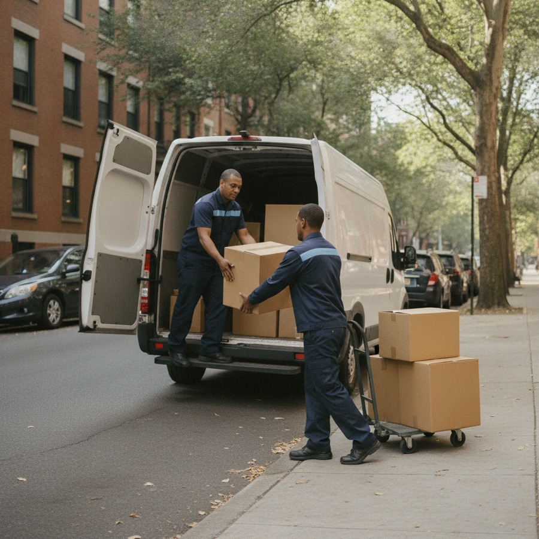
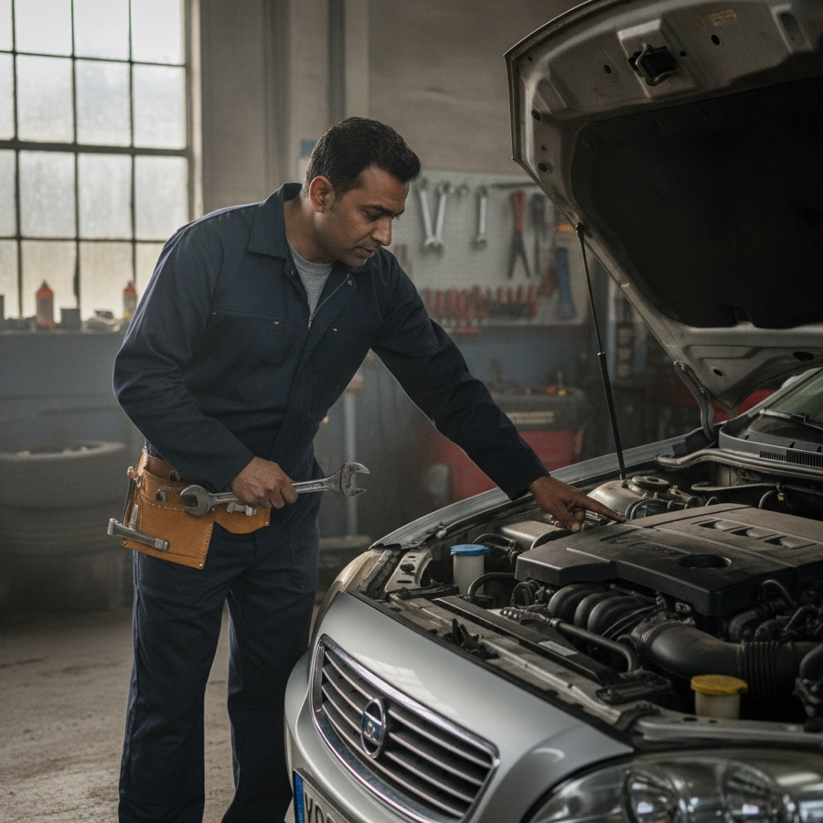

# TOEIC® Listening Practice Test 02

> 100 题 · Part 1（6）+ Part 2（25）+ Part 3（39）+ Part 4（30）· 约 45 分钟
> 音频为电脑合成（TTS），非真人录音。音频文件见 `audio/m2/`。

## PART 1 — Photographs（1–6）

For each question, you will listen to four short statements about a photograph. Select the statement that best describes what is happening in the picture.

### Q1

*照片内容*：Inside a flower shop, a woman wearing an apron stands at the counter arranging a bouquet of roses and greenery; metal buckets full of cut flowers line the wall behind her.

音频：`audio/m2/p1-1.mp3`

- (A) She's watering the plants in the window.
- (B) She's sweeping the floor of the shop.
- (C) She's paying for a purchase at the register.
- (D) She's arranging a bouquet of flowers.

**答案：D**

解析：The woman is arranging a bouquet at the counter, so (D) is correct. She is not watering plants, paying, or sweeping.

### Q2

*照片内容*：Two men in matching uniforms stand at the open rear doors of a delivery van parked at the curb, lifting cardboard boxes from the sidewalk into the vehicle.

音频：`audio/m2/p1-2.mp3`

- (A) They're loading boxes into a van.
- (B) They're unloading furniture from a truck.
- (C) They're repairing the engine of the vehicle.
- (D) They're washing the side of the van.

**答案：A**

解析：The men are lifting boxes into the van, so (A) is correct. They are not unloading furniture, repairing the engine, or washing the van.

### Q3

*照片内容*：A chef in a white uniform carefully places slices of vegetables onto a plate at a stainless-steel kitchen counter, while pots steam on the stove behind him.

音频：`audio/m2/p1-3.mp3`

- (A) The chef is washing dishes in the sink.
- (B) The chef is chopping vegetables on a board.
- (C) The chef is arranging food on a plate.
- (D) The chef is reading from a recipe book.

**答案：C**

解析：The chef is plating the food, so (C) is correct. He is not washing dishes, chopping, or reading a recipe.

### Q4

*照片内容*：In a library, a young man stands beside a tall bookshelf, sliding a book into an empty gap on the shelf while a small cart of books rests next to him.

音频：`audio/m2/p1-4.mp3`

- (A) He's reading a book at a desk.
- (B) He's returning a book to the shelf.
- (C) He's carrying a stack of chairs.
- (D) He's switching off the lights.

**答案：B**

解析：He is placing a book back on the shelf, so (B) is correct. He is not reading, carrying chairs, or turning off lights.

### Q5

*照片内容*：A woman in a business suit stands at a podium addressing a large audience seated in rows; behind her, a projection screen displays a bar chart.

音频：`audio/m2/p1-5.mp3`

- (A) She's giving a presentation to an audience.
- (B) She's handing out documents to the crowd.
- (C) She's arranging rows of empty chairs.
- (D) She's watching a film in a theater.

**答案：A**

解析：The woman is presenting to a seated audience, so (A) is correct. She is not distributing documents, arranging chairs, or watching a film.

### Q6

*照片内容*：A mechanic in overalls leans over the open hood of a car in a garage, holding a wrench as he inspects the engine.

音频：`audio/m2/p1-6.mp3`

- (A) He's driving the car out of the garage.
- (B) He's filling the tank with fuel.
- (C) He's inflating one of the tires.
- (D) He's inspecting the engine of the car.

**答案：D**

解析：The mechanic is examining the engine with a wrench, so (D) is correct. He is not driving, refueling, or inflating a tire.

## PART 2 — Question-Response（7–31）

You will hear a question or statement followed by three responses. Select the best response to the question or statement.

### Q7

问句/陈述：Where are the training manuals kept?

音频：`audio/m2/p2-1.mp3`

- (A) Next Tuesday afternoon.
- (B) Yes, they were helpful.
- (C) In the cabinet by the door.

**答案：C**

解析：'Where' asks for a place, so 'In the cabinet by the door' (C) is correct. (A) gives a time and (B) answers a yes/no question.

### Q8

问句/陈述：When will the new catalog be printed?

音频：`audio/m2/p2-2.mp3`

- (A) At the print shop downtown.
- (B) By the end of next week.
- (C) About five hundred copies.

**答案：B**

解析：'When' calls for a time, so 'By the end of next week' (B) is correct. (A) gives a place and (C) gives a quantity.

### Q9

问句/陈述：Who's in charge of the summer internship program?

音频：`audio/m2/p2-3.mp3`

- (A) Ms. Delgado in Human Resources.
- (B) On the second floor.
- (C) It starts in June.

**答案：A**

解析：'Who' asks for a person, so 'Ms. Delgado in Human Resources' (A) is correct. (B) answers 'where' and (C) answers 'when'.

### Q10

问句/陈述：Why is the cafeteria closed today?

音频：`audio/m2/p2-4.mp3`

- (A) Until about two o'clock.
- (B) On the ground floor.
- (C) They're replacing the ovens.

**答案：C**

解析：'Why' asks for a reason, so 'They're replacing the ovens' (C) is correct. (A) gives a time and (B) gives a location.

### Q11

问句/陈述：How can I reset my email password?

音频：`audio/m2/p2-5.mp3`

- (A) It's a very strong password.
- (B) Call the help desk at extension 300.
- (C) About twice a month.

**答案：B**

解析：'How' asks for a method, so 'Call the help desk at extension 300' (B) is correct. (A) describes the password and (C) gives a frequency.

### Q12

问句/陈述：Would you like me to book a taxi to the airport?

音频：`audio/m2/p2-6.mp3`

- (A) Yes, please, for eight o'clock.
- (B) It was a long flight.
- (C) At the main terminal.

**答案：A**

解析：The offer is accepted with 'Yes, please, for eight o'clock' (A). (B) refers to a past flight and (C) gives a place.

### Q13

问句/陈述：You've sent the samples to the client, haven't you?

音频：`audio/m2/p2-7.mp3`

- (A) A free sample.
- (B) Yes, they went out yesterday.
- (C) In the storage room.

**答案：B**

解析：The tag question checks whether the samples were sent, so 'Yes, they went out yesterday' (B) is correct. (A) and (C) don't address the shipment.

### Q14

问句/陈述：Could you help me move these chairs into the hall?

音频：`audio/m2/p2-8.mp3`

- (A) Sure, just give me a second.
- (B) It's a comfortable chair.
- (C) In the main hall.

**答案：A**

解析：The request is met with agreement, so 'Sure, just give me a second' (A) is correct. (B) and (C) reuse words without helping.

### Q15

问句/陈述：Should we meet in person or hold the review over video?

音频：`audio/m2/p2-9.mp3`

- (A) A very detailed review.
- (B) Video is easier for everyone.
- (C) In the boardroom.

**答案：B**

解析：The choice question is answered by picking video, so 'Video is easier for everyone' (B) is correct. (A) echoes 'review' and (C) gives a place.

### Q16

问句/陈述：What time does the morning shift start?

音频：`audio/m2/p2-10.mp3`

- (A) In the break room.
- (B) At six thirty sharp.
- (C) It's a twelve-hour shift.

**答案：B**

解析：'What time' asks for a start time, so 'At six thirty sharp' (B) is correct. (A) gives a place and (C) gives a duration.

### Q17

问句/陈述：How much does overnight shipping cost?

音频：`audio/m2/p2-11.mp3`

- (A) It ships out tonight.
- (B) Around thirty-five dollars.
- (C) To the branch office.

**答案：B**

解析：'How much' asks for a price, so 'Around thirty-five dollars' (B) is correct. (A) gives a time and (C) gives a destination.

### Q18

问句/陈述：Isn't the annual audit scheduled for this month?

音频：`audio/m2/p2-12.mp3`

- (A) A very thorough audit.
- (B) In the finance office.
- (C) Actually, it's been moved to next month.

**答案：C**

解析：The negative question checks the timing, so 'Actually, it's been moved to next month' (C) is correct. (A) and (B) don't address the date.

### Q19

问句/陈述：Do you know whether the parking garage is full?

音频：`audio/m2/p2-13.mp3`

- (A) Yes, but there's still space on level three.
- (B) It's a large garage.
- (C) On the corner of Fifth Street.

**答案：A**

解析：The embedded yes/no question is answered by 'Yes, but there's still space on level three' (A). (B) and (C) describe the garage but not its status.

### Q20

问句/陈述：Let's go over the presentation slides before lunch.

音频：`audio/m2/p2-14.mp3`

- (A) She presented very well.
- (B) Good idea, I'll open the file now.
- (C) The lunch menu looks great.

**答案：B**

解析：The suggestion is accepted with 'Good idea, I'll open the file now' (B). (A) and (C) reuse words without responding.

### Q21

问句/陈述：Which printer should I use for the color brochures?

音频：`audio/m2/p2-15.mp3`

- (A) We're low on toner.
- (B) Sometime last month.
- (C) The one near the copy room.

**答案：C**

解析：'Which printer' asks you to identify one, so 'The one near the copy room' (C) is correct. (A) is off-topic and (B) gives a time.

### Q22

问句/陈述：I can't get the projector to turn on.

音频：`audio/m2/p2-16.mp3`

- (A) A very bright projector.
- (B) Try checking the power cable.
- (C) We're out of markers.

**答案：B**

解析：The problem invites a helpful suggestion, so 'Try checking the power cable' (B) is correct. (A) and (C) don't solve the problem.

### Q23

问句/陈述：Has the venue confirmed our reservation yet?

音频：`audio/m2/p2-17.mp3`

- (A) No, I'm still waiting to hear.
- (B) A lovely venue.
- (C) It seats two hundred people.

**答案：A**

解析：The yes/no question about the confirmation is answered by 'No, I'm still waiting to hear' (A). (B) and (C) describe the venue instead.

### Q24

问句/陈述：Where should I put the recycling bins?

音频：`audio/m2/p2-18.mp3`

- (A) They're emptied on Fridays.
- (B) About a dozen bottles.
- (C) Down the hall by the exit.

**答案：C**

解析：'Where' asks for a place, so 'Down the hall by the exit' (C) is correct. (A) gives a schedule and (B) gives a quantity.

### Q25

问句/陈述：The air conditioning in the lobby is too cold, isn't it?

音频：`audio/m2/p2-19.mp3`

- (A) Yes, I'll ask maintenance to adjust it.
- (B) In about five minutes.
- (C) A very pleasant lobby.

**答案：A**

解析：The tag question seeks agreement, so 'Yes, I'll ask maintenance to adjust it' (A) is correct. (B) gives a time and (C) is unrelated.

### Q26

问句/陈述：Are you taking the early train or the express to the conference?

音频：`audio/m2/p2-20.mp3`

- (A) It was very useful.
- (B) I'll catch the express.
- (C) At platform six.

**答案：B**

解析：The choice question is answered by 'I'll catch the express' (B). (A) refers to a past event and (C) gives a place.

### Q27

问句/陈述：Why don't we push the deadline to Friday?

音频：`audio/m2/p2-21.mp3`

- (A) He met the deadline.
- (B) A tight schedule.
- (C) That would give us more time.

**答案：C**

解析：'Why don't we' is a suggestion, so 'That would give us more time' (C) is correct. (A) repeats 'deadline' and (B) is a fragment.

### Q28

问句/陈述：How was the product demonstration this morning?

音频：`audio/m2/p2-22.mp3`

- (A) It went very smoothly.
- (B) By the sales team.
- (C) Next month, I think.

**答案：A**

解析：'How was' asks for an evaluation, so 'It went very smoothly' (A) is correct. (B) answers 'who' and (C) gives a future time.

### Q29

问句/陈述：Didn't we already approve the travel budget?

音频：`audio/m2/p2-23.mp3`

- (A) The trip was wonderful.
- (B) In the spreadsheet.
- (C) I believe it's still pending.

**答案：C**

解析：The negative question is answered by 'I believe it's still pending' (C). (A) refers to a trip and (B) gives a location.

### Q30

问句/陈述：Who designed the new company logo?

音频：`audio/m2/p2-24.mp3`

- (A) A freelance artist did.
- (B) It looks very modern.
- (C) Sometime in the spring.

**答案：A**

解析：'Who' asks for a person, so 'A freelance artist did' (A) is correct. (B) evaluates the logo and (C) gives a time.

### Q31

问句/陈述：I'd be glad to walk you through the new software.

音频：`audio/m2/p2-25.mp3`

- (A) It's on sale this week.
- (B) She walked in late.
- (C) That would be a big help, thanks.

**答案：C**

解析：The friendly offer is accepted with 'That would be a big help, thanks' (C). (A) is unrelated and (B) reuses 'walk' without answering.

## PART 3 — Conversations（32–70）

You will hear several conversations between two or more people. You will be asked to answer three questions about what the speakers say. Select the best response.

### Questions 32–34

音频：`audio/m2/p3-1.mp3`

**Courier rate sheet**：Service Delivery time Cost Standard 5 business days $10 Two-Day 2 business days $20 Overnight Next business day $35

**录音原文：**

> M: Dana, this signed contract has to reach our Boston office by Wednesday. It's Monday now — what are our shipping options?
> W: I've got the courier's rate sheet right here. Standard takes five business days, so that's far too slow. Overnight would work, but it's the most expensive option.
> M: Wednesday is two days away. Is there something in between that still gets it there on time?
> W: There is — the two-day service would have it there right on schedule, and it's much cheaper than overnight.
> M: Perfect. Let's go with that one, then, and I'll hand you the envelope in a minute.

**Q32.** What does the man need to send?
- (A) A signed contract
- (B) A product sample
- (C) An invoice
- (D) A laptop

答案：**A**　解析：He says 'this signed contract has to reach our Boston office by Wednesday.'

**Q33.** Why do the speakers reject standard shipping?
- (A) It is too expensive
- (B) It takes too long to arrive
- (C) It requires a signature
- (D) It is not available on Mondays

答案：**B**　解析：The woman says standard 'takes five business days, so that's far too slow.'

**Q34.** Look at the graphic. Which service will they most likely choose?
- (A) Standard
- (B) Overnight
- (C) Two-Day
- (D) None of them

答案：**C**　解析：They need it in two days but want to avoid the priciest option, so the Two-Day service ($20) fits best.

### Questions 35–37

音频：`audio/m2/p3-2.mp3`

**录音原文：**

> W: Hello, I'm calling about my account. I was charged twice this month for my design software subscription — there are two identical payments of forty-nine dollars on my statement.
> M: I'm sorry about that. Let me pull up your account. Yes, I can see the duplicate charge. It looks like our system processed the renewal twice by mistake.
> W: I'd like the extra charge removed. I only ever signed up for one plan.
> M: Of course. I'll refund the duplicate payment today, and it should appear on your statement within three to five business days.
> W: That's fine, as long as it doesn't happen again next month.

**Q35.** Why is the woman calling?
- (A) To cancel her subscription
- (B) To ask for a receipt
- (C) To upgrade her plan
- (D) To report being charged twice

答案：**D**　解析：She says she 'was charged twice this month' with two identical payments.

**Q36.** What does the man say caused the problem?
- (A) The woman signed up twice
- (B) The price recently increased
- (C) The system processed the renewal twice
- (D) A payment was declined

答案：**C**　解析：He explains that 'our system processed the renewal twice by mistake.'

**Q37.** What does the woman imply when she says, "as long as it doesn't happen again next month"?
- (A) She wants to cancel immediately
- (B) She thinks the refund is too slow
- (C) She accepts the refund but is concerned about future billing
- (D) She needs the money right away

答案：**C**　解析：She accepts his solution while signaling worry that the double charge could recur.

### Questions 38–40

音频：`audio/m2/p3-3.mp3`

**录音原文：**

> M: Good morning. I have a car booked for pickup this Friday, but my meeting was moved up, so I'd like to collect it Thursday evening instead, if that's possible.
> W: Let me check availability. Yes, we have a vehicle ready from six o'clock on Thursday, and the daily rate stays the same.
> M: Great. One more thing — could I get a car with built-in navigation? I'll be driving to several towns I don't know well.
> W: Of course. I'll reserve one of our models with a satellite navigation system and note the change on your booking.
> M: Perfect. I'll be there around half past six on Thursday, then.

**Q38.** What does the man want to change about his booking?
- (A) The type of car
- (B) The rental price
- (C) The drop-off location
- (D) The pickup day and time

答案：**D**　解析：He asks to collect the car Thursday evening instead of Friday.

**Q39.** Why does the man request navigation?
- (A) He dislikes using his phone
- (B) He will drive to unfamiliar towns
- (C) The roads are often closed
- (D) He gets carsick

答案：**B**　解析：He says he'll be 'driving to several towns I don't know well.'

**Q40.** What does the woman say she will do?
- (A) Lower the daily rate
- (B) Add a second driver
- (C) Cancel the Friday booking fee
- (D) Reserve a car with navigation

答案：**D**　解析：She says she'll 'reserve one of our models with a satellite navigation system.'

### Questions 41–43

音频：`audio/m2/p3-4.mp3`

**录音原文：**

> M: Thanks for meeting. The company's twentieth anniversary is two months away, and I want us to plan something memorable. Fiona, have you looked into venues?
> W: I have. The riverside hall is available and holds two hundred, but it's at the very top of our budget. The community center is cheaper, but it only fits a hundred and twenty.
> M: We're expecting about a hundred and eighty guests, so the community center would be too small. Declan, what about catering?
> M2: I've got two quotes. Honestly, if we book the bigger venue, we'll have to keep the catering simple to stay on budget. I'd rather cut back on the food than cram everyone into a small room.
> M: Agreed. Let's book the riverside hall and go with the simpler menu.
> W: I'll confirm the hall this afternoon before someone else takes the date.

**Q41.** What are the speakers mainly planning?
- (A) A company anniversary party
- (B) A product launch
- (C) A staff training day
- (D) A client dinner

答案：**A**　解析：They are planning something memorable for the company's twentieth anniversary.

**Q42.** Why would the community center not work?
- (A) It is too expensive
- (B) It is too small for the expected guests
- (C) It is too far away
- (D) It is already booked

答案：**B**　解析：It fits only 120, but about 180 guests are expected.

**Q43.** What does Declan mean when he says he'd "rather cut back on the food than cram everyone into a small room"?
- (A) He prefers the larger venue even with a simpler menu
- (B) He wants to cancel the event
- (C) He thinks the food is more important than the space
- (D) He would like a smaller guest list

答案：**A**　解析：He favors booking the bigger hall and economizing on catering to fit everyone comfortably.

### Questions 44–46

音频：`audio/m2/p3-5.mp3`

**录音原文：**

> W: Thanks for coming out so fast. There's a leak under the sink in the second-floor kitchen — water's been pooling on the floor since this morning.
> M: Let me take a look. Ah, I see it — the connector under the basin has cracked. I'll need to shut off the water to this floor while I replace it.
> W: How long will that take? A lot of people rely on that kitchen for their coffee.
> M: About an hour. I've got the part on the van, so I can do it right now. I'd just ask everyone to keep the cabinet clear until it dries out.
> W: No problem. I'll put up a sign and let the floor know the water will be off for an hour.

**Q44.** What problem are the speakers discussing?
- (A) A broken coffee machine
- (B) A blocked drain in the restroom
- (C) A power outage
- (D) A leak under the kitchen sink

答案：**D**　解析：'There's a leak under the sink in the second-floor kitchen.'

**Q45.** What does the man say caused the problem?
- (A) A cracked connector under the basin
- (B) A loose faucet handle
- (C) A clogged pipe
- (D) A worn-out seal on the dishwasher

答案：**A**　解析：He says 'the connector under the basin has cracked.'

**Q46.** What will the woman do?
- (A) Turn off the water herself
- (B) Order a replacement part
- (C) Put up a sign and notify the floor
- (D) Move the coffee machine

答案：**C**　解析：She says 'I'll put up a sign and let the floor know the water will be off.'

### Questions 47–49

音频：`audio/m2/p3-6.mp3`

**录音原文：**

> W: Sam, I wanted to ask — would you be open to moving to the corner desk by the window? The one you're at now is right next to the printers.
> M: Honestly, that would be a relief. The printer noise makes it hard to concentrate when I'm on the phone with clients.
> W: That's exactly what I thought. The corner desk is much quieter, and it gets more natural light too. We could move you this Friday after work.
> M: Friday works for me. I don't have much to pack — mostly my monitor and a few files.
> W: Great. I'll let facilities know so they can help you carry the monitor over.

**Q47.** What does the woman offer the man?
- (A) A pay raise
- (B) Time off on Friday
- (C) A new computer
- (D) A different desk

答案：**D**　解析：She asks if he would move to 'the corner desk by the window.'

**Q48.** Why does the man want to move?
- (A) His chair is uncomfortable
- (B) The printer noise makes it hard to concentrate
- (C) He wants to sit near his team
- (D) His current desk is too small

答案：**B**　解析：He says 'the printer noise makes it hard to concentrate' on client calls.

**Q49.** What is suggested about the corner desk?
- (A) It is quieter and brighter
- (B) It is closer to the printers
- (C) It has a larger monitor
- (D) It is only temporary

答案：**A**　解析：The woman notes it is 'much quieter' and 'gets more natural light too.'

### Questions 50–52

音频：`audio/m2/p3-7.mp3`

**录音原文：**

> M: Hi, I dropped off my laptop last week — the screen had gone completely black. I'm here to check on it. The name's Brennan.
> W: Let me find your ticket. Here we are. Good news — it turned out to be the display cable, not the screen itself, so the repair was far cheaper than we first quoted.
> M: Oh, that's a relief. I was worried I'd need a whole new screen.
> W: Not at all. It's ready to go, and we tested it this morning. The total comes to eighty dollars instead of the two hundred we estimated.
> M: Brilliant. I'll take it now — thank you so much.

**Q50.** Why is the man at the shop?
- (A) To buy a new laptop
- (B) To ask about warranties
- (C) To return a purchase
- (D) To pick up a repaired laptop

答案：**D**　解析：He came 'to check on' the laptop he dropped off for repair.

**Q51.** What was actually wrong with the laptop?
- (A) The screen was broken
- (B) The battery had failed
- (C) The display cable was faulty
- (D) The keyboard was damaged

答案：**C**　解析：The technician says 'it turned out to be the display cable, not the screen itself.'

**Q52.** What does the woman say about the cost?
- (A) It is lower than the original estimate
- (B) It is higher than expected
- (C) It is covered by warranty
- (D) It has not been calculated yet

答案：**A**　解析：The total is 'eighty dollars instead of the two hundred we estimated.'

### Questions 53–55

音频：`audio/m2/p3-8.mp3`

**录音原文：**

> W: So this is the storage unit I mentioned — about fifteen hundred square feet, ground floor, with a loading door wide enough for a delivery truck.
> M: That's a good size. We've been running out of room at our current place — stock is stacked in the hallways at this point.
> W: A lot of growing businesses have that exact problem. This unit is climate-controlled, too, which matters if you store anything sensitive to heat.
> M: We do, actually — some of our products can't sit in a hot warehouse all summer. And that wide loading door would make our deliveries much easier.
> W: Would you like to take some measurements before you decide?
> M: Yes. Let me bring my operations manager by tomorrow to measure up properly.

**Q53.** Who most likely is the woman?
- (A) A delivery driver
- (B) A storage rental agent
- (C) A product supplier
- (D) A warehouse packer

答案：**B**　解析：She is showing a storage unit and discussing its features to a prospective renter.

**Q54.** Why does the man's business need more space?
- (A) It is relocating downtown
- (B) Its current unit was damaged
- (C) It is growing and running out of room
- (D) Its rent has increased

答案：**C**　解析：He says they've 'been running out of room' with stock 'stacked in the hallways.'

**Q55.** What will the man most likely do next?
- (A) Sign a lease today
- (B) Look at a different unit
- (C) Bring his operations manager to measure the unit
- (D) Cancel the appointment

答案：**C**　解析：He plans to 'bring my operations manager by tomorrow to measure up.'

### Questions 56–58

音频：`audio/m2/p3-9.mp3`

**录音原文：**

> W: Right, the spring newsletter goes out in three weeks, so I wanted the three of us to nail down the content today. Ravi, how are the articles coming along?
> M: The main feature's finished, and I've got two shorter pieces drafted. I just need the interview with our new director, which I'm doing on Thursday.
> W2: Once the text is final, I'll need at least four days to lay everything out and add the graphics. So Thursday is cutting it a bit close for me.
> W: Understood. Ravi, could you write up the interview by Friday morning so Beatrice has the full week?
> M: I can turn it around Friday morning, no problem.
> W2: That works perfectly. A full week is plenty of time for the layout.

**Q56.** What are the speakers planning?
- (A) A company newsletter
- (B) A press conference
- (C) A training manual
- (D) A product catalog

答案：**A**　解析：They are nailing down the content for 'the spring newsletter.'

**Q57.** What does Ravi still need to do?
- (A) Design the cover
- (B) Interview the new director
- (C) Print the copies
- (D) Choose the photographs

答案：**B**　解析：He says he 'just need[s] the interview with our new director.'

**Q58.** Why is the designer concerned about Thursday?
- (A) She will be on vacation
- (B) The printer is unavailable
- (C) She needs several days to lay out the newsletter after the text is final
- (D) She has another deadline that day

答案：**C**　解析：She says she needs 'at least four days' once the text is final, so a Thursday interview is tight.

### Questions 59–61

音频：`audio/m2/p3-10.mp3`

**录音原文：**

> M: Hi, my laptop keeps dropping off the Wi-Fi in the east conference room. It's fine at my desk, but in there it disconnects every few minutes.
> W: That room's been a known dead spot. We actually installed a new wireless access point in there yesterday, but your laptop may still be connecting to the old, weaker signal.
> M: That would explain it. I've got a video call scheduled in that room at three.
> W: Let me fix it now. If you forget the old network on your laptop and reconnect, it'll latch onto the stronger access point. It takes about a minute.
> M: Great, I'll do that before my call starts.

**Q59.** What problem is the man experiencing?
- (A) His laptop will not start
- (B) His screen keeps freezing
- (C) His email is not loading
- (D) His Wi-Fi keeps disconnecting in a conference room

答案：**D**　解析：His laptop 'disconnects every few minutes' in the east conference room.

**Q60.** What does the woman say is causing the problem?
- (A) A virus on his laptop
- (B) His laptop connecting to the old, weaker signal
- (C) A broken network cable
- (D) An expired account

答案：**B**　解析：She explains the laptop 'may still be connecting to the old, weaker signal.'

**Q61.** What does the woman tell the man to do?
- (A) Restart his laptop
- (B) Move to another room
- (C) Forget the old network and reconnect
- (D) Buy a new laptop

答案：**C**　解析：She says to 'forget the old network on your laptop and reconnect.'

### Questions 62–64

音频：`audio/m2/p3-11.mp3`

**Weekly posting schedule**：Day Post Monday Product photo Tuesday Customer review Thursday Behind the scenes Friday Special offer

**录音原文：**

> W: I've been reviewing our social media numbers, and our short how-to videos are getting far more engagement than the product photos we usually post.
> M: That makes sense. People love learning something quickly. A photo just sits there, but a thirty-second tip actually teaches them something.
> W: Exactly. So for the autumn push, I want to lean into tutorials and post fewer static images. What do you think?
> M: I'm on board. I'd film a weekly series of quick tips and post them in the slot where our product photo usually goes. I can storyboard the first month by next week.
> W: Do it. Send the storyboard over when it's ready and I'll run it past the rest of the team.

**Q62.** What is the conversation mainly about?
- (A) Their social media content strategy
- (B) Hiring a video editor
- (C) Redesigning the website
- (D) Lowering advertising costs

答案：**A**　解析：They discuss leaning into video tutorials for the autumn social media push.

**Q63.** Why does the man think videos work better than photos?
- (A) They are cheaper to make
- (B) They are easier to share
- (C) They quickly teach people something
- (D) They reach older customers

答案：**C**　解析：He says a photo 'just sits there,' but a short tip 'actually teaches them something.'

**Q64.** Look at the graphic. On which day will the tip videos most likely be posted?
- (A) Monday
- (B) Tuesday
- (C) Thursday
- (D) Friday

答案：**A**　解析：The man will post the tips 'in the slot where our product photo usually goes.' The schedule shows the product photo goes out on Monday, so the answer is (A). Tuesday, Thursday and Friday are used for customer reviews, behind-the-scenes posts and special offers, which he does not mention replacing.

### Questions 65–67

音频：`audio/m2/p3-12.mp3`

**Staff parking permits**：Permit Monthly fee Standard car $40 Electric car $30 Motorcycle $15 Carpool (two or more staff) $20

**录音原文：**

> M: Sorry to bother you — I just started on Monday. Do you know where staff are meant to park? The main lot had a sign saying 'permit holders only.'
> W: Ah, yes. You'll need a parking permit for that lot, and it takes about a week to process. In the meantime, there's free parking in the lot behind the library across the street.
> M: Oh, that's handy. How do I apply for the permit? My neighbour works here too, so we'll be driving in together.
> W: Reception handles it — just fill in a short form and bring your license plate number. I'd do it today; the sooner you apply, the sooner you can use the main lot.
> M: Thanks. I'll pop down at lunch and sort it out.

**Q65.** What is the man asking about?
- (A) Where staff should park
- (B) How to get a train pass
- (C) The location of reception
- (D) When his shift starts

答案：**A**　解析：He asks 'where staff are meant to park.'

**Q66.** What does the woman suggest the man do in the meantime?
- (A) Take the bus
- (B) Work from home
- (C) Ask his manager for a space
- (D) Park in the lot behind the library

答案：**D**　解析：She points him to 'free parking in the lot behind the library across the street.'

**Q67.** Look at the graphic. What is the monthly fee for the permit the man will most likely get?
- (A) $40
- (B) $30
- (C) $15
- (D) $20

答案：**D**　解析：The man says his neighbour also works there and they'll be 'driving in together,' so he needs the carpool permit for two or more staff. The graphic lists it at $20 a month, so the answer is (D). $40 is the standard car fee, and $30 and $15 are for electric cars and motorcycles.

### Questions 68–70

音频：`audio/m2/p3-13.mp3`

**录音原文：**

> W: Welcome aboard, both of you. This morning I'll cover our safety procedures, and this afternoon you'll get a full tour of the floor. Marco, you're joining the packing team, correct?
> M: That's right. I'm mainly wondering about the equipment — I've never used the label scanners before.
> W: No worries, we'll train you on those step by step this week. Liam, you're on receiving, so you'll spend more time with the forklifts, which need a separate certification.
> M2: Right — do I get that certification here, or do I need it beforehand?
> W: We provide it on-site. There's a half-day forklift course on Wednesday, and you can't operate one until you've passed it. Any other questions? No? Then let's start with the safety video.

**Q68.** What is mainly happening in the conversation?
- (A) A job interview
- (B) A safety inspection
- (C) A customer complaint
- (D) An orientation for new employees

答案：**D**　解析：The trainer welcomes two new hires and outlines safety training and a floor tour.

**Q69.** What is Marco concerned about?
- (A) Meeting his team
- (B) Using the unfamiliar label scanners
- (C) The length of his shift
- (D) Finding the warehouse

答案：**B**　解析：He says he's 'never used the label scanners before.'

**Q70.** What must Liam do before he can operate a forklift?
- (A) Buy his own safety gear
- (B) Pass a forklift certification course
- (C) Work on the packing team first
- (D) Get approval from Marco

答案：**B**　解析：The trainer says 'you can't operate one until you've passed' the forklift course.

## PART 4 — Talks（71–100）

You will hear several talks given by a single speaker. You will be asked to answer three questions about what the speaker says. Select the best response.

### Questions 71–73 · Factory tour welcome

音频：`audio/m2/p4-1.mp3`

**Today's tour stops**：Stop Time Assembly Line 10:00 Packaging 10:30 Quality Lab 11:00 Gift Shop 11:30

**录音原文：**

> Good morning, everyone, and welcome to the Crestwood chocolate factory. I'm Maria, and I'll be leading your tour today. Before we set off, there's one small change to the schedule in your handout. The packaging area, which we were due to visit at ten thirty, is being deep-cleaned this morning, so we'll swap it with the quality lab. That means we'll see the quality lab first, at ten thirty, and come back to packaging at eleven. Everything else stays exactly the same. Please stay behind the yellow lines at all times, and feel free to ask questions as we go.

**Q71.** Where does the talk most likely take place?
- (A) At a bakery
- (B) At a farm
- (C) At a supermarket
- (D) At a chocolate factory

答案：**D**　解析：The speaker welcomes the group 'to the Crestwood chocolate factory.'

**Q72.** Why has the schedule changed?
- (A) A machine broke down
- (B) The packaging area is being cleaned
- (C) A guide is unavailable
- (D) A group arrived late

答案：**B**　解析：The packaging area 'is being deep-cleaned this morning,' so it is swapped with the quality lab.

**Q73.** Look at the graphic. Which stop will the group now visit at 11:00?
- (A) Assembly Line
- (B) Gift Shop
- (C) Quality Lab
- (D) Packaging

答案：**D**　解析：The packaging visit is moved from 10:30 to 11:00, so the group will now visit Packaging at 11:00.

### Questions 74–76 · Train station announcement

音频：`audio/m2/p4-2.mp3`

**录音原文：**

> Attention, passengers on platform four. The ten-fifteen express service to Central City has been moved to platform seven due to a signalling problem on this side of the station. Passengers should make their way to platform seven, using the footbridge at the far end of the concourse. The service is now expected to depart six minutes late, at ten twenty-one. Please listen for further announcements, and mind the gap between the train and the platform edge as you board. We apologise for the disruption to your journey this morning.

**Q74.** What change is being announced?
- (A) A cancelled service
- (B) A change of platform
- (C) A lower ticket price
- (D) A new destination

答案：**B**　解析：The express service 'has been moved to platform seven.'

**Q75.** Why has the change occurred?
- (A) A security alert
- (B) Bad weather
- (C) A staff shortage
- (D) A signalling problem

答案：**D**　解析：The change is 'due to a signalling problem on this side of the station.'

**Q76.** How can passengers reach platform seven?
- (A) By taking a shuttle bus
- (B) By exiting the station
- (C) By waiting for staff assistance
- (D) By using the footbridge

答案：**D**　解析：Passengers should go to platform seven 'using the footbridge at the far end of the concourse.'

### Questions 77–79 · Podcast excerpt

音频：`audio/m2/p4-3.mp3`

**录音原文：**

> Welcome back to The Corner Office, the show where we talk about running a small business, and I'm your host, Daniel Cho. Today we're diving into something every shop owner struggles with: how to price your products so you actually make a profit without scaring customers away. My guest is Elena Marsh, who has helped hundreds of independent retailers set their prices. And a quick note before we begin — you can grab the free pricing worksheet Elena put together from our website. All right, let's take a short break, and when we come back, Elena will walk us through her three-step method.

**Q77.** What is the main topic of today's episode?
- (A) How to price products for a profit
- (B) How to hire retail staff
- (C) How to design a store layout
- (D) How to reduce shipping costs

答案：**A**　解析：The host says today's topic is 'how to price your products so you actually make a profit.'

**Q78.** Who is the guest?
- (A) A retail store owner
- (B) A bank manager
- (C) A pricing consultant
- (D) A radio producer

答案：**C**　解析：Elena Marsh 'has helped hundreds of independent retailers set their prices.'

**Q79.** What will listeners most likely hear next?
- (A) An interview
- (B) A listener call
- (C) A news update
- (D) A commercial break

答案：**D**　解析：The host says 'let's take a short break,' so an advertisement will play next.

### Questions 80–82 · Advertisement

音频：`audio/m2/p4-4.mp3`

**录音原文：**

> Tired of the same old living room? This month, Maple and Oak Furniture is clearing out its entire winter collection to make room for spring. Every sofa, armchair, and dining set on our floor is at least forty percent off, and if you spend over eight hundred dollars, we'll deliver and assemble your furniture absolutely free. Our design team is on hand seven days a week to help you find the perfect fit for your space. Visit us on Weaver Street, just opposite the train station. Hurry, though — once this collection is gone, it's gone for good.

**Q80.** What is being advertised?
- (A) A furniture sale
- (B) A home-cleaning service
- (C) An interior design class
- (D) A moving company

答案：**A**　解析：The ad promotes a clearance of 'every sofa, armchair, and dining set.'

**Q81.** What do customers who spend over eight hundred dollars receive?
- (A) A second item free
- (B) Free delivery and assembly
- (C) An extended warranty
- (D) A gift card

答案：**B**　解析：Spending over eight hundred dollars means 'we'll deliver and assemble your furniture absolutely free.'

**Q82.** Why does the speaker tell listeners to hurry?
- (A) The store closes early
- (B) Prices rise next week
- (C) The collection is limited and won't be restocked
- (D) Parking is limited

答案：**C**　解析：He warns that 'once this collection is gone, it's gone for good.'

### Questions 83–85 · Garden tour guide

音频：`audio/m2/p4-5.mp3`

**录音原文：**

> Welcome, everyone, to the Ashford Botanical Gardens. My name is Colin, and I'll be showing you around for the next ninety minutes. We'll start in the tropical glasshouse, which is kept warm and humid, so do take off your coats if you get too warm. From there we'll walk through the rose garden and finish at the water-lily pond. I must ask that you stay on the marked paths, as some of the beds have been newly planted and are quite delicate. Photography is encouraged, and at the end of the tour, our gift shop offers seeds and plants you can grow at home. Now, if you'll follow me.

**Q83.** Where does the talk most likely take place?
- (A) At a botanical garden
- (B) At a farmers' market
- (C) At a park playground
- (D) At a flower shop

答案：**A**　解析：The guide welcomes visitors 'to the Ashford Botanical Gardens.'

**Q84.** What are the listeners asked to do?
- (A) Stay on the marked paths
- (B) Leave their bags at the entrance
- (C) Remain silent during the tour
- (D) Wear protective gloves

答案：**A**　解析：He asks visitors to 'stay on the marked paths,' as the beds are delicate.

**Q85.** What can the listeners do at the end of the tour?
- (A) Attend a lecture
- (B) Have a free lunch
- (C) Buy seeds and plants at the gift shop
- (D) Take a boat ride

答案：**C**　解析：At the end, 'our gift shop offers seeds and plants you can grow at home.'

### Questions 86–88 · Meeting excerpt

音频：`audio/m2/p4-6.mp3`

**录音原文：**

> Before we finish today, I want to introduce a change that starts next Monday. We're rolling out a new recycling program across all three floors. You'll notice we've removed the individual bins from under everyone's desks and replaced them with central sorting stations near the elevators — one for paper, one for plastics, and one for general waste. I know walking a few extra steps is an adjustment, but this should cut our landfill waste roughly in half. Amara from the facilities team has placed a quick guide by each station, and she'll be around all week if you have any questions.

**Q86.** What is the main purpose of the announcement?
- (A) To introduce a new recycling program
- (B) To announce a company merger
- (C) To report on quarterly sales
- (D) To schedule a staff party

答案：**A**　解析：The speaker describes 'rolling out a new recycling program across all three floors.'

**Q87.** What change will employees notice?
- (A) New desks throughout the office
- (B) Longer working hours
- (C) Desk bins replaced with central sorting stations
- (D) A new elevator

答案：**C**　解析：Individual desk bins are removed and 'replaced with central sorting stations near the elevators.'

**Q88.** What is one expected benefit of the change?
- (A) Lower rent
- (B) Cutting landfill waste in half
- (C) Faster deliveries
- (D) More parking

答案：**B**　解析：The speaker says the change 'should cut our landfill waste roughly in half.'

### Questions 89–91 · Traffic and weather report

音频：`audio/m2/p4-7.mp3`

**录音原文：**

> Here's your morning drive-time update. If you're heading into the city on the Harbor Bridge, brace yourself — that earlier stalled truck has now cleared, but traffic is still crawling, so allow yourself an extra twenty minutes. The Route 12 underpass remains closed due to flooding, so use Grand Avenue as your detour. As for the weather, the fog you're seeing will burn off by mid-morning, giving way to plenty of sunshine and a comfortable high of twenty-two degrees. It's shaping up to be a lovely afternoon. We'll check the roads again at the bottom of the hour. Back to you in the studio.

**Q89.** What kind of report is this?
- (A) A traffic and weather report
- (B) A financial report
- (C) A sports report
- (D) A local news interview

答案：**A**　解析：The speaker gives a 'morning drive-time update' on roads and weather.

**Q90.** Why is the Route 12 underpass closed?
- (A) A traffic accident
- (B) Road repairs
- (C) Flooding
- (D) A public event

答案：**C**　解析：The underpass 'remains closed due to flooding.'

**Q91.** What does the speaker say about the afternoon weather?
- (A) It will rain heavily
- (B) It will turn cold
- (C) It will be sunny and comfortable
- (D) It will stay foggy

答案：**C**　解析：The fog will burn off, 'giving way to plenty of sunshine and a comfortable high.'

### Questions 92–94 · Recorded instructions

音频：`audio/m2/p4-8.mp3`

**录音原文：**

> Thank you for calling the IT help line. Before you speak to an agent, you may be able to solve your issue using our self-service options. To reset a forgotten password, please press one, and a temporary code will be sent to you by text message. To report a broken device, such as a laptop or monitor, press two, and a repair ticket will be created automatically. For help connecting to the office network from home, press three to hear step-by-step instructions. If you would still like to speak with a member of our team, please stay on the line and the next available agent will be with you shortly.

**Q92.** Who is the message most likely intended for?
- (A) Sales customers
- (B) New job applicants
- (C) Delivery drivers
- (D) People with computer or device problems

答案：**D**　解析：It is a recorded message on the 'IT help line' for people with technical issues.

**Q93.** What should a caller do to reset a password?
- (A) Stay on the line
- (B) Press two
- (C) Press three
- (D) Press one

答案：**D**　解析：'To reset a forgotten password, please press one.'

**Q94.** What happens if a caller presses two?
- (A) They hear network instructions
- (B) A repair ticket is created
- (C) They are transferred to sales
- (D) Their password is reset

答案：**B**　解析：Pressing two reports a broken device, and 'a repair ticket will be created automatically.'

### Questions 95–97 · Introduction of a speaker

音频：`audio/m2/p4-9.mp3`

**ReadOn libraries by region**：Region Libraries North 24 East 9 South 31 West 18

**录音原文：**

> Good evening, everyone, and thank you for coming. It gives me great pleasure to introduce our guest of honour. Rosa Ibarra started out as a schoolteacher, but she is known today as the founder of ReadOn, a charity that has opened more than eighty free libraries in rural communities. She's here tonight to tell us how a single donated bookshelf grew into a nationwide movement. She'll also explain why her next goal is the region with the fewest ReadOn libraries so far. After her talk, she'll be happy to answer your questions, and signed copies of her memoir will be available at the table by the entrance. Please join me in giving a warm welcome to Rosa Ibarra.

**Q95.** What is the purpose of the talk?
- (A) To introduce a guest speaker
- (B) To present an award
- (C) To open a new library
- (D) To thank donors

答案：**A**　解析：The speaker says it is his pleasure 'to introduce our guest of honour,' Rosa Ibarra.

**Q96.** What is Rosa Ibarra known for today?
- (A) Teaching at a school
- (B) Founding a charity that opens free libraries
- (C) Writing children's textbooks
- (D) Hosting a radio show

答案：**B**　解析：She is 'known today as the founder of ReadOn,' which opens free libraries.

**Q97.** Look at the graphic. Which region does Rosa Ibarra plan to focus on next?
- (A) North
- (B) East
- (C) South
- (D) West

答案：**B**　解析：The speaker says her next goal is 'the region with the fewest ReadOn libraries so far.' The graphic shows the East has only 9, the lowest figure, so the answer is (B). The South has the most (31), and the North (24) and West (18) both have more libraries than the East.

### Questions 98–100 · Store announcement

音频：`audio/m2/p4-10.mp3`

**录音原文：**

> Attention, shoppers. Greenmarket will be closing in fifteen minutes, at eight o'clock this evening. Please make your way to the checkouts, where all tills are now open to serve you as quickly as possible. A reminder that our fresh bakery items are now half price for the last hour of trading, so do stop by the bakery aisle before you leave. Tomorrow we open at seven in the morning with a fresh delivery of fruit and vegetables. Thank you for shopping with us, and please take care in the car park, as the ground is wet after this evening's rain.

**Q98.** Why is the announcement being made?
- (A) To report a lost item
- (B) To introduce a loyalty card
- (C) To announce a new product
- (D) To tell shoppers the store is closing soon

答案：**D**　解析：The store 'will be closing in fifteen minutes,' and shoppers are directed to the checkouts.

**Q99.** What is now half price?
- (A) Fresh fruit
- (B) Frozen goods
- (C) Fresh bakery items
- (D) Household products

答案：**C**　解析：'Our fresh bakery items are now half price for the last hour of trading.'

**Q100.** What are shoppers warned about?
- (A) A wet car park
- (B) A road closure
- (C) A power cut
- (D) Limited parking

答案：**A**　解析：Shoppers are asked to 'take care in the car park, as the ground is wet.'

---

题目来源：toeicmocktests.com（公开免费练习材料）。TOEIC® / ETS® 为 ETS 注册商标，本项目与 ETS 无关联。仅供个人学习使用。
