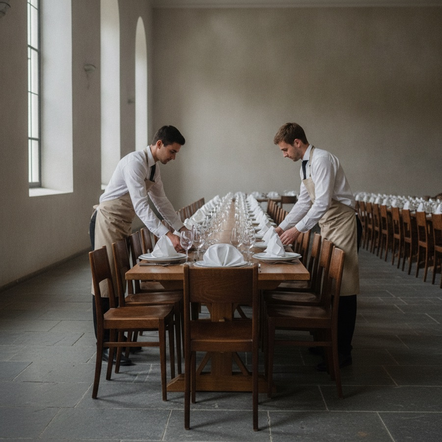

# TOEIC® Listening Practice Test 03

> 100 题 · Part 1（6）+ Part 2（25）+ Part 3（39）+ Part 4（30）· 约 45 分钟
> 音频为电脑合成（TTS），非真人录音。音频文件见 `audio/m3/`。

## PART 1 — Photographs（1–6）

For each question, you will listen to four short statements about a photograph. Select the statement that best describes what is happening in the picture.

### Q1

*照片内容*：A woman stands on a small stepladder in an empty room, running a paint roller up and down a wall; an open paint can rests on the floor beside her.

音频：`audio/m3/p1-1.mp3`

- (A) She's hanging a picture on the wall.
- (B) She's painting the wall with a roller.
- (C) She's cleaning the window glass.
- (D) She's moving furniture out of the room.

**答案：B**

解析：The woman is rolling paint onto the wall, so (B) is correct. She is not hanging a picture, cleaning a window, or moving furniture.

### Q2

*照片内容*：A group of cyclists wearing helmets rides in single file along a paved trail that runs beside a river.

音频：`audio/m3/p1-2.mp3`

- (A) The cyclists are riding along a trail.
- (B) They're repairing a flat tire.
- (C) They're resting on a park bench.
- (D) They're crossing a busy street.

**答案：A**

解析：The cyclists are riding along the riverside trail, so (A) is correct. They are not fixing a tire, resting, or crossing a street.

### Q3

*照片内容*：At a supermarket checkout, a cashier scans a carton of eggs while a customer waits beside a cart full of groceries.

音频：`audio/m3/p1-3.mp3`

- (A) The cashier is stacking shelves with cans.
- (B) The customer is loading a shopping cart.
- (C) They're carrying bags out to a car.
- (D) The cashier is scanning an item at the register.

**答案：D**

解析：The cashier is scanning an item at the register, so (D) is correct. No shelves are being stacked, the cart is already full, and no bags are being carried out.

### Q4

*照片内容*：A man wearing gloves waters rows of potted seedlings inside a bright greenhouse full of green plants.

音频：`audio/m3/p1-4.mp3`

- (A) He's planting seeds in the ground.
- (B) He's watering the potted plants.
- (C) He's trimming a tall hedge.
- (D) He's loading pots onto a truck.

**答案：B**

解析：The man is watering the potted seedlings, so (B) is correct. He is not planting in the ground, trimming a hedge, or loading a truck.

### Q5

*照片内容*：Two waiters in aprons set a long banquet table, carefully placing plates and folded napkins at each seat.

音频：`audio/m3/p1-5.mp3`

- (A) The waiters are setting the table.
- (B) The guests are being served dinner.
- (C) They're clearing dishes from the table.
- (D) They're sweeping under the tables.

**答案：A**

解析：The waiters are setting the table with plates and napkins, so (A) is correct. No guests are being served, and nothing is being cleared or swept.

### Q6

*照片内容*：An electrician stands on a ladder installing a ceiling light fixture, holding a screwdriver up to the exposed wiring.

音频：`audio/m3/p1-6.mp3`

- (A) He's painting the ceiling white.
- (B) He's carrying the ladder across the room.
- (C) He's installing a light fixture.
- (D) He's replacing a pane of glass.

**答案：C**

解析：The electrician is installing a ceiling light fixture, so (C) is correct. He is not painting, carrying the ladder, or replacing glass.

## PART 2 — Question-Response（7–31）

You will hear a question or statement followed by three responses. Select the best response to the question or statement.

### Q7

问句/陈述：Where's the nearest supply room?

音频：`audio/m3/p2-1.mp3`

- (A) Around ten boxes.
- (B) Just down that hallway.
- (C) Yes, it's well stocked.

**答案：B**

解析：'Where' asks for a place, so 'Just down that hallway' (B) is correct. (A) gives a quantity and (C) answers a yes/no question.

### Q8

问句/陈述：When is the staff meeting scheduled?

音频：`audio/m3/p2-2.mp3`

- (A) In the conference room.
- (B) At nine tomorrow morning.
- (C) About an hour long.

**答案：B**

解析：'When' asks for a time, so 'At nine tomorrow morning' (B) is correct. (A) gives a place and (C) gives a duration.

### Q9

问句/陈述：Who's covering the front desk this weekend?

音频：`audio/m3/p2-3.mp3`

- (A) Priya volunteered to.
- (B) On Saturday and Sunday.
- (C) It's a busy lobby.

**答案：A**

解析：'Who' asks for a person, so 'Priya volunteered to' (A) is correct. (B) gives days and (C) describes the lobby.

### Q10

问句/陈述：Why was the delivery returned?

音频：`audio/m3/p2-4.mp3`

- (A) To the wrong address.
- (B) By the courier.
- (C) The address was incorrect.

**答案：C**

解析：'Why' asks for a reason, so 'The address was incorrect' (C) is correct. (A) and (B) reuse related words without giving the reason.

### Q11

问句/陈述：How do I apply for a parking permit?

音频：`audio/m3/p2-5.mp3`

- (A) It's a small fee.
- (B) Fill out the form at reception.
- (C) On the third level.

**答案：B**

解析：'How' asks for a method, so 'Fill out the form at reception' (B) is correct. (A) mentions cost and (C) gives a location.

### Q12

问句/陈述：Would you like me to forward you the meeting notes?

音频：`audio/m3/p2-6.mp3`

- (A) Yes, that would be great.
- (B) It was a productive meeting.
- (C) In the shared folder.

**答案：A**

解析：The offer is accepted with 'Yes, that would be great' (A). (B) evaluates the meeting and (C) gives a place.

### Q13

问句/陈述：You've backed up the files, haven't you?

音频：`audio/m3/p2-7.mp3`

- (A) A large hard drive.
- (B) Yes, everything's saved.
- (C) In the server room.

**答案：B**

解析：The tag question checks the backup, so 'Yes, everything's saved' (B) is correct. (A) and (C) don't confirm the backup.

### Q14

问句/陈述：Can you give me a hand with this display stand?

音频：`audio/m3/p2-8.mp3`

- (A) Of course, where does it go?
- (B) A colorful display.
- (C) It's on sale now.

**答案：A**

解析：The request is met with agreement, so 'Of course, where does it go?' (A) is correct. (B) and (C) reuse words without helping.

### Q15

问句/陈述：Do you want the report printed or emailed?

音频：`audio/m3/p2-9.mp3`

- (A) A detailed report.
- (B) By the printer.
- (C) Emailed is fine.

**答案：C**

解析：The choice question is answered by 'Emailed is fine' (C). (A) describes the report and (B) gives a location.

### Q16

问句/陈述：What time do the doors open for the event?

音频：`audio/m3/p2-10.mp3`

- (A) At the main entrance.
- (B) Not until six thirty.
- (C) About two hundred guests.

**答案：B**

解析：'What time' asks for a time, so 'Not until six thirty' (B) is correct. (A) gives a place and (C) gives a number.

### Q17

问句/陈述：How much is a full-page ad in the magazine?

音频：`audio/m3/p2-11.mp3`

- (A) It comes out monthly.
- (B) On the back cover.
- (C) Roughly four hundred dollars.

**答案：C**

解析：'How much' asks for a price, so 'Roughly four hundred dollars' (C) is correct. (A) gives a frequency and (B) gives a location.

### Q18

问句/陈述：Isn't the workshop being held on Friday?

音频：`audio/m3/p2-12.mp3`

- (A) A very useful workshop.
- (B) In the training room.
- (C) Actually, it's on Thursday.

**答案：C**

解析：The negative question checks the day, so 'Actually, it's on Thursday' (C) is correct. (A) and (B) don't address the date.

### Q19

问句/陈述：Do you know if the café takes credit cards?

音频：`audio/m3/p2-13.mp3`

- (A) Yes, they take all major cards.
- (B) It's a cozy café.
- (C) Just around the corner.

**答案：A**

解析：The embedded yes/no question is answered by 'Yes, they take all major cards' (A). (B) and (C) describe the café instead.

### Q20

问句/陈述：Let's confirm the numbers before we send the invoice.

音频：`audio/m3/p2-14.mp3`

- (A) He paid the invoice.
- (B) Good idea, I'll double-check them.
- (C) In the accounts folder.

**答案：B**

解析：The suggestion is accepted with 'Good idea, I'll double-check them' (B). (A) and (C) reuse words without responding.

### Q21

问句/陈述：Which room did they book for the interview?

音频：`audio/m3/p2-15.mp3`

- (A) We need more chairs.
- (B) Last Wednesday.
- (C) The one at the end of the hall.

**答案：C**

解析：'Which room' asks you to identify one, so 'The one at the end of the hall' (C) is correct. (A) is off-topic and (B) gives a time.

### Q22

问句/陈述：The printer on this floor is out of paper again.

音频：`audio/m3/p2-16.mp3`

- (A) A very fast printer.
- (B) I'll grab a fresh ream.
- (C) We're low on ink.

**答案：B**

解析：The problem invites a helpful response, so 'I'll grab a fresh ream' (B) is correct. (A) and (C) don't solve the paper shortage.

### Q23

问句/陈述：Has the client signed the agreement yet?

音频：`audio/m3/p2-17.mp3`

- (A) No, we're still waiting.
- (B) A fair agreement.
- (C) It's ten pages long.

**答案：A**

解析：The yes/no question about the signature is answered by 'No, we're still waiting' (A). (B) and (C) describe the agreement instead.

### Q24

问句/陈述：Where should I file these receipts?

音频：`audio/m3/p2-18.mp3`

- (A) They add up quickly.
- (B) About twenty of them.
- (C) In the blue folder on my desk.

**答案：C**

解析：'Where' asks for a place, so 'In the blue folder on my desk' (C) is correct. (A) is a comment and (B) gives a quantity.

### Q25

问句/陈述：The lobby lights have been flickering, haven't they?

音频：`audio/m3/p2-19.mp3`

- (A) Yes, I'll report it to maintenance.
- (B) In a few minutes.
- (C) A bright lobby.

**答案：A**

解析：The tag question seeks agreement, so 'Yes, I'll report it to maintenance' (A) is correct. (B) gives a time and (C) is unrelated.

### Q26

问句/陈述：Are we hiring one assistant or two this quarter?

音频：`audio/m3/p2-20.mp3`

- (A) It was a great interview.
- (B) In the HR office.
- (C) Just one for now.

**答案：C**

解析：The choice question is answered by 'Just one for now' (C). (A) refers to an interview and (B) gives a place.

### Q27

问句/陈述：Why don't we move the launch to next month?

音频：`audio/m3/p2-21.mp3`

- (A) He launched the app.
- (B) A tight timeline.
- (C) That would give the team more time.

**答案：C**

解析：'Why don't we' is a suggestion, so 'That would give the team more time' (C) is correct. (A) reuses 'launch' and (B) is a fragment.

### Q28

问句/陈述：How did the site inspection go this morning?

音频：`audio/m3/p2-22.mp3`

- (A) It went well, no issues.
- (B) By the safety officer.
- (C) Next Tuesday, I believe.

**答案：A**

解析：'How did it go' asks for an evaluation, so 'It went well, no issues' (A) is correct. (B) answers 'who' and (C) gives a future time.

### Q29

问句/陈述：Didn't we already reorder the printer cartridges?

音频：`audio/m3/p2-23.mp3`

- (A) The printout is clear.
- (B) I think that's still pending.
- (C) In the supply cabinet.

**答案：B**

解析：The negative question is answered by 'I think that's still pending' (B). (A) plays on 'print' and (C) gives a location.

### Q30

问句/陈述：Who's presenting the budget at the board meeting?

音频：`audio/m3/p2-24.mp3`

- (A) The finance manager is.
- (B) It looks reasonable.
- (C) Sometime next week.

**答案：A**

解析：'Who' asks for a person, so 'The finance manager is' (A) is correct. (B) evaluates the budget and (C) gives a time.

### Q31

问句/陈述：Let me know if you'd like me to book the meeting room for Thursday.

音频：`audio/m3/p2-25.mp3`

- (A) The room was too small.
- (B) No, it was on Thursday.
- (C) Yes, please, for the afternoon.

**答案：C**

解析：The speaker offers to book a room, and (C) accepts the offer with a useful detail. (A) repeats 'room' and (B) repeats 'Thursday', but neither responds to the offer.

## PART 3 — Conversations（32–70）

You will hear several conversations between two or more people. You will be asked to answer three questions about what the speakers say. Select the best response.

### Questions 32–34

音频：`audio/m3/p3-1.mp3`

**Train times to Fairview**：Train Departs Arrives A 9:00 AM 11:30 AM B 10:15 AM 12:45 PM C 11:30 AM 2:00 PM

**录音原文：**

> W: Ravi, we need to get to the Fairview office for the two o'clock client meeting. I've pulled up the train times.
> M: Good. I'd like to be there by half past one so we have time to set up the room before the client arrives.
> W: That rules out the last train — it doesn't get in until two. The mid-morning one arrives at quarter to one, which gives us plenty of buffer.
> M: And it means we're not sitting around the station too long, either. Let's take that one.
> W: Great, I'll book two tickets right now.

**Q32.** Why do the speakers need to travel to Fairview?
- (A) For a client meeting
- (B) To tour a new office
- (C) To attend a training course
- (D) To pick up a delivery

答案：**A**　解析：They need to get to Fairview 'for the two o'clock client meeting.'

**Q33.** Why won't they take the last train?
- (A) It is fully booked
- (B) It does not stop at Fairview
- (C) It is too expensive
- (D) It arrives too late to set up

答案：**D**　解析：The last train 'doesn't get in until two,' leaving no time to set up before the meeting.

**Q34.** Look at the graphic. Which train will they most likely take?
- (A) Train A
- (B) None of them
- (C) Train C
- (D) Train B

答案：**D**　解析：Train B arrives at 12:45, giving buffer before the 1:30 target, while Train C arrives too late.

### Questions 35–37

音频：`audio/m3/p3-2.mp3`

**录音原文：**

> W: Hi, I'm calling about my gym membership. I switched to the monthly plan back in March, but I'm still being billed at the higher annual rate.
> M: I'm sorry about that. Let me check your account. You're right — the change never went through in our system, so you've been charged the old rate for two months.
> W: I'd like the difference refunded. I've been paying more than I agreed to.
> M: Absolutely. I'll process a refund for the overcharge today and make sure the correct monthly rate applies from now on.
> W: Thank you. As long as next month's bill is right, I'll be satisfied.

**Q35.** Why is the woman calling?
- (A) To cancel her membership
- (B) To report being billed at the wrong rate
- (C) To upgrade to the annual plan
- (D) To freeze her account

答案：**B**　解析：She is 'still being billed at the higher annual rate' after switching plans.

**Q36.** What does the man say caused the problem?
- (A) The woman chose the wrong plan
- (B) The rates recently increased
- (C) A payment was declined
- (D) The plan change did not go through in the system

答案：**D**　解析：He explains 'the change never went through in our system.'

**Q37.** What does the woman imply when she says, "As long as next month's bill is right, I'll be satisfied"?
- (A) She wants to cancel immediately
- (B) She accepts the fix but wants correct future billing
- (C) She thinks the refund is too small
- (D) She needs the money urgently

答案：**B**　解析：She accepts the refund on the condition that future bills are correct.

### Questions 38–40

音频：`audio/m3/p3-3.mp3`

**录音原文：**

> M: Hi, I ordered a hundred event programs — the name's Whitfield. I was told they'd be ready Friday, but our event got moved up, so I need them by Wednesday if at all possible.
> W: Let me check the queue. Yes, we can have them finished by Wednesday afternoon, though it would mean a small rush fee.
> M: That's fine. Also, could you use a heavier paper stock this time? The last order felt a bit flimsy.
> W: Of course. I'll switch you to our premium cardstock and note it on the order.
> M: Perfect. I'll come by around four on Wednesday to collect them.

**Q38.** What does the man want?
- (A) To cancel his order
- (B) To pick up his order earlier
- (C) To increase the quantity
- (D) To get a refund

答案：**B**　解析：He needs the programs 'by Wednesday' instead of Friday because the event was moved up.

**Q39.** Why does the man ask for heavier paper?
- (A) The last order felt too flimsy
- (B) It is cheaper
- (C) The event is outdoors
- (D) The printer recommended it

答案：**A**　解析：He says 'the last order felt a bit flimsy.'

**Q40.** What will the woman do?
- (A) Waive the rush fee
- (B) Reprint the last order
- (C) Deliver the order to him
- (D) Switch him to premium cardstock

答案：**D**　解析：She says she'll 'switch you to our premium cardstock.'

### Questions 41–43

音频：`audio/m3/p3-4.mp3`

**录音原文：**

> M: Thanks for meeting. The pitch to Hartford Retail is Thursday, and I want us fully prepared. Nora, how are the slides coming?
> W: The deck's nearly done — twenty slides covering the strategy and the budget. I just need the final sales figures for the results section.
> M: Declan, can you get those figures over today?
> M2: I can, but honestly, twenty slides feels like a lot for a thirty-minute pitch. I'd rather cut it down than rush through everything and lose the client's attention.
> M: Good point. Nora, let's trim it to the twelve strongest slides.
> W: Agreed. I'll tighten it up as soon as Declan sends the numbers.

**Q41.** What are the speakers preparing?
- (A) A client pitch
- (B) A staff newsletter
- (C) A job interview
- (D) A budget audit

答案：**A**　解析：They are preparing 'the pitch to Hartford Retail' on Thursday.

**Q42.** What does Nora still need?
- (A) The final sales figures
- (B) A meeting room
- (C) New software
- (D) The client's approval

答案：**A**　解析：She says she 'just need[s] the final sales figures for the results section.'

**Q43.** What does Declan mean when he says he'd "rather cut it down than rush through everything"?
- (A) He prefers a longer meeting
- (B) He wants to cancel the pitch
- (C) He needs more data
- (D) He thinks there are too many slides for the time

答案：**D**　解析：He feels twenty slides is too many for a thirty-minute pitch and prefers fewer.

### Questions 44–46

音频：`audio/m3/p3-5.mp3`

**录音原文：**

> W: Thanks for coming. The main elevator has been stuck on the ground floor since this morning — the doors just won't close.
> M: Let me have a look. Ah, there's a sensor on the door track that's misaligned, so the system thinks something is blocking the doors.
> W: Can you fix it today? We've got deliveries this afternoon that need to go up to the fifth floor.
> M: I can realign the sensor now — it's about a forty-minute job. I'd just ask you to keep people out of the car until I've tested it.
> W: No problem. I'll put an out-of-service sign on it and let reception know.

**Q44.** What problem are the speakers discussing?
- (A) A broken staircase
- (B) An elevator whose doors won't close
- (C) A power outage
- (D) A leaking ceiling

答案：**B**　解析：'The main elevator has been stuck... the doors just won't close.'

**Q45.** What does the man say caused the problem?
- (A) A misaligned door sensor
- (B) A worn cable
- (C) A software crash
- (D) A power surge

答案：**A**　解析：He says 'there's a sensor on the door track that's misaligned.'

**Q46.** What will the woman do?
- (A) Reschedule the deliveries
- (B) Realign the sensor herself
- (C) Put up an out-of-service sign and notify reception
- (D) Call a different technician

答案：**C**　解析：She says 'I'll put an out-of-service sign on it and let reception know.'

### Questions 47–49

音频：`audio/m3/p3-6.mp3`

**录音原文：**

> W: Tom, I wanted to check — would it be alright if I took the last week of July off? My sister's getting married and I'd like to travel for it.
> M: Let me look at the calendar. That week's a bit tight — Dan is already off then, and we can't have two people out during the audit.
> W: Ah, I forgot the audit was that week. Could I take the first week of August instead?
> M: That works much better. Things quiet down once the audit wraps up. I'll approve it — just put the request in the system so payroll has a record.
> W: Great, I'll do that this afternoon. Thanks, Tom.

**Q47.** What is the woman asking for?
- (A) A pay raise
- (B) Time off from work
- (C) A schedule change
- (D) A transfer

答案：**B**　解析：She asks to take 'the last week of July off' to travel for a wedding.

**Q48.** Why can't the woman take the last week of July off?
- (A) A colleague is already off and the audit is that week
- (B) The office is closed
- (C) She has a client meeting
- (D) She has used all her leave

答案：**A**　解析：Dan is already off, and 'we can't have two people out during the audit.'

**Q49.** What does the man ask the woman to do?
- (A) Cancel her trip
- (B) Find someone to cover for her
- (C) Put the request in the system
- (D) Speak to payroll directly

答案：**C**　解析：He says to 'put the request in the system so payroll has a record.'

### Questions 50–52

音频：`audio/m3/p3-7.mp3`

**录音原文：**

> M: Hi, I bought this espresso machine here about three months ago, and it's stopped heating up. I've still got the receipt.
> W: I'm sorry to hear that. Since it's under a year old, it's covered by the warranty, so any repair is free of charge.
> M: Oh, brilliant. Do I just leave it with you, then?
> W: Yes — I'll log it and send it to our service center. Repairs usually take about a week, and we'll call you when it's ready. If it can't be fixed, you'll get a replacement.
> M: That's reassuring. I'll leave it with you now.

**Q50.** What is wrong with the machine?
- (A) It leaks water
- (B) It makes a loud noise
- (C) It has stopped heating up
- (D) It won't turn off

答案：**C**　解析：The man says the machine 'stopped heating up.'

**Q51.** Why is the repair free of charge?
- (A) It is a store promotion
- (B) The machine is under warranty
- (C) The man is a member
- (D) The part is inexpensive

答案：**B**　解析：'Since it's under a year old, it's covered by the warranty.'

**Q52.** What will happen if the machine cannot be fixed?
- (A) The man will get a refund
- (B) The repair will take longer
- (C) The man will be charged a fee
- (D) The man will get a replacement

答案：**D**　解析：The associate says 'if it can't be fixed, you'll get a replacement.'

### Questions 53–55

音频：`audio/m3/p3-8.mp3`

**录音原文：**

> W: So this is one of our private offices — room for four desks, a lockable door, and it looks out over the courtyard.
> M: It's nice and quiet. I've been working from cafés, but the noise and the unreliable Wi-Fi are really slowing me down.
> W: A lot of our members come to us for exactly that reason. Every office includes fast, dedicated internet and twenty-four-hour access with your own key card.
> M: The around-the-clock access is a big plus — I often work late, and sometimes very early. And having a proper space to meet clients would look far more professional.
> W: Would you like to try it for a day before committing to a membership?
> M: Yes, let's do that. I'll come in Monday and give it a proper test.

**Q53.** Who most likely is the woman?
- (A) A café owner
- (B) A client of the man
- (C) An internet technician
- (D) A coworking space representative

答案：**D**　解析：She is showing private offices and discussing membership, so she represents a coworking space.

**Q54.** Why is the man looking for a new workspace?
- (A) His office lease is ending
- (B) Cafés are noisy with unreliable Wi-Fi
- (C) He is relocating cities
- (D) He needs more desks for staff

答案：**B**　解析：He says 'the noise and the unreliable Wi-Fi are really slowing me down.'

**Q55.** What will the man most likely do next?
- (A) Sign a membership today
- (B) Look at another building
- (C) Try the space for a day on Monday
- (D) Return to working in cafés

答案：**C**　解析：He agrees to 'come in Monday and give it a proper test.'

### Questions 56–58

音频：`audio/m3/p3-9.mp3`

**录音原文：**

> W: Okay, we've got funds approved to upgrade the design team's gear. Ben, what should the priority be?
> M: Honestly, the laptops. Some are five years old and can barely run the software — people are waiting ages for files to load.
> W2: I'd agree the laptops come first. The monitors are old too, but they still work fine, so they can wait until next quarter.
> W: Makes sense. Ben, how many laptops are we talking about?
> M: Six, to replace the oldest ones. That should fit comfortably within the budget.
> W: Good. Ben, put together the order and I'll sign off on it tomorrow.

**Q56.** What is the meeting mainly about?
- (A) Upgrading equipment for the design team
- (B) Hiring new designers
- (C) Choosing new software
- (D) Moving to a new office

答案：**A**　解析：They have 'funds approved to upgrade the design team's gear.'

**Q57.** What does Ben say should be the priority?
- (A) The laptops
- (B) The monitors
- (C) The printers
- (D) The desks

答案：**A**　解析：Ben says 'honestly, the laptops,' since some can barely run the software.

**Q58.** Why can the monitors wait until next quarter?
- (A) They are cheaper to replace
- (B) They still work fine
- (C) No one uses them
- (D) They are still under warranty

答案：**B**　解析：The woman notes the monitors are old but 'still work fine.'

### Questions 59–61

音频：`audio/m3/p3-10.mp3`

**录音原文：**

> M: Hi, my calendar isn't syncing across my devices. I add a meeting on my laptop, but it never shows up on my phone.
> W: Let me check your account. Ah — your phone is still signed in with an old email address we retired last month, so it's pulling from the wrong account.
> M: That explains it. I've missed a couple of reminders because of it.
> W: Let's fix that. If you sign out on your phone and log back in with your current address, both devices will sync automatically. Takes about two minutes.
> M: Great, I'll do that right now.

**Q59.** What problem is the man experiencing?
- (A) His laptop won't turn on
- (B) His calendar isn't syncing between devices
- (C) His email is full
- (D) His phone battery drains fast

答案：**B**　解析：Meetings added on his laptop 'never show up on my phone.'

**Q60.** What does the woman say is causing the problem?
- (A) A weak internet signal
- (B) A software update is needed
- (C) His phone is signed in with an old email address
- (D) His calendar is full

答案：**C**　解析：His phone is 'signed in with an old email address we retired last month.'

**Q61.** What does the woman tell the man to do?
- (A) Restart his laptop
- (B) Buy a new phone
- (C) Sign out and log back in with his current address
- (D) Delete the calendar app

答案：**C**　解析：She says to 'sign out on your phone and log back in with your current address.'

### Questions 62–64

音频：`audio/m3/p3-11.mp3`

**Print order: holiday campaign**：Item Quantity Flyers 8,000 Postcards 2,500 Gift tags 500 Window posters 40

**录音原文：**

> W: I've been comparing our email newsletter with the printed flyers we mail out, and the emails are getting far better results — more clicks and almost no cost.
> M: That doesn't surprise me. Flyers get tossed in the recycling, but an email with a good subject line actually gets opened.
> W: Exactly. So for the holiday campaign, let's cancel the flyers on this print order and keep everything else. I want most of our effort going into email. Your thoughts?
> M: I'm all for it. I'd also test sending them on different days to see when people open them most. I can set up a quick trial next week.
> W: Do it. Send me the results once the trial's done.

**Q62.** What is the conversation mainly about?
- (A) Lowering postage costs
- (B) Hiring a new copywriter
- (C) Redesigning the company logo
- (D) Whether to focus on email or print for the campaign

答案：**D**　解析：They discuss shifting effort into email and cutting the print run for the holiday campaign.

**Q63.** Why does the man think email works better than flyers?
- (A) Email is more colorful
- (B) Flyers are more expensive to design
- (C) Email reaches older customers
- (D) Flyers get thrown away, but a good email gets opened

答案：**D**　解析：He says flyers 'get tossed in the recycling,' but a good email 'actually gets opened.'

**Q64.** Look at the graphic. How many printed items will the speakers remove from the order?
- (A) 8,000
- (B) 2,500
- (C) 500
- (D) 40

答案：**A**　解析：The woman says, 'let's cancel the flyers on this print order and keep everything else.' The order form lists 8,000 flyers, so the answer is (A). The 2,500 postcards, 500 gift tags and 40 window posters all stay on the order.

### Questions 65–67

音频：`audio/m3/p3-12.mp3`

**录音原文：**

> M: Excuse me — I just joined last week. Someone said the company has a bike-share scheme for getting between our two buildings. Is that right?
> W: Yes! There's a rack of bikes outside the main entrance. You just unlock one with the staff app and drop it at the rack by the other building.
> M: That's handy. The walk between them takes a good fifteen minutes.
> W: Exactly, the bike cuts it to about five. Just check the app first — on sunny days they get taken quickly, so there aren't always bikes free at lunchtime.
> M: Good to know. I'll download the app today.

**Q65.** What is the man asking about?
- (A) A company bike-share scheme
- (B) A shuttle bus
- (C) A parking permit
- (D) A walking route

答案：**A**　解析：He asks whether 'the company has a bike-share scheme.'

**Q66.** What must the man do to use a bike?
- (A) Pay a small fee
- (B) Reserve one a day ahead
- (C) Unlock one with the staff app
- (D) Bring his own lock

答案：**C**　解析：'You just unlock one with the staff app.'

**Q67.** Why does the woman suggest checking the app first?
- (A) The bikes are often broken
- (B) The app is hard to use
- (C) Bikes get taken quickly and may not be available
- (D) The rack is far away

答案：**C**　解析：She warns that on sunny days 'they get taken quickly,' so bikes aren't always free.

### Questions 68–70

音频：`audio/m3/p3-13.mp3`

**Staff phone extensions**：Department Extension Stockroom 210 Electronics 220 Customer service 230 IT help desk 240

**录音原文：**

> W: Welcome, both of you. This morning we'll go over the point-of-sale system, and this afternoon you'll shadow a senior associate on the floor. Jake, you're joining the electronics section, right?
> M: That's right. I'm a little unsure about processing returns — I've heard the procedure can be tricky.
> W: That's exactly what we'll practice this morning, step by step. If a return ever gets complicated, just call the customer service desk. Owen, you're in the stockroom, so you'll focus more on the inventory scanners than the register.
> M2: Got it. Will we each get our own login for the system today?
> W: You'll get a temporary login before lunch, and the IT team will set up your permanent ones this afternoon. Any questions? No? Let's get started.

**Q68.** What is mainly happening in the conversation?
- (A) A job interview
- (B) A store inspection
- (C) A customer complaint
- (D) An orientation for new employees

答案：**D**　解析：The trainer welcomes two new hires and outlines training and floor shadowing.

**Q69.** What is Jake unsure about?
- (A) Meeting his manager
- (B) Processing returns
- (C) Finding the stockroom
- (D) The length of his shift

答案：**B**　解析：He says he's 'a little unsure about processing returns.'

**Q70.** Look at the graphic. Which extension should Jake call if a return gets complicated?
- (A) 210
- (B) 220
- (C) 230
- (D) 240

答案：**C**　解析：The trainer tells Jake to 'call the customer service desk' if a return gets complicated. The graphic lists Customer service at extension 230, so the answer is (C). 220 is Jake's own Electronics section, 210 is the stockroom where Owen works, and 240 is the IT help desk that handles logins.

## PART 4 — Talks（71–100）

You will hear several talks given by a single speaker. You will be asked to answer three questions about what the speaker says. Select the best response.

### Questions 71–73 · Cooking school welcome

音频：`audio/m3/p4-1.mp3`

**Today's class schedule**：Class Time Knife Skills 9:00 Pasta Making 10:00 Bread Baking 11:00 Dessert 12:00

**录音原文：**

> Good morning, everyone, and welcome to the Riverside Cooking School. I'm Teresa, and I'll be your instructor today. Before we tie on our aprons, one quick change to the schedule in your booklet. Our bread-baking chef is stuck in traffic and will arrive a little later than planned, so we're going to swap the last two classes. That means we'll do the dessert class at eleven o'clock and move bread baking to twelve. Everything else stays exactly the same. Please wash your hands at the sinks along the back wall, and let's get started with knife skills.

**Q71.** Where does the talk most likely take place?
- (A) At a restaurant
- (B) At a bakery
- (C) At a grocery store
- (D) At a cooking school

答案：**D**　解析：The speaker welcomes everyone 'to the Riverside Cooking School.'

**Q72.** Why has the schedule changed?
- (A) A class was cancelled
- (B) The bread-baking chef is delayed
- (C) The kitchen is being cleaned
- (D) Too few students signed up

答案：**B**　解析：'Our bread-baking chef is stuck in traffic,' so the last two classes are swapped.

**Q73.** Look at the graphic. Which class will now be held at 11:00?
- (A) Knife Skills
- (B) Pasta Making
- (C) Bread Baking
- (D) Dessert

答案：**D**　解析：The dessert class moves from 12:00 to 11:00, so Dessert will be held at 11:00.

### Questions 74–76 · Airport announcement

音频：`audio/m3/p4-2.mp3`

**录音原文：**

> Good evening, passengers. This is a final boarding call for Coastal Air flight 208 to Lisbon, now boarding at gate 15. Would any remaining passengers please make their way to the gate immediately, as the doors will close in ten minutes. We remind you that each passenger may carry only one piece of hand luggage into the cabin; any additional bags must be checked at the gate. Please have your boarding pass and passport ready for inspection. Passengers with connecting flights in Lisbon should speak to a member of our ground crew upon arrival.

**Q74.** What is the purpose of the announcement?
- (A) A flight cancellation
- (B) A gate change
- (C) A final boarding call
- (D) A delay notice

答案：**C**　解析：It is 'a final boarding call for Coastal Air flight 208.'

**Q75.** What are passengers reminded about hand luggage?
- (A) It must be weighed
- (B) It must be placed under the seat
- (C) Only one piece is allowed in the cabin
- (D) It is not permitted

答案：**C**　解析：Each passenger 'may carry only one piece of hand luggage into the cabin.'

**Q76.** What should passengers with connecting flights do?
- (A) Collect their bags first
- (B) Change their tickets now
- (C) Speak to the ground crew on arrival
- (D) Board through a separate gate

答案：**C**　解析：They 'should speak to a member of our ground crew upon arrival.'

### Questions 77–79 · Podcast excerpt

音频：`audio/m3/p4-3.mp3`

**录音原文：**

> Welcome back to Grow Small, the podcast for anyone building a business from the ground up. I'm your host, Marcus Lee. On today's show, we're tackling a challenge I hear about constantly: how to hire your very first employee without making a costly mistake. Joining me is Amina Farah, who has coached dozens of founders through their first hires. Before we get into it, remember you can download our free hiring checklist from the show notes. Stick around — after this quick break, Amina shares the three questions she says every founder should ask in an interview.

**Q77.** What is the main topic of today's episode?
- (A) How to hire a first employee
- (B) How to raise money
- (C) How to price products
- (D) How to build a website

答案：**A**　解析：The topic is 'how to hire your very first employee without making a costly mistake.'

**Q78.** Who is the guest?
- (A) A first-time founder
- (B) A business coach
- (C) A recruiter for a large firm
- (D) A radio host

答案：**B**　解析：Amina Farah 'has coached dozens of founders through their first hires.'

**Q79.** What will listeners most likely hear next?
- (A) An interview
- (B) A commercial break
- (C) A listener question
- (D) A music segment

答案：**B**　解析：The host says 'after this quick break,' so an advertisement will play next.

### Questions 80–82 · Advertisement

音频：`audio/m3/p4-4.mp3`

**录音原文：**

> Is your garden looking a little tired? This spring, Meadowbrook Garden Centre has everything you need to bring it back to life. Right now, all trees, shrubs, and flowering plants are buy two, get one free, and members of our loyalty club save an extra ten percent at the till. Not sure where to start? Our staff are trained horticulturists, happy to advise you on what will thrive in your soil. Find us on the Coast Road, open every day until six. Come and see why Meadowbrook has been the region's favourite garden centre for over forty years.

**Q80.** What is being advertised?
- (A) A garden centre
- (B) A landscaping service
- (C) A farmers' market
- (D) A hardware store

答案：**A**　解析：The ad promotes Meadowbrook Garden Centre and its plants.

**Q81.** What do loyalty club members receive?
- (A) A free plant
- (B) An extra ten percent off
- (C) Free delivery
- (D) A gardening class

答案：**B**　解析：Members 'save an extra ten percent at the till.'

**Q82.** What does the speaker say about the staff?
- (A) They are hiring now
- (B) They work only on weekends
- (C) They deliver plants for free
- (D) They are trained horticulturists who can advise you

答案：**D**　解析：'Our staff are trained horticulturists, happy to advise you.'

### Questions 83–85 · Castle tour guide

音频：`audio/m3/p4-5.mp3`

**录音原文：**

> Welcome to Alderstone Castle, one of the best-preserved medieval fortresses in the country. My name is Edmund, and I'll be your guide this afternoon. We'll begin in the great hall, then climb the spiral staircase to the battlements, where you'll enjoy a superb view of the valley. Please take care on the steps, as they are steep and uneven in places. I'm afraid the east tower is closed today for restoration work, so we won't be visiting it. At the end of the tour, do stop by the tea room in the courtyard, which serves freshly baked scones. Now, please follow me inside.

**Q83.** Where does the talk most likely take place?
- (A) At a hotel
- (B) At a cathedral
- (C) At an art museum
- (D) At a castle

答案：**D**　解析：The guide welcomes visitors 'to Alderstone Castle.'

**Q84.** What is closed today?
- (A) The great hall
- (B) The east tower
- (C) The tea room
- (D) The battlements

答案：**B**　解析：'The east tower is closed today for restoration work.'

**Q85.** What are the listeners asked to do?
- (A) Take care on the steps
- (B) Leave their bags outside
- (C) Stay together in one group
- (D) Turn off their phones

答案：**A**　解析：He asks visitors to 'take care on the steps, as they are steep and uneven.'

### Questions 86–88 · Meeting excerpt

音频：`audio/m3/p4-6.mp3`

**录音原文：**

> Before we wrap up, I want to flag one change that starts next week. We're moving all expense claims to a new app called ClaimEasy. Instead of stapling paper receipts to a form, you'll simply photograph each receipt with your phone and the app files it automatically. I know learning a new tool takes a moment, but this should get your reimbursements to you far faster — most within three days instead of three weeks. Diego from finance is running two short drop-in sessions on Wednesday, so please stop by if you'd like a walkthrough.

**Q86.** What is the main purpose of the announcement?
- (A) To introduce a new expense-reporting app
- (B) To change the office layout
- (C) To announce a pay raise
- (D) To schedule an audit

答案：**A**　解析：The speaker describes 'moving all expense claims to a new app called ClaimEasy.'

**Q87.** What is one benefit of the change?
- (A) Lower travel costs
- (B) More vacation days
- (C) Fewer meetings
- (D) Faster reimbursements

答案：**D**　解析：It 'should get your reimbursements to you far faster — most within three days.'

**Q88.** What can employees do on Wednesday?
- (A) Submit paper receipts
- (B) Reset their passwords
- (C) Meet the finance director
- (D) Attend a drop-in walkthrough session

答案：**D**　解析：Diego is 'running two short drop-in sessions on Wednesday' for a walkthrough.

### Questions 89–91 · Traffic and weather report

音频：`audio/m3/p4-7.mp3`

**录音原文：**

> Time now for your midday roads and weather check. Drivers heading south on the Interstate should be aware of a lane closure near exit 9, where crews are patching potholes — expect a slow crawl through that stretch until early afternoon. Everywhere else is moving nicely. Turning to the sky, we've got clear conditions right now, but a line of thunderstorms is building to the west and should reach the city by the evening commute, so keep an umbrella handy on your way home. Highs today near twenty-six degrees. We'll be back with another check in half an hour.

**Q89.** What kind of report is this?
- (A) A traffic and weather report
- (B) A financial report
- (C) A sports report
- (D) A travel review

答案：**A**　解析：The speaker gives a 'midday roads and weather check.'

**Q90.** Why is there a slow-down near exit 9?
- (A) A collision
- (B) Crews patching potholes
- (C) Heavy rain
- (D) A parade

答案：**B**　解析：There is 'a lane closure near exit 9, where crews are patching potholes.'

**Q91.** What does the speaker advise for the evening?
- (A) Leave work early
- (B) Avoid the Interstate
- (C) Keep an umbrella handy
- (D) Take public transport

答案：**C**　解析：With storms coming by the evening commute, he says to 'keep an umbrella handy.'

### Questions 92–94 · Recorded instructions

音频：`audio/m3/p4-8.mp3`

**录音原文：**

> Thank you for calling the Bramley Health Clinic. Please listen carefully, as our options have recently changed. To book, change, or cancel an appointment, press one. To request a repeat prescription, press two, and please have your patient number ready. For test results, press three; note that results are only given out after eleven in the morning. If you believe your situation is urgent, please hang up and call the emergency number. For all other enquiries, stay on the line and a receptionist will be with you as soon as possible.

**Q92.** Who is the message most likely intended for?
- (A) Delivery drivers
- (B) Job applicants
- (C) Patients of a health clinic
- (D) New doctors

答案：**C**　解析：It is a recorded message for callers to 'the Bramley Health Clinic.'

**Q93.** What should a caller do to book an appointment?
- (A) Stay on the line
- (B) Press two
- (C) Press three
- (D) Press one

答案：**D**　解析：'To book, change, or cancel an appointment, press one.'

**Q94.** What is said about test results?
- (A) They are mailed out
- (B) They are only given after eleven in the morning
- (C) They require a fee
- (D) They are read by a doctor

答案：**B**　解析：For test results, 'results are only given out after eleven in the morning.'

### Questions 95–97 · Introduction of a speaker

音频：`audio/m3/p4-9.mp3`

**录音原文：**

> Good afternoon, everyone, and thank you for being here. It's my honour to introduce today's speaker. Dr. Samuel Okoro trained as an engineer, but he is best known now as the inventor of a low-cost water filter that has brought clean drinking water to hundreds of villages. He's here to share the story of how a simple idea, sketched on a napkin, became a device used across three continents. Following his talk, he'll take your questions, and there'll be a chance to see one of his filters on display in the foyer. Please give a warm welcome to Dr. Samuel Okoro.

**Q95.** What is the purpose of the talk?
- (A) To introduce a guest speaker
- (B) To present a prize
- (C) To open an exhibit
- (D) To thank sponsors

答案：**A**　解析：The speaker says it is his honour 'to introduce today's speaker,' Dr. Samuel Okoro.

**Q96.** What is Dr. Okoro best known for now?
- (A) Teaching engineering
- (B) Running a charity race
- (C) Writing a science book
- (D) Inventing a low-cost water filter

答案：**D**　解析：He is 'best known now as the inventor of a low-cost water filter.'

**Q97.** What can attendees do after the talk?
- (A) Ask questions and see a filter on display
- (B) Tour a factory
- (C) Receive a free sample
- (D) Sign up as volunteers

答案：**A**　解析：After his talk, 'he'll take your questions,' and a filter will be on display in the foyer.

### Questions 98–100 · Library announcement

音频：`audio/m3/p4-10.mp3`

**Visitor survey: what should we add?**：Suggestion Share of votes Sunday opening 38% Language classes 17% Laptop lending 26% Film nights 19%

**录音原文：**

> Attention, please. The Kingsford Public Library will be closing in twenty minutes, at eight o'clock. Please bring any items you wish to borrow to the front desk now, where our staff are ready to check them out for you. A gentle reminder that books due back today can be returned in the drop box by the main doors even after we close. Tomorrow we open at nine. We've also counted the votes from our visitor survey. Your top request will need extra staff, so next month we'll start with your second most popular choice. Thank you for visiting, and please remember to take all your belongings with you as you leave.

**Q98.** Why is the announcement being made?
- (A) To report a lost book
- (B) To introduce a new librarian
- (C) To tell visitors the library is closing soon
- (D) To announce a book sale

答案：**C**　解析：'The Kingsford Public Library will be closing in twenty minutes.'

**Q99.** How can books be returned after closing?
- (A) By mail
- (B) At the front desk
- (C) In the drop box by the main doors
- (D) Through the app

答案：**C**　解析：Books due today 'can be returned in the drop box by the main doors even after we close.'

**Q100.** Look at the graphic. What will the library most likely add next month?
- (A) Sunday opening
- (B) Language classes
- (C) Laptop lending
- (D) Film nights

答案：**C**　解析：The speaker says the top request needs extra staff, so next month the library will 'start with your second most popular choice.' The survey shows Sunday opening first (38%) and Laptop lending second (26%), so the answer is (C). Sunday opening is the top request that has to wait, and Film nights (19%) and Language classes (17%) received fewer votes.

---

题目来源：toeicmocktests.com（公开免费练习材料）。TOEIC® / ETS® 为 ETS 注册商标，本项目与 ETS 无关联。仅供个人学习使用。
