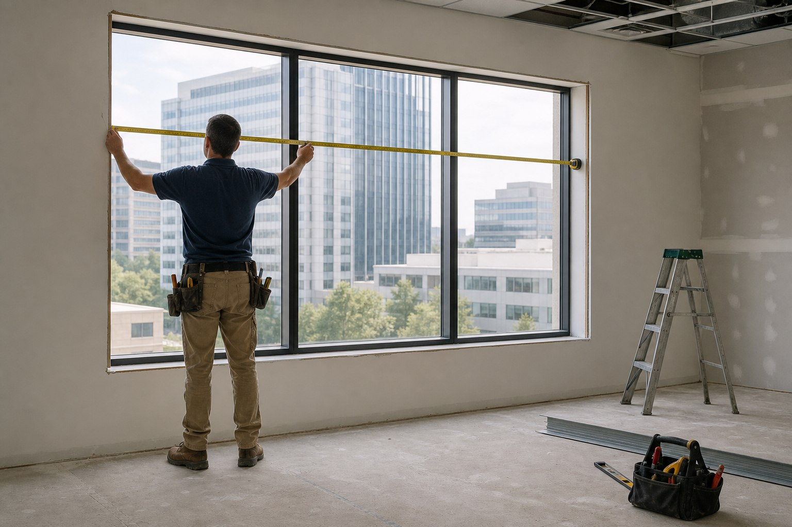
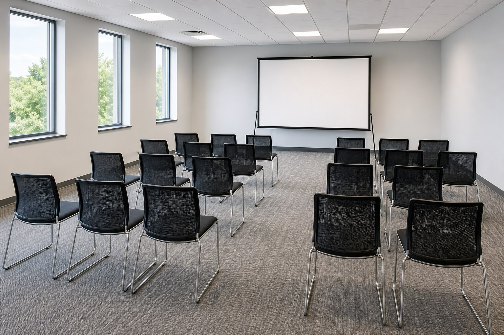
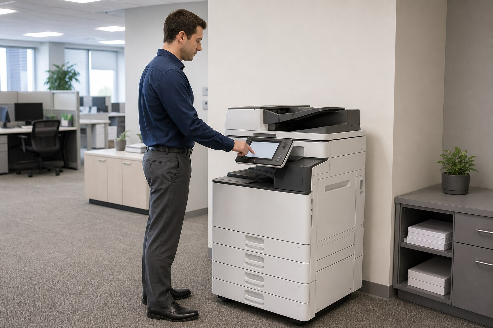
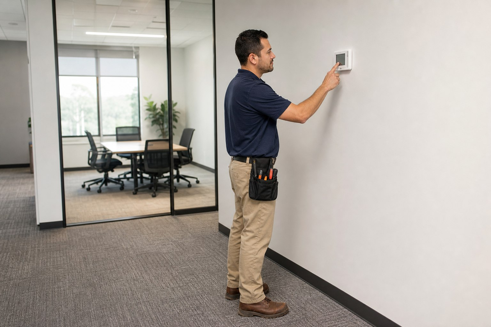

# TOEIC® Listening Practice Test 05

> 100 题 · Part 1（6）+ Part 2（25）+ Part 3（39）+ Part 4（30）· 约 45 分钟
> 音频为电脑合成（TTS），非真人录音。音频文件见 `audio/m5/`。

## PART 1 — Photographs（1–6）

For each question, you will listen to four short statements about a photograph. Select the statement that best describes what is happening in the picture.

### Q1

*照片内容*：一名工作人員正在測量窗框的寬度。

音频：`audio/m5/p1-1.mp3`

- (A) A worker is measuring the width of a window frame.
- (B) Some curtains are being hung.
- (C) The glass is being cleaned.
- (D) The window frame is being painted.

**答案：A**

解析：工作人員將捲尺水平拉過窗框，正在量測寬度。畫面中沒有窗簾、清潔工具或油漆刷。

### Q2

*照片内容*：一排排椅子面向簡報幕。

音频：`audio/m5/p1-2.mp3`

- (A) The chairs have been stacked beside the wall.
- (B) Several people are watching a presentation.
- (C) Tables are arranged around the edge of the room.
- (D) Rows of chairs are facing a presentation screen.

**答案：D**

解析：空教室中的椅子分列成數排，全部朝向前方的簡報幕。椅子沒有堆疊，現場也沒有人或桌子。

### Q3

*照片内容*：一台办公设备正通过触摸屏操作。

音频：`audio/m5/p1-3.mp3`

- (A) Some sheets are being fed into an automatic document feeder.
- (B) The machine is being wheeled away from the wall.
- (C) An office machine is being operated using a touch screen.
- (D) A drawer beneath the control panel is being pulled open.

**答案：C**

解析：男子的手指正触碰机器的控制屏。纸盒并未拉开，也没有送纸或移动机器的动作；后三项用常见办公动作作为干扰。此题为基于原许可图片的改编。

### Q4

*照片内容*：一條充電線正被接上車輛。

音频：`audio/m5/p1-4.mp3`

- (A) The windshield is being washed.
- (B) A mechanic is replacing a tire.
- (C) Some boxes are being unloaded from the trunk.
- (D) A charging cable is being connected to a vehicle.

**答案：D**

解析：男子正把充電接頭插入車身後側的充電口。畫面中沒有清洗擋風玻璃、更換輪胎或從行李廂卸貨。

### Q5

*照片内容*：兩名通勤者正在比較交通路線圖。

音频：`audio/m5/p1-5.mp3`

- (A) Two commuters are comparing transit maps.
- (B) Passengers are boarding a train.
- (C) A traveler is buying a ticket from a machine.
- (D) The transit shelter is completely empty.

**答案：A**

解析：兩名通勤者手持紙本路線圖，旁邊也有大型路線圖，顯示他們正在比對交通資訊；畫面沒有列車或售票機。

### Q6

*照片内容*：一名工作人員正在調整壁掛式恆溫器。

音频：`audio/m5/p1-6.mp3`

- (A) A worker is adjusting a wall-mounted thermostat.
- (B) A picture is being hung in a hallway.
- (C) The wall is being painted.
- (D) Some wiring is being removed from the ceiling.

**答案：A**

解析：工作人員伸手按下牆上的恆溫器控制面板。畫面沒有掛畫、油漆或拆除天花板線路。

## PART 2 — Question-Response（7–31）

You will hear a question or statement followed by three responses. Select the best response to the question or statement.

### Q7

问句/陈述：Why was the mobile-login launch delayed?

音频：`audio/m5/p2-1.mp3`

- (A) Because the encryption test took longer than expected.
- (B) The new badge scanner is beside the entrance.
- (C) I can reserve a larger room.

**答案：A**

解析：Why was the launch delayed? 要回答原因，encryption test took longer 是原因句。

### Q8

问句/陈述：Who has the latest revenue figures for the investor briefing?

音频：`audio/m5/p2-2.mp3`

- (A) I think Mr. Alvarez has the latest figures.
- (B) Only two boxes were delivered.
- (C) The cafeteria closes at seven.

**答案：A**

解析：Who has...? 詢問誰有最新數字，I think Mr. Alvarez... 是自然的間接回答。

### Q9

问句/陈述：Should we postpone the software demonstration?

音频：`audio/m5/p2-3.mp3`

- (A) It was demonstrated in the lobby.
- (B) Let's wait for the client's reply first.
- (C) The software license is renewable.

**答案：B**

解析：Should we...? 提出決策；先等客戶回覆是保留式、但自然的間接回答。

### Q10

问句/陈述：The data migration will take two hours longer than expected.

音频：`audio/m5/p2-4.mp3`

- (A) The database contains customer records.
- (B) It was expected by the technical team.
- (C) Then let's notify the evening-shift staff.

**答案：C**

解析：移轉延長會影響晚班；通知晚班員工是最合理的情境反應。

### Q11

问句/陈述：Who's taking minutes while Lena presents the quarterly forecast?

音频：`audio/m5/p2-5.mp3`

- (A) I can, unless Martin has already volunteered.
- (B) In the main conference room.
- (C) The forecast was revised twice.

**答案：A**

解析：Who's taking minutes 詢問由誰記錄會議內容；I can 直接承接工作，unless 子句補充可能已有志願者。

### Q12

问句/陈述：Would you mind sending me the revised schedule?

音频：`audio/m5/p2-6.mp3`

- (A) It was revised yesterday.
- (B) Not at all. I'll send it right away.
- (C) Yes, the schedule changed.

**答案：B**

解析：Would you mind...? 接受請求可回答 Not at all。

### Q13

问句/陈述：Which route should we take to the airport?

音频：`audio/m5/p2-7.mp3`

- (A) The expressway is usually faster.
- (B) Our flight leaves at seven.
- (C) I took a taxi yesterday.

**答案：A**

解析：Which route 問路線選擇。

### Q14

问句/陈述：Isn't Mr. Gomez attending the trade show?

音频：`audio/m5/p2-8.mp3`

- (A) He works in marketing.
- (B) No, he has another appointment.
- (C) The trade show was successful.

**答案：B**

解析：依事實回答否定疑問句。

### Q15

问句/陈述：What do you think of the new office layout?

音频：`audio/m5/p2-9.mp3`

- (A) It's much easier to move around now.
- (B) The office moved last month.
- (C) On the third floor.

**答案：A**

解析：What do you think of...? 問意見。

### Q16

问句/陈述：Has the finance department approved the budget?

音频：`audio/m5/p2-10.mp3`

- (A) Yes, it was very costly.
- (B) Not yet, but they expect to finish today.
- (C) The budget meeting is upstairs.

**答案：B**

解析：現在完成式 Yes/No 問句，回答目前狀態。

### Q17

问句/陈述：Didn't the technician replace this part yesterday?

音频：`audio/m5/p2-11.mp3`

- (A) The part costs thirty dollars.
- (B) Yesterday was very busy.
- (C) No, the replacement hasn't arrived yet.

**答案：C**

解析：否定疑問句仍依事實回答；此處說明尚未更換的原因。

### Q18

问句/陈述：Could you tell me where the orientation is being held?

音频：`audio/m5/p2-12.mp3`

- (A) It begins after lunch.
- (B) The new employees attended.
- (C) In the auditorium on the first floor.

**答案：C**

解析：where 問地點。

### Q19

问句/陈述：Has the customer confirmed the delivery address?

音频：`audio/m5/p2-13.mp3`

- (A) The delivery truck is outside.
- (B) Yes, the package is heavy.
- (C) Not yet, so I sent another e-mail.

**答案：C**

解析：現在完成式問目前是否已完成；回答尚未並說明後續行動。

### Q20

问句/陈述：Why hasn't the replacement part arrived?

音频：`audio/m5/p2-14.mp3`

- (A) It fits this machine.
- (B) We ordered two parts.
- (C) The supplier shipped it to the wrong address.

**答案：C**

解析：Why 問尚未抵達的原因。

### Q21

问句/陈述：Didn't you reserve the conference room?

音频：`audio/m5/p2-15.mp3`

- (A) I tried, but it was already booked.
- (B) The conference lasted two hours.
- (C) The room is on the fifth floor.

**答案：A**

解析：否定疑問句依事實回答，並說明沒有訂到的原因。

### Q22

问句/陈述：Could you check whether the client received our proposal?

音频：`audio/m5/p2-16.mp3`

- (A) Sure, I'll call this afternoon.
- (B) The proposal is well written.
- (C) We received two packages.

**答案：A**

解析：Could you...? 是請求，應承諾採取行動。

### Q23

问句/陈述：Hasn't the maintenance inspection finished yet?

音频：`audio/m5/p2-17.mp3`

- (A) No, it will continue for another hour.
- (B) The inspector signed the form.
- (C) Yes, the equipment is new.

**答案：A**

解析：尚未完成，並補充還需一小時。

### Q24

问句/陈述：May I borrow your access card for a moment?

音频：`audio/m5/p2-18.mp3`

- (A) The card reader is downstairs.
- (B) I borrowed a laptop.
- (C) I'm sorry, cards can't be shared.

**答案：C**

解析：對借用門禁卡的請求，依安全規定婉拒。

### Q25

问句/陈述：Why was my membership renewal rejected?

音频：`audio/m5/p2-19.mp3`

- (A) Your membership lasts a year.
- (B) The form is at the front desk.
- (C) The payment information was incomplete.

**答案：C**

解析：Why 問遭拒原因。

### Q26

问句/陈述：Could I exchange this jacket for a larger size?

音频：`audio/m5/p2-20.mp3`

- (A) The jacket is on sale.
- (B) The fitting room is occupied.
- (C) Certainly, if you have the receipt.

**答案：C**

解析：退換貨請求最自然的回應是說明可辦理的條件。

### Q27

问句/陈述：Why hasn't the advertising copy been approved?

音频：`audio/m5/p2-21.mp3`

- (A) The legal team requested a revision.
- (B) It was copied in color.
- (C) The advertisement starts tomorrow.

**答案：A**

解析：Why 問尚未核准的原因。

### Q28

问句/陈述：Didn't the courier pick up the package this morning?

音频：`audio/m5/p2-22.mp3`

- (A) The package is lightweight.
- (B) This morning was busy.
- (C) No, the pickup was rescheduled.

**答案：C**

解析：否定疑問句依事實回答，並說明重新排程。

### Q29

问句/陈述：When will the replacement sensor be delivered?

音频：`audio/m5/p2-23.mp3`

- (A) I usually take the express train.
- (B) The vendor said it would arrive by Friday.
- (C) Yes, the meeting room is upstairs.

**答案：B**

解析：題目問交期或送達時間時，回答供應商說週五前送達最自然。

### Q30

问句/陈述：Who is coordinating the AI ethics workshop?

音频：`audio/m5/p2-24.mp3`

- (A) Yes, the tablet has a protective case.
- (B) The dashboard was updated twice.
- (C) Please ask Mia; she manages the training calendar.

**答案：C**

解析：Who is coordinating...? 需要回答負責人或轉介對象，Mia manages the calendar 最合適。

### Q31

问句/陈述：When should we begin the product-demo rehearsal?

音频：`audio/m5/p2-25.mp3`

- (A) It is made of recycled paper.
- (B) The cafeteria is downstairs.
- (C) Not until the consultant arrives.

**答案：C**

解析：Not until... 可回應 When 類型問題，表示要等顧問抵達後才開始或處理。

## PART 3 — Conversations（32–70）

You will hear several conversations between two or more people. You will be asked to answer three questions about what the speakers say. Select the best response.

### Questions 32–34

音频：`audio/m5/p3-1.mp3`

**录音原文：**

> M: Ms. Owens, your résumé shows extensive experience in international sales. Could you tell me about your work in Singapore?
> W: Certainly. I managed a team of twelve and helped increase regional revenue by eighteen percent.
> M: Impressive. The next step is a video interview with our vice president.

**Q32.** What is the purpose of the conversation?
- (A) To revise a travel itinerary
- (B) To inspect a branch office
- (C) To conduct a job interview
- (D) To negotiate a sales contract

答案：**C**　解析：談論履歷、經驗和下一階段面試。

**Q33.** What did the woman accomplish in Singapore?
- (A) She designed a new product
- (B) She reduced travel costs
- (C) She increased regional revenue
- (D) She opened twelve stores

答案：**C**　解析：女子說提高區域營收 18%。

**Q34.** What will the woman most likely do next?
- (A) Attend a trade show
- (B) Train new employees
- (C) Have another interview
- (D) Submit an expense report

答案：**C**　解析：下一步是與副總裁視訊面試。

### Questions 35–37

音频：`audio/m5/p3-2.mp3`

**录音原文：**

> M: I tested the projector in Conference Room C, but the image is still too dark.
> W: The larger projector is available in Room A. We could move the presentation there.
> M: Good idea. I'll tell the attendees about the room change.

**Q35.** What problem does the man mention?
- (A) A projector image is too dark
- (B) A presentation file is missing
- (C) A conference room is locked
- (D) Several attendees are late

答案：**A**　解析：男子說投影畫面太暗。

**Q36.** What does the woman suggest?
- (A) Using another room
- (B) Buying a new computer
- (C) Printing the slides
- (D) Postponing the meeting

答案：**A**　解析：女子建議移到有較大投影機的 A 會議室。

**Q37.** What will the man do?
- (A) Cancel the presentation
- (B) Notify the attendees
- (C) Repair the projector
- (D) Reserve a restaurant

答案：**B**　解析：男子會通知與會者更換房間。

### Questions 38–40

音频：`audio/m5/p3-3.mp3`

**录音原文：**

> M: The product photos on our website look blurry on mobile phones.
> W: I can resize the image files this afternoon. We should also test the pages on several screen sizes.
> M: Good. Please finish before the online sale begins tomorrow.

**Q38.** What issue are the speakers discussing?
- (A) A delayed shipment
- (B) A missing customer review
- (C) Blurry website images
- (D) Incorrect product prices

答案：**C**　解析：產品照片在手機顯示模糊。

**Q39.** What does the woman propose doing?
- (A) Testing different screen sizes
- (B) Replacing all products
- (C) Hiring a photographer today
- (D) Closing the website

答案：**A**　解析：她提議測試多種螢幕尺寸。

**Q40.** When should the work be completed?
- (A) Before tomorrow's online sale
- (B) By the end of next month
- (C) After a customer survey
- (D) Before today's lunch

答案：**A**　解析：男子要求在明天促銷前完成。

### Questions 41–43

音频：`audio/m5/p3-4.mp3`

**录音原文：**

> M: The client wants us to demonstrate the reporting feature during tomorrow's video call.
> W: Then we should use the test account rather than real customer data.
> M: Agreed. I'll prepare a sample report and send you the login information.

**Q41.** What does the client want to see?
- (A) A reporting feature
- (B) A hiring plan
- (C) A delivery schedule
- (D) A new office location

答案：**A**　解析：客戶想看報表功能。

**Q42.** Why does the woman suggest using a test account?
- (A) To lower the software price
- (B) To shorten the video call
- (C) To train a new employee
- (D) To avoid using real customer data

答案：**D**　解析：避免使用真實顧客資料。

**Q43.** What will the man send to the woman?
- (A) Customer invoices
- (B) A meeting recording
- (C) Login information
- (D) A printed contract

答案：**C**　解析：男子會寄登入資訊。

### Questions 44–46

音频：`audio/m5/p3-5.mp3`

**录音原文：**

> M: Did the security update finish on the reception tablets?
> W: Not yet. The network team found a compatibility issue with the older models.
> M: We have visitors arriving at nine tomorrow. Can we use the backup login page?
> W: Yes, but I will ask the team to test it again this afternoon.

**Q44.** What is implied about some reception tablets?
- (A) They are older models
- (B) They were recently stolen
- (C) They are used only outdoors
- (D) They have no internet access

答案：**A**　解析：女方說 compatibility issue with the older models，表示有些平板是舊機型。

**Q45.** What temporary solution does the man suggest?
- (A) Using a backup login page
- (B) Canceling tomorrow's appointments
- (C) Printing visitor badges in advance
- (D) Replacing all of the tablets

答案：**A**　解析：男方問 Can we use the backup login page?，所以暫時方案是使用備用登入頁。

**Q46.** Why do the tablets need to be ready by tomorrow morning?
- (A) A network audit will begin
- (B) Visitors are expected at nine
- (C) A delivery will be checked in
- (D) The office will close at noon

答案：**B**　解析：男方說 visitors arriving at nine tomorrow，接待系統必須在訪客抵達前可用。

### Questions 47–49

音频：`audio/m5/p3-6.mp3`

**录音原文：**

> M: The webinar test looks clear, but the captions are appearing about five seconds late.
> W: I noticed that too. The streaming platform has a sync setting we can adjust.
> M: Good. Can you fix it before the Australian office joins the rehearsal?
> W: Yes, I will update it and run another test in ten minutes.

**Q47.** What problem do the speakers mention?
- (A) The captions are delayed
- (B) The presenter is late
- (C) The registration link is broken
- (D) The venue has changed

答案：**A**　解析：男子說 captions are appearing about five seconds late，表示字幕延遲。

**Q48.** What will the woman adjust?
- (A) A sync setting
- (B) A seating chart
- (C) A shipping address
- (D) A hotel reservation

答案：**A**　解析：女子提到 streaming platform has a sync setting we can adjust，因此她會調整同步設定。

**Q49.** What will happen in ten minutes?
- (A) A presenter will be hired
- (B) A report will be printed
- (C) Another test will be run
- (D) The office will close

答案：**C**　解析：女子最後說 run another test in ten minutes，表示十分鐘後會再測一次。

### Questions 50–52

音频：`audio/m5/p3-7.mp3`

**录音原文：**

> M: The analytics team is relocating to the fourth floor on Monday.
> W: I reserved twelve desks, but only eight monitors have arrived.
> M: We can borrow four from the training room until the shipment comes in.
> W: Great. I will label the desks and ask facilities to install the docking stations.

**Q50.** What are the speakers mainly discussing?
- (A) Hiring temporary reception staff
- (B) Ordering new security badges
- (C) Rescheduling a training seminar
- (D) Preparing desks for a relocated team

答案：**D**　解析：對話圍繞 relocated analytics team、desks、monitors 和 docking stations，主題是替搬遷團隊準備座位。

**Q51.** How many monitors still need to be provided?
- (A) Four
- (B) Eight
- (C) Twelve
- (D) Sixteen

答案：**A**　解析：需要十二台螢幕，但 only eight monitors have arrived，所以還缺四台。

**Q52.** What will the woman probably do next?
- (A) Contact the facilities department
- (B) Cancel the monitor shipment
- (C) Move to the fourth floor
- (D) Revise the analytics dashboard

答案：**A**　解析：女方說會 ask facilities to install the docking stations，所以接下來可能聯絡設施部。

### Questions 53–55

音频：`audio/m5/p3-8.mp3`

**录音原文：**

> W: Did you enable automatic transcription for tomorrow's client briefing?
> M: Not yet. The legal department says we need each guest's consent before recording.
> W: Then I'll add a consent notice to the invitation and ask the account manager to confirm with the guests.
> M: Good. Once she replies, I can set the assistant to delete the recording after thirty days.

**Q53.** Why has automatic transcription not been enabled?
- (A) Guest consent is still required
- (B) The assistant needs an update
- (C) The invitation has already been sent
- (D) The briefing was postponed

答案：**A**　解析：男方說法務要求 recording 前取得 each guest's consent，因此尚未啟用。

**Q54.** What will the woman do?
- (A) Replace the meeting assistant
- (B) Shorten the client briefing
- (C) Revise the invitation and contact an account manager
- (D) Delete an earlier recording

答案：**C**　解析：女方會 add a consent notice，並 ask the account manager to confirm。

**Q55.** What will happen after the account manager replies?
- (A) The legal department will send invoices
- (B) Guests will receive new devices
- (C) A deletion schedule will be configured
- (D) The briefing will move to another room

答案：**C**　解析：男方說 Once she replies，就設定錄音在三十天後自動刪除。

### Questions 56–58

音频：`audio/m5/p3-9.mp3`

**录音原文：**

> M: Have we confirmed live captions for Friday's product demonstration? Two clients will join from overseas.
> W: The captioning vendor is available, but its quote covers English only. One client requested Japanese translation.
> M: Our Tokyo office has an interpreter on staff. Could she join remotely for the question-and-answer session?
> W: I'll ask her. If she is available, we can keep the vendor for the main presentation and avoid changing the schedule.

**Q56.** What problem do the speakers discuss?
- (A) Two clients cannot join the meeting
- (B) The Tokyo office changed its schedule
- (C) A demonstration has been canceled
- (D) A quote does not include a needed language

答案：**D**　解析：字幕廠商的報價只含英文，但客戶需要日文翻譯；核心問題是報價未涵蓋所需語言。

**Q57.** Why does the man mention the Tokyo office?
- (A) It employs an interpreter
- (B) It designed the new product
- (C) It will host the demonstration
- (D) It received a lower vendor quote

答案：**A**　解析：男士提到東京辦公室有專職口譯員，目的是提出日文翻譯的替代解決方案。

**Q58.** What does the woman imply about the schedule?
- (A) It can remain unchanged if the interpreter is free
- (B) It must be shortened for overseas clients
- (C) It has already been sent to the vendor
- (D) It includes a second demonstration

答案：**A**　解析：女士說若口譯員有空，就能 avoid changing the schedule，意即目前時程可維持不變。

### Questions 59–61

音频：`audio/m5/p3-10.mp3`

**录音原文：**

> W: Hi, Daniel. The client moved tomorrow's product presentation from 10 A.M. to 2 P.M.
> M: Thanks for letting me know. I'll update the room reservation and notify the design team.
> W: Great. Please ask them to bring the revised brochures.

**Q59.** What are the speakers mainly discussing?
- (A) A change to a presentation
- (B) A new product price
- (C) A hiring decision
- (D) A travel reimbursement

答案：**A**　解析：對話重點是簡報時間改動。

**Q60.** What will the man do?
- (A) Print employee badges
- (B) Meet a supplier at the airport
- (C) Cancel a product launch
- (D) Reserve a room and contact a team

答案：**D**　解析：男子說會更新會議室預約並通知設計團隊。

**Q61.** What does the woman ask the design team to bring?
- (A) Customer surveys
- (B) Revised brochures
- (C) Expense reports
- (D) Laptop warranties

答案：**B**　解析：女子要求攜帶修訂後的小冊子。

### Questions 62–64

音频：`audio/m5/p3-11.mp3`

**录音原文：**

> W: We received a message from our shipping company. The office chairs won't arrive until Friday because of a storm.
> M: That's a problem. The new employees start on Thursday.
> W: We can move some chairs from the training room temporarily.

**Q62.** Why will the delivery be late?
- (A) Because the warehouse is full
- (B) Because of severe weather
- (C) Because payment is missing
- (D) Because the order was canceled

答案：**B**　解析：女子明確說 because of a storm。

**Q63.** What will happen on Thursday?
- (A) A storm will reach the city
- (B) The training room will close
- (C) New employees will begin work
- (D) The chairs will be repaired

答案：**C**　解析：男子說新員工星期四開始上班。

**Q64.** What does the woman suggest?
- (A) Postponing employee training
- (B) Calling every supplier
- (C) Using chairs from another room
- (D) Buying desks online

答案：**C**　解析：女子建議暫時搬用訓練室的椅子。

### Questions 65–67

音频：`audio/m5/p3-12.mp3`

**录音原文：**

> W: Hello, I'm calling about order 7615. We need thirty notebooks instead of twenty.
> M: I can update the quantity, but the delivery date may move from Tuesday to Wednesday.
> W: Wednesday is fine, as long as the boxes arrive before noon.

**Q65.** Why is the woman calling?
- (A) To report damaged notebooks
- (B) To request a refund
- (C) To apply for a job
- (D) To change an order quantity

答案：**D**　解析：女子要把筆記本數量從二十本改成三十本。

**Q66.** What may change?
- (A) The shipping address
- (B) The delivery date
- (C) The product color
- (D) The payment method

答案：**B**　解析：男子說交貨日期可能由星期二改到星期三。

**Q67.** What does the woman require?
- (A) A lower price
- (B) Separate invoices
- (C) Tuesday delivery
- (D) Delivery before noon

答案：**D**　解析：女子說只要中午以前抵達即可。

### Questions 68–70

音频：`audio/m5/p3-13.mp3`

**录音原文：**

> W: I found a morning flight to Osaka, but it leaves at six ten.
> M: That's early. Is there a later flight that arrives before the conference dinner?
> W: Yes, one leaves at nine and arrives at noon. It costs thirty dollars more.

**Q68.** What are the speakers arranging?
- (A) A product delivery
- (B) A training schedule
- (C) A flight
- (D) A dinner menu

答案：**C**　解析：對話在比較飛往大阪的班機。

**Q69.** Why does the man prefer a later flight?
- (A) He wants to arrive after dinner
- (B) The first flight leaves very early
- (C) He needs a cheaper ticket
- (D) The conference has been canceled

答案：**B**　解析：六點十分太早。

**Q70.** What is said about the nine o'clock flight?
- (A) It costs more
- (B) It arrives in the evening
- (C) It has no available seats
- (D) It requires two transfers

答案：**A**　解析：該班機多三十美元。

## PART 4 — Talks（71–100）

You will hear several talks given by a single speaker. You will be asked to answer three questions about what the speaker says. Select the best response.

### Questions 71–73

音频：`audio/m5/p4-1.mp3`

**录音原文：**

> This is a reminder that the west stairwell will be closed tomorrow from 9 A.M. until 1 P.M. for safety inspections. During that time, employees should use the elevators near the cafeteria or the east stairwell. Deliveries should enter through the loading dock on Pine Street.

**Q71.** What will be closed?
- (A) An elevator
- (B) A stairwell
- (C) A cafeteria
- (D) A loading dock

答案：**B**　解析：西側樓梯間將關閉。

**Q72.** What should employees use?
- (A) The elevators or east stairwell
- (B) The Pine Street entrance only
- (C) The west stairwell
- (D) The emergency exit

答案：**A**　解析：公告指定電梯或東側樓梯間。

**Q73.** Where should deliveries enter?
- (A) Through the loading dock
- (B) Through the cafeteria
- (C) Through the main lobby
- (D) Through the west stairwell

答案：**A**　解析：貨運應從 Pine Street 裝卸區進入。

### Questions 74–76

音频：`audio/m5/p4-2.mp3`

**录音原文：**

> Thank you for attending the Regional Entrepreneurs Conference. The keynote speech will begin in the Grand Hall at nine thirty. After the speech, participants may choose from three smaller workshops. A schedule and room map are included inside your name badge holder.

**Q74.** Where will the keynote speech take place?
- (A) In the registration office
- (B) In a small workshop room
- (C) In the Grand Hall
- (D) In a hotel restaurant

答案：**C**　解析：主題演講在大禮堂。

**Q75.** What may participants do after the speech?
- (A) Collect a refund
- (B) Meet the keynote speaker privately
- (C) Attend one of three workshops
- (D) Leave for the airport

答案：**C**　解析：之後可選擇三場工作坊之一。

**Q76.** Where can participants find a room map?
- (A) At the parking entrance
- (B) On the conference website only
- (C) Under their seats
- (D) Inside the name badge holder

答案：**D**　解析：地圖放在名牌套內。

### Questions 77–79

音频：`audio/m5/p4-3.mp3`

**录音原文：**

> Thank you for purchasing the CleanAir 500 purifier. Before first use, remove the protective covering from the filter and place the unit at least thirty centimeters from a wall. The indicator light will turn orange when the filter needs to be replaced. Replacement filters can be ordered through our website.

**Q77.** What should users do before first use?
- (A) Order a replacement filter
- (B) Place the unit against a wall
- (C) Turn the indicator light orange
- (D) Remove a covering from the filter

答案：**D**　解析：首次使用前要移除濾網保護膜。

**Q78.** How far should the unit be from a wall?
- (A) More than three meters
- (B) It may touch the wall
- (C) At least thirty centimeters
- (D) Exactly five centimeters

答案：**C**　解析：至少離牆三十公分。

**Q79.** What does an orange light indicate?
- (A) The unit is too far from a wall
- (B) The website is unavailable
- (C) The covering is still attached
- (D) The filter needs replacement

答案：**D**　解析：橘色燈表示需要更換濾網。

### Questions 80–82

音频：`audio/m5/p4-4.mp3`

**录音原文：**

> Good morning. Beginning Monday, employees who visit the client center may use the company mobile app to check in at the lobby kiosk. After opening the app, select Client Center Visit and scan the code displayed on the kiosk screen. A printed badge will still be required, so please pick it up before entering the meeting area. If you have trouble with the app, ask the reception team for assistance.

**Q80.** What is the announcement mainly about?
- (A) A cafeteria renovation
- (B) A cancelled software order
- (C) A new mobile check-in feature
- (D) A change in parking fees

答案：**C**　解析：公告主要說明員工可使用公司手機 app 在大廳 kiosk 辦理報到，因此主題是新的手機報到功能。

**Q81.** What should employees scan?
- (A) A code on a kiosk screen
- (B) A paper parking pass
- (C) A cafeteria receipt
- (D) A visitor's passport

答案：**A**　解析：公告提到 scan the code displayed on the kiosk screen，員工要掃描自助機螢幕上的代碼。

**Q82.** What is still required?
- (A) A laptop password
- (B) A printed badge
- (C) A parking receipt
- (D) A signed lunch form

答案：**B**　解析：公告明確說 A printed badge will still be required，表示仍需要紙本識別證。

### Questions 83–85

音频：`audio/m5/p4-5.mp3`

**录音原文：**

> Attention all employees. The lobby check-in kiosk will be offline tomorrow while a software patch is installed. During this time, visitors should check in at the security desk and show a photo ID. Employees expecting guests should send the guest list to reception by 5 P.M. today.

**Q83.** What is the announcement mainly about?
- (A) A temporary change to visitor check-in
- (B) A new cafeteria menu
- (C) A quarterly sales contest
- (D) A delay in payroll processing

答案：**A**　解析：公告主要說 lobby kiosk will be offline 和 visitors should check in at the security desk，主題是訪客報到方式暫時改變。

**Q84.** Where should visitors check in tomorrow?
- (A) At the security desk
- (B) At the cafeteria entrance
- (C) In the training room
- (D) On the fourth floor

答案：**A**　解析：公告明確說 visitors should check in at the security desk。

**Q85.** What are employees asked to do by 5 P.M.?
- (A) Send a guest list to reception
- (B) Install a software patch
- (C) Move a kiosk to the lobby
- (D) Print new identification cards

答案：**A**　解析：最後一句說 employees expecting guests should send the guest list to reception by 5 P.M. today。

### Questions 86–88

音频：`audio/m5/p4-6.mp3`

**录音原文：**

> Registration is now open for the Saturday workshop, Managing Remote Project Teams. The session is designed for new project managers and will include practical exercises on scheduling, feedback, and conflict resolution. Register by Friday to receive a 15 percent discount and a digital workbook.

**Q86.** What is being advertised?
- (A) A professional development workshop
- (B) A new commuter train route
- (C) A restaurant opening
- (D) A software refund program

答案：**A**　解析：廣告提到 Saturday workshop、project managers 和 early registration，因此是在宣傳專業進修工作坊。

**Q87.** Who is the workshop designed for?
- (A) New project managers
- (B) Experienced accountants
- (C) Hotel receptionists
- (D) Warehouse technicians

答案：**A**　解析：音檔中明確說 The session is designed for new project managers。

**Q88.** What is offered to people who register by Friday?
- (A) A printed contract
- (B) A private consulting session
- (C) A discount and a digital workbook
- (D) A free hotel room

答案：**C**　解析：最後一句說 Register by Friday to receive a 15 percent discount and a digital workbook。

### Questions 89–91

音频：`audio/m5/p4-7.mp3`

**录音原文：**

> Good morning, store managers. The energy-monitoring portal will be offline tonight from nine until midnight while technicians recalibrate the rooftop solar meters. This work will not interrupt electricity in any store. However, automated energy reports scheduled during that period will be generated tomorrow morning instead. Managers do not need to submit manual readings unless an alert remains visible after the portal returns. A short guide to the updated dashboard will be posted in the operations library on Friday.

**Q89.** Why will the monitoring portal be unavailable?
- (A) The operations library is moving
- (B) New stores are being added
- (C) Solar meters are being recalibrated
- (D) Managers are entering manual readings

答案：**C**　解析：公告說技術人員重新校準屋頂太陽能電表，因此監控平台於晚間暫停服務。

**Q90.** What will happen to reports scheduled during the maintenance period?
- (A) They will be produced the next morning
- (B) They will be sent to technicians
- (C) They will be canceled
- (D) They will require manager approval

答案：**A**　解析：原文說該時段的自動報告 will be generated tomorrow morning instead，答案是隔天早上產生。

**Q91.** Under what condition should managers submit manual readings?
- (A) If an alert remains after the portal is restored
- (B) If a store loses electricity
- (C) If a report arrives before midnight
- (D) If the updated guide is unavailable

答案：**A**　解析：公告明確限定 unless an alert remains visible after the portal returns；只有平台恢復後警示仍存在，才需提交人工讀數。

### Questions 92–94

音频：`audio/m5/p4-8.mp3`

**录音原文：**

> Attention passengers. The 8:15 train to Riverside will depart twenty minutes late because maintenance crews are inspecting the tracks. Passengers may use their current tickets on the 8:30 express train at no additional charge.

**Q92.** What is the purpose of the announcement?
- (A) To recruit maintenance workers
- (B) To report a train delay
- (C) To advertise a new station
- (D) To explain a ticket price increase

答案：**B**　解析：公告說明列車延誤。

**Q93.** Why is the train delayed?
- (A) The driver is absent
- (B) A ticket machine is broken
- (C) Heavy rain flooded the station
- (D) The tracks are being inspected

答案：**D**　解析：維修人員正在檢查軌道。

**Q94.** What may passengers do?
- (A) Board at a different city
- (B) Take an express train without paying extra
- (C) Request a hotel room
- (D) Exchange tickets next week

答案：**B**　解析：原票可免費搭乘 8:30 快車。

### Questions 95–97

音频：`audio/m5/p4-9.mp3`

**录音原文：**

> Welcome to the City Design Museum. The photography exhibit on the second floor opens at 10:30. Guided tours begin every hour in the main lobby. Please note that food and beverages are not permitted inside the galleries.

**Q95.** Where is the announcement being made?
- (A) At a restaurant
- (B) At a factory
- (C) At an airport
- (D) At a museum

答案：**D**　解析：內容提及 exhibit、guided tours、galleries。

**Q96.** When does the photography exhibit open?
- (A) At 1:30
- (B) At 10:30
- (C) At 9:00
- (D) At noon

答案：**B**　解析：公告明確說 10:30。

**Q97.** What is prohibited in the galleries?
- (A) Photography
- (B) Guided tours
- (C) Children
- (D) Food and drinks

答案：**D**　解析：展廳禁止飲食。

### Questions 98–100

音频：`audio/m5/p4-10.mp3`

**录音原文：**

> Employees on the fourth floor should be aware that the water supply will be turned off tomorrow from ten A.M. until noon while a pipe is replaced. Restrooms on the third and fifth floors will remain available. Please direct any questions to the facilities department.

**Q98.** What will happen tomorrow?
- (A) The water will be turned off temporarily
- (B) The fourth floor will close permanently
- (C) Employees will move offices
- (D) A new restroom will open

答案：**A**　解析：明天會暫時停水。

**Q99.** Which restrooms will remain available?
- (A) Only those in the lobby
- (B) Those on the third and fifth floors
- (C) Only those on the fourth floor
- (D) Those near the cafeteria

答案：**B**　解析：三樓與五樓可使用。

**Q100.** Whom should employees contact with questions?
- (A) The accounting department
- (B) The security office
- (C) The cafeteria manager
- (D) The facilities department

答案：**D**　解析：問題請洽設施部門。

---

题目来源：TOEIC Question Ocean（MIT 许可原创模拟题）。TOEIC® / ETS® 为 ETS 注册商标，本项目与 ETS 无关联。仅供个人学习使用。
