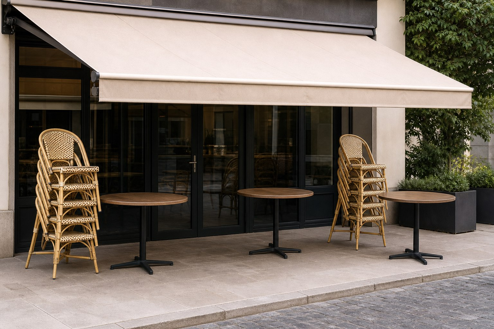
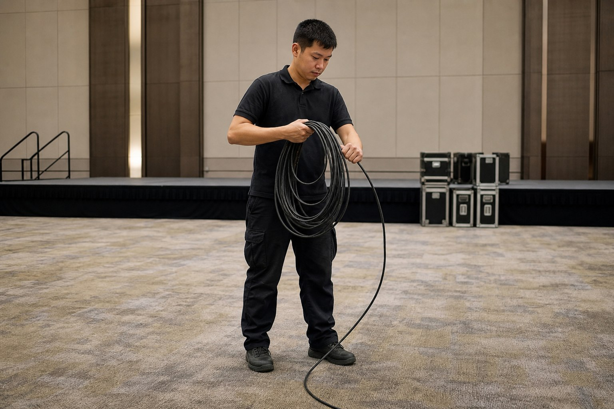
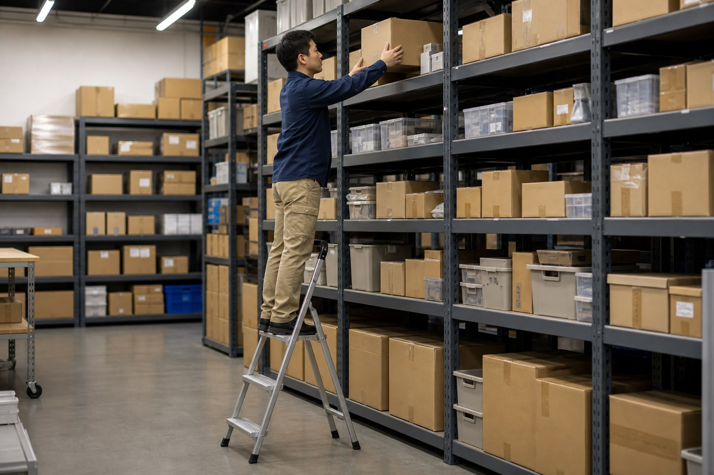
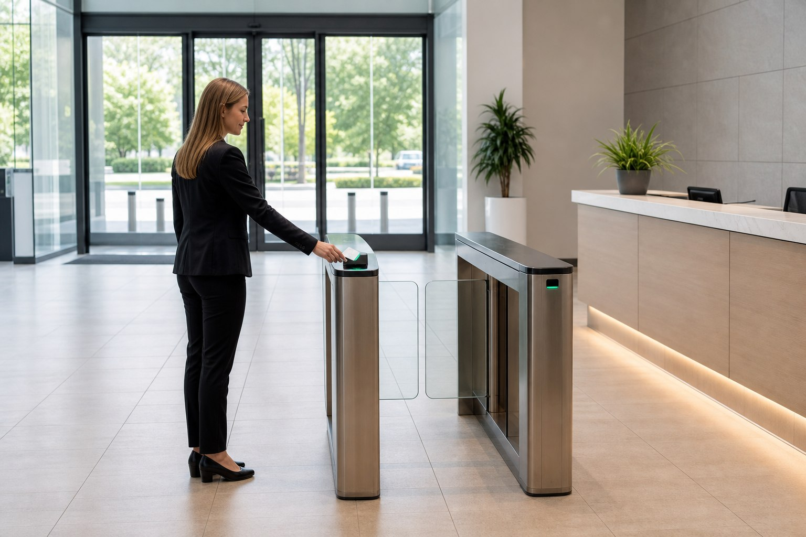
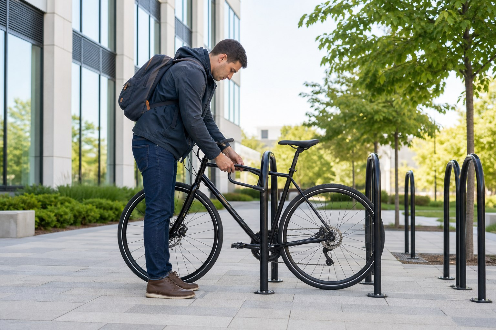

# TOEIC® Listening Practice Test 06

> 100 题 · Part 1（6）+ Part 2（25）+ Part 3（39）+ Part 4（30）· 约 45 分钟
> 音频为电脑合成（TTS），非真人录音。音频文件见 `audio/m6/`。

## PART 1 — Photographs（1–6）

For each question, you will listen to four short statements about a photograph. Select the statement that best describes what is happening in the picture.

### Q1

*照片内容*：幾張椅子堆疊在咖啡館桌子旁。

音频：`audio/m6/p1-1.mp3`

- (A) Customers are being served at the tables.
- (B) The tables have been covered with tablecloths.
- (C) Several chairs have been stacked beside cafe tables.
- (D) The awning has been folded above the entrance.

**答案：C**

解析：數張椅子整齊堆疊在咖啡館桌子旁。桌面沒有桌巾或顧客，遮陽棚則是展開狀態。

### Q2

*照片内容*：一名技術人員正在捲收電纜。

音频：`audio/m6/p1-2.mp3`

- (A) The floor is being cleaned with a machine.
- (B) A cable is being connected to a wall outlet.
- (C) A technician is coiling an electrical cable.
- (D) A technician is carrying a speaker onto a stage.

**答案：C**

解析：技術人員雙手整理多圈電纜，正在將它捲收。電纜沒有接到插座，也沒有人搬喇叭或清潔地面。

### Q3

*照片内容*：一名技術人員正在檢查一排太陽能板。

音频：`audio/m6/p1-3.mp3`

- (A) Some equipment is being loaded into a truck.
- (B) A technician is inspecting a row of solar panels.
- (C) The panels are covered with snow.
- (D) A worker is painting the roof.

**答案：B**

解析：技術人員跪在太陽能板旁，正使用儀表檢查設備；屋頂上沒有積雪、油漆作業或卡車。

### Q4

*照片内容*：一名工作人員正在把箱子放上高處的架子。

音频：`audio/m6/p1-4.mp3`

- (A) The storage shelves are completely empty.
- (B) A ladder has been folded against a wall.
- (C) A worker is placing a box on a high shelf.
- (D) Some boxes are being carried outdoors.

**答案：C**

解析：工作人員站在梯子上，雙手正把紙箱放到較高的貨架。貨架並非空的，梯子也沒有收起。

### Q5

*照片内容*：一名女子正在旋轉閘門的讀卡機上感應門禁卡。

音频：`audio/m6/p1-5.mp3`

- (A) A woman is tapping an access card on a turnstile reader.
- (B) The glass doors are being cleaned.
- (C) Some luggage is being carried through the lobby.
- (D) A receptionist is arranging flowers on a counter.

**答案：A**

解析：女子將門禁卡靠近旋轉閘門的讀卡區。她沒有整理花卉、清潔玻璃門或搬運行李。

### Q6

*照片内容*：一名通勤者正在把自行車鎖在停車架上。

音频：`audio/m6/p1-6.mp3`

- (A) A bicycle is being loaded onto a vehicle.
- (B) A commuter is fastening a bicycle to a rack.
- (C) The bicycle's rear tire is being replaced.
- (D) Several cyclists are riding past an office.

**答案：B**

解析：通勤者將鎖具環繞自行車車架與停車架，正在固定自行車；畫面沒有車輛、換胎或其他騎士。

## PART 2 — Question-Response（7–31）

You will hear a question or statement followed by three responses. Select the best response to the question or statement.

### Q7

问句/陈述：Do all drafts have to be reviewed by legal?

音频：`audio/m6/p2-1.mp3`

- (A) She bought it near the station.
- (B) Only the final version needs approval.
- (C) I prefer the window seat.

**答案：B**

解析：問句若涉及草稿或版本是否都需核准，Only the final version needs approval 直接回應核准範圍。

### Q8

问句/陈述：Have the laboratory test results arrived?

音频：`audio/m6/p2-2.mp3`

- (A) The printer is next to the elevator.
- (B) I chose the vegetarian option.
- (C) Not yet, but I expect them before noon.

**答案：C**

解析：Have the results arrived? 問結果到了沒，Not yet, but... 是自然且資訊完整的回答。

### Q9

问句/陈述：Haven't the revised invoices been sent to the clients?

音频：`audio/m6/p2-3.mp3`

- (A) We sent three sales representatives.
- (B) The clients requested itemized bills.
- (C) They're still waiting for the director's signature.

**答案：C**

解析：問發票是否已寄出；still waiting for... 間接表示尚未寄出並說明原因。

### Q10

问句/陈述：Didn't the supplier agree to cover the rush fee?

音频：`audio/m6/p2-4.mp3`

- (A) Only if we ordered before noon.
- (B) At the loading dock.
- (C) The invoice was printed yesterday.

**答案：A**

解析：否定問句詢問供應商是否同意負擔急件費；Only if... 說明該承諾附帶的條件，是最切合的回應。

### Q11

问句/陈述：The backup server still hasn't synchronized with the billing system.

音频：`audio/m6/p2-5.mp3`

- (A) It is stored in the supply cabinet.
- (B) The invoice includes tax.
- (C) I'll postpone the switchover, then.

**答案：C**

解析：備援伺服器尚未同步，合理後續是延後系統切換；then 表示根據前述狀況採取決定。

### Q12

问句/陈述：Haven't the invoices been mailed yet?

音频：`audio/m6/p2-6.mp3`

- (A) They were very expensive.
- (B) At the post office.
- (C) No, the printer stopped working.

**答案：C**

解析：否定疑問句仍依事實回答；此處說明尚未寄出的原因。

### Q13

问句/陈述：Why don't we review the proposal after lunch?

音频：`audio/m6/p2-7.mp3`

- (A) That sounds like a good idea.
- (B) The proposal was approved.
- (C) Lunch is included.

**答案：A**

解析：Why don't we...? 是提議。

### Q14

问句/陈述：Could I get an aisle seat, please?

音频：`audio/m6/p2-8.mp3`

- (A) The aisle is narrow.
- (B) I'll check what is available.
- (C) The flight was canceled.

**答案：B**

解析：服務情境中應確認座位供應狀況。

### Q15

问句/陈述：Should I call the supplier now or wait until tomorrow?

音频：`audio/m6/p2-9.mp3`

- (A) Call now, in case the office closes early.
- (B) The supplier called yesterday.
- (C) Tomorrow is a holiday.

**答案：A**

解析：選擇問句應直接給建議。

### Q16

问句/陈述：Would you like me to make a copy of the receipt?

音频：`audio/m6/p2-10.mp3`

- (A) The copier was repaired.
- (B) I paid by credit card.
- (C) Yes, that would be helpful.

**答案：C**

解析：Would you like me to...? 是主動提供協助，最自然的是接受或婉拒。

### Q17

问句/陈述：Why don't we move the display closer to the entrance?

音频：`audio/m6/p2-11.mp3`

- (A) The display was expensive.
- (B) That might attract more customers.
- (C) The entrance closes at nine.

**答案：B**

解析：Why don't we...? 是建議，應回應是否同意。

### Q18

问句/陈述：Shouldn't we order more printer paper before the holiday?

音频：`audio/m6/p2-12.mp3`

- (A) The printer is near my desk.
- (B) Yes, I'll add it to the supply order.
- (C) The holiday lasts three days.

**答案：B**

解析：Shouldn't we...? 帶有建議意味，最自然的是同意並採取行動。

### Q19

问句/陈述：Would it be possible to extend the deadline?

音频：`audio/m6/p2-13.mp3`

- (A) I can ask the project manager.
- (B) The deadline was printed clearly.
- (C) We submitted three copies.

**答案：A**

解析：對能否延期的詢問，最自然的回應是表示會向負責人確認。

### Q20

问句/陈述：Is there enough time to review the contract today?

音频：`audio/m6/p2-14.mp3`

- (A) The contract has ten pages.
- (B) I reviewed the schedule.
- (C) Yes, if we start before lunch.

**答案：C**

解析：Yes/No 問時間是否足夠，回答條件最自然。

### Q21

问句/陈述：Why don't I send you the updated price list?

音频：`audio/m6/p2-15.mp3`

- (A) The list is alphabetical.
- (B) Thanks, that would be useful.
- (C) Prices rose last month.

**答案：B**

解析：Why don't I...? 在此表示主動提議協助，應接受或婉拒。

### Q22

问句/陈述：Should we print the handouts in color?

音频：`audio/m6/p2-16.mp3`

- (A) The printer uses less paper.
- (B) I handed them out yesterday.
- (C) Only the charts need to be in color.

**答案：C**

解析：選擇如何列印，回應哪部分需要彩色最自然。

### Q23

问句/陈述：Would you prefer a printed receipt or an e-mail copy?

音频：`audio/m6/p2-17.mp3`

- (A) I copied the document.
- (B) An e-mail copy, please.
- (C) The payment was approved.

**答案：B**

解析：選擇問句應直接選擇其中一項。

### Q24

问句/陈述：Would you be able to review this estimate today?

音频：`audio/m6/p2-18.mp3`

- (A) I should have time after lunch.
- (B) The estimate was accurate.
- (C) It costs about two hundred dollars.

**答案：A**

解析：Would you be able to...? 是請求，應說明能否完成。

### Q25

问句/陈述：Haven't the conference badges been printed?

音频：`audio/m6/p2-19.mp3`

- (A) No, the final guest list just arrived.
- (B) The badge has a blue border.
- (C) They were on the conference table.

**答案：A**

解析：否定疑問句依事實回答，並解釋尚未列印的原因。

### Q26

问句/陈述：Would you mind checking these figures once more?

音频：`audio/m6/p2-20.mp3`

- (A) Not at all. I'll review them now.
- (B) The figures increased last year.
- (C) There are twelve figures.

**答案：A**

解析：Would you mind...? 接受請求可回答 Not at all。

### Q27

问句/陈述：Should I reserve the larger meeting room?

音频：`audio/m6/p2-21.mp3`

- (A) I attended the meeting.
- (B) Yes, we expect about forty guests.
- (C) The room is on the right.

**答案：B**

解析：Should I...? 是詢問是否採取行動。

### Q28

问句/陈述：Could we move the appointment to Friday morning?

音频：`audio/m6/p2-22.mp3`

- (A) The appointment lasted an hour.
- (B) Let me check the consultant's schedule.
- (C) Friday is the fifth day.

**答案：B**

解析：對更改預約時間的請求，先確認行程最自然。

### Q29

问句/陈述：Did you still need me to update the compliance report?

音频：`audio/m6/p2-23.mp3`

- (A) About twelve people attended.
- (B) No, I already sent the revised file.
- (C) It is located near the service elevator.

**答案：B**

解析：Did you still need...? 是詢問是否仍需要動作，回答已寄出修正版最符合。

### Q30

问句/陈述：Did anyone restart the tablet at the registration desk?

音频：`audio/m6/p2-24.mp3`

- (A) I reset the tablet this morning.
- (B) The meeting room seats twelve people.
- (C) Yes, the report was printed yesterday.

**答案：A**

解析：問句若在詢問裝置故障或登入問題，I reset the tablet this morning 是自然回應；其餘選項轉到會議室或報告，不符合情境。

### Q31

问句/陈述：When should we reopen the training room?

音频：`audio/m6/p2-25.mp3`

- (A) After the safety inspection is complete.
- (B) At the north entrance.
- (C) It was printed in color.

**答案：A**

解析：When should...? 詢問時間，After... 回答何時可以重新開放，語意最吻合。

## PART 3 — Conversations（32–70）

You will hear several conversations between two or more people. You will be asked to answer three questions about what the speakers say. Select the best response.

### Questions 32–34

音频：`audio/m6/p3-1.mp3`

**录音原文：**

> M: The online advertisement attracted more visitors than expected, but few of them completed a purchase.
> W: Perhaps the checkout process is too complicated. We should ask the Web team to review it.
> M: Agreed. I'll also compare our prices with those of our competitors.

**Q32.** What are the speakers concerned about?
- (A) A low purchase rate
- (B) A delayed advertisement
- (C) A lack of website visitors
- (D) A shortage of products

答案：**A**　解析：訪客多但完成購買的人少。

**Q33.** What does the woman suggest?
- (A) Closing the online store
- (B) Changing the company logo
- (C) Reviewing the checkout process
- (D) Hiring more salespeople

答案：**C**　解析：女子建議請網站團隊檢查結帳流程。

**Q34.** What will the man compare?
- (A) Shipping routes
- (B) Advertising images
- (C) Product prices
- (D) Employee schedules

答案：**C**　解析：男子會比較競爭者價格。

### Questions 35–37

音频：`audio/m6/p3-2.mp3`

**录音原文：**

> M: The refrigerator in the restaurant kitchen isn't maintaining the correct temperature.
> W: I called the service company, but their technician cannot come until Friday.
> M: Then we should move the dairy products to the smaller refrigerator in the bakery.

**Q35.** What problem is mentioned?
- (A) A bakery order is late
- (B) A kitchen employee is absent
- (C) A restaurant is overcrowded
- (D) A refrigerator is not cold enough

答案：**D**　解析：冰箱無法維持正確溫度。

**Q36.** When can the technician come?
- (A) Tomorrow morning
- (B) On Friday
- (C) This afternoon
- (D) On Monday

答案：**B**　解析：技術人員星期五才能來。

**Q37.** What does the man suggest?
- (A) Moving some food
- (B) Buying new equipment immediately
- (C) Closing the bakery
- (D) Canceling a delivery

答案：**A**　解析：男子建議移動乳製品。

### Questions 38–40

音频：`audio/m6/p3-3.mp3`

**录音原文：**

> M: The photos for the winter catalog are scheduled for Thursday, but the sample coats haven't arrived.
> W: The supplier says they will be delivered tomorrow morning.
> M: Good. Please check every item as soon as the boxes arrive.

**Q38.** What are the speakers preparing for?
- (A) A catalog photo session
- (B) A winter conference
- (C) A supplier interview
- (D) A clothing sale today

答案：**A**　解析：他們正準備冬季目錄攝影。

**Q39.** When should the coats arrive?
- (A) This afternoon
- (B) Tomorrow morning
- (C) Thursday evening
- (D) Next winter

答案：**B**　解析：供應商說明早送達。

**Q40.** What does the man ask the woman to do?
- (A) Return all the coats
- (B) Call a different photographer
- (C) Inspect the delivered items
- (D) Cancel the photo session

答案：**C**　解析：箱子送達後要檢查所有商品。

### Questions 41–43

音频：`audio/m6/p3-4.mp3`

**录音原文：**

> M: Did the security update finish on the reception tablets?
> W: Not yet. The network team found a compatibility issue with the older models.
> M: We have visitors arriving at nine tomorrow. Can we use the backup login page?
> W: Yes, but I will ask the team to test it again this afternoon.

**Q41.** What problem are the speakers discussing?
- (A) A missing visitor badge
- (B) A broken delivery cart
- (C) A canceled client lunch
- (D) A delayed security update

答案：**D**　解析：兩人討論 security update 還沒完成，且會影響明早的登入流程。

**Q42.** When are visitors expected to arrive?
- (A) At noon today
- (B) At nine tomorrow
- (C) This afternoon
- (D) Next Monday

答案：**B**　解析：男方說 We have visitors arriving at nine tomorrow。

**Q43.** What will the woman probably do this afternoon?
- (A) Order new reception desks
- (B) Print visitor name tags
- (C) Reschedule a client meeting
- (D) Ask a team to test a backup page

答案：**D**　解析：女方最後說會請 team this afternoon 再測 backup login page。

### Questions 44–46

音频：`audio/m6/p3-5.mp3`

**录音原文：**

> M: The safety training video is ready, but the captions are not matching the audio.
> W: Thanks for checking. The vendor sent a corrected file this morning.
> M: Should I upload it to the learning portal now?
> W: Please do. The warehouse staff need to complete the course by Friday.

**Q44.** What are the speakers mainly discussing?
- (A) A delay in office furniture delivery
- (B) A request for a new printer
- (C) A change to lunch service
- (D) A problem with a training video

答案：**D**　解析：對話一開始提到 safety training video 的字幕與音訊不一致，後續也在談修正版檔案與上傳，因此主題是訓練影片的問題。

**Q45.** What did the vendor send?
- (A) A warehouse schedule
- (B) A new microphone
- (C) A corrected file
- (D) A printed manual

答案：**C**　解析：女子說 The vendor sent a corrected file this morning，表示供應商寄來的是修正版檔案。

**Q46.** What will the man probably do next?
- (A) Record a new video
- (B) Cancel the training course
- (C) Upload a file to a learning portal
- (D) Call the warehouse supervisor

答案：**C**　解析：男子問是否要上傳到 learning portal，女子回答 Please do，所以男子接下來很可能會上傳檔案。

### Questions 47–49

音频：`audio/m6/p3-6.mp3`

**录音原文：**

> W: I just checked the support dashboard, and three tickets are missing customer names.
> M: That usually happens when the mobile form is submitted too quickly.
> W: Can you add a required-field warning before today's update goes live?
> M: Yes. I will add it and test the form within the hour.

**Q47.** What problem does the woman mention?
- (A) A vendor changed its address
- (B) The website is loading slowly
- (C) Some tickets are missing customer names
- (D) The help desk is closed

答案：**C**　解析：女方提到 three support tickets are missing customer names，因此問題是部分工單缺少客戶姓名。

**Q48.** What does the man say he will do?
- (A) Call three customers
- (B) Cancel a software release
- (C) Print a dashboard report
- (D) Add a required-field warning

答案：**D**　解析：男方說 I will add it and test the form，it 指女方要求的 required-field warning。

**Q49.** When will the man test the form?
- (A) During next month's audit
- (B) Within the hour
- (C) Tomorrow morning
- (D) After the help desk closes

答案：**B**　解析：男方最後說 within the hour，表示一小時內會測試表單。

### Questions 50–52

音频：`audio/m6/p3-7.mp3`

**录音原文：**

> M: Hi, this is Daniel from Northstar Supplies. I cannot open the presentation file you sent.
> W: Sorry about that. It may be too large for your email server.
> M: Could you upload it to the vendor portal instead?
> W: Of course. I will upload it now and send you a temporary password.

**Q50.** Why is the man calling the woman?
- (A) To confirm a dinner reservation
- (B) To report a lost laptop
- (C) To ask about a presentation file
- (D) To request a refund

答案：**C**　解析：男方第一句提到 cannot open the presentation file，因此來電目的是詢問簡報檔問題。

**Q51.** What does the man ask the woman to do?
- (A) Print several copies
- (B) Schedule a factory tour
- (C) Reduce the product price
- (D) Upload the file to a portal

答案：**D**　解析：男方問 Could you upload it to the vendor portal instead? 因此要求她上傳到入口網站。

**Q52.** What will the woman send to the man?
- (A) A shipping label
- (B) A revised invoice
- (C) A temporary password
- (D) A dinner invitation

答案：**C**　解析：女方最後說 send you a temporary password，表示會寄臨時密碼。

### Questions 53–55

音频：`audio/m6/p3-8.mp3`

**录音原文：**

> W: Are the warehouse tablets ready for passkey sign-in?
> M: The pilot worked on the newer devices, but twelve older scanners cannot install the security update.
> W: The leased replacements are scheduled to arrive Tuesday. What should the night shift use until then?
> M: I'll issue temporary security keys and leave a sign-out sheet with the supervisor.

**Q53.** What problem does the man mention?
- (A) The pilot program was canceled
- (B) New tablets were delivered late
- (C) Some scanners cannot install an update
- (D) The night supervisor lost a form

答案：**C**　解析：男方說 twelve older scanners cannot install the security update。

**Q54.** What is expected to happen on Tuesday?
- (A) A pilot report will be published
- (B) Replacement devices will arrive
- (C) Employees will return security keys
- (D) A supervisor will start the night shift

答案：**B**　解析：女方說 leased replacements are scheduled to arrive Tuesday。

**Q55.** What will the man provide?
- (A) New warehouse shelves
- (B) A software training video
- (C) Printed delivery labels
- (D) Temporary security keys

答案：**D**　解析：男方明確說 I'll issue temporary security keys。

### Questions 56–58

音频：`audio/m6/p3-9.mp3`

**录音原文：**

> W: The phishing-simulation report says the finance team clicked fewer test links this month, but more employees entered passwords after clicking.
> M: So the click rate improved, but the risky behavior became more serious. Should we still end the pilot on Friday?
> W: Not yet. The report covers only two weeks, and several new hires have not taken the security workshop.
> M: I'll extend the pilot through the workshop next Wednesday and ask the analyst to separate new-hire results.

**Q56.** What concern does the man express about the report?
- (A) It excludes the finance team
- (B) A less frequent action now has more serious consequences
- (C) The workshop results were published too early
- (D) The analyst used last month's click rate

答案：**B**　解析：男士對比「點擊較少」與「輸入密碼較多」，指出發生次數下降，但實際風險更嚴重。

**Q57.** Why does the woman recommend continuing the pilot?
- (A) The workshop has been canceled
- (B) The observation period is limited
- (C) The finance team requested another report
- (D) The analyst missed Friday's deadline

答案：**B**　解析：女士說報告 only covers two weeks，且新進員工尚未受訓，因此目前資料不足以結束試行。

**Q58.** What will the man most likely ask the analyst to do?
- (A) Remove all password data
- (B) Compare two finance systems
- (C) Report new employees as a separate group
- (D) Schedule the security workshop

答案：**C**　解析：男士明說 ask the analyst to separate new-hire results，也就是將新進員工獨立呈現。

### Questions 59–61

音频：`audio/m6/p3-10.mp3`

**录音原文：**

> M: Good afternoon. I have a reservation under the name Chen, but my flight arrives after midnight.
> W: That's fine. I'll mark your reservation for late arrival. Would you also like us to arrange airport transportation?
> M: Yes, please. That would be very helpful.

**Q59.** Where most likely does the woman work?
- (A) At a hotel
- (B) At a factory
- (C) At a bank
- (D) At a museum

答案：**A**　解析：提到 reservation、late arrival 與機場接送，最可能是飯店。

**Q60.** What concern does the man mention?
- (A) His payment was rejected
- (B) His luggage is missing
- (C) He will arrive very late
- (D) His room is too small

答案：**C**　解析：男子擔心午夜後才抵達。

**Q61.** What service does the man request?
- (A) Laundry repair
- (B) Conference catering
- (C) Package delivery
- (D) Airport transportation

答案：**D**　解析：男子接受安排機場交通。

### Questions 62–64

音频：`audio/m6/p3-11.mp3`

**录音原文：**

> W: The coffee machine in the employee lounge is leaking again.
> M: I'll call the repair company, but they may not come until tomorrow.
> W: In that case, let's put up a sign and move the smaller machine from the second floor.

**Q62.** What problem is mentioned?
- (A) A lounge is overcrowded
- (B) A repair bill is missing
- (C) A sign was printed incorrectly
- (D) A machine is leaking

答案：**D**　解析：咖啡機漏水。

**Q63.** What will the man probably do?
- (A) Contact a repair company
- (B) Order more coffee
- (C) Clean the second floor
- (D) Replace an employee

答案：**A**　解析：男子說會打電話給維修公司。

**Q64.** What does the woman propose?
- (A) Closing the building
- (B) Canceling tomorrow's meeting
- (C) Buying a refrigerator
- (D) Moving another machine

答案：**D**　解析：女子建議搬二樓的小型機器。

### Questions 65–67

音频：`audio/m6/p3-12.mp3`

**录音原文：**

> W: The customer service workshop is almost full. Should we add a second session next week?
> M: Yes. Wednesday afternoon is open in the training room.
> W: Great. I'll ask Human Resources to send another announcement.

**Q65.** What are the speakers discussing?
- (A) Hiring a workshop instructor
- (B) Adding another training session
- (C) Canceling a customer order
- (D) Moving to a new office

答案：**B**　解析：他們討論增加第二場訓練。

**Q66.** When is the training room available?
- (A) Saturday afternoon
- (B) Wednesday afternoon
- (C) Monday morning
- (D) Friday evening

答案：**B**　解析：男子說星期三下午有空。

**Q67.** What will the woman ask Human Resources to do?
- (A) Reserve a restaurant
- (B) Interview a candidate
- (C) Prepare customer invoices
- (D) Send another announcement

答案：**D**　解析：女子會請人資再發公告。

### Questions 68–70

音频：`audio/m6/p3-13.mp3`

**录音原文：**

> W: The accounting team is moving to the sixth floor on Monday.
> M: Then we need to update the directory in the lobby.
> W: I'll also send a message to our regular delivery companies.

**Q68.** What will happen on Monday?
- (A) A delivery company will close
- (B) The lobby will be renovated
- (C) A team will move to another floor
- (D) A directory will be printed for sale

答案：**C**　解析：會計團隊星期一搬到六樓。

**Q69.** What does the man say needs to be updated?
- (A) The lobby directory
- (B) The accounting software
- (C) The delivery schedule
- (D) The company website

答案：**A**　解析：男子說要更新大廳目錄。

**Q70.** Whom will the woman contact?
- (A) New accounting applicants
- (B) Building inspectors
- (C) Conference attendees
- (D) Regular delivery companies

答案：**D**　解析：女子會通知固定合作的送貨公司。

## PART 4 — Talks（71–100）

You will hear several talks given by a single speaker. You will be asked to answer three questions about what the speaker says. Select the best response.

### Questions 71–73

音频：`audio/m6/p4-1.mp3`

**录音原文：**

> Before we begin today's safety workshop, please sign the attendance sheet near the entrance and collect a training booklet. The morning session will end at eleven forty-five, followed by lunch in the cafeteria. The afternoon demonstration will take place outdoors, so please bring your identification badge.

**Q71.** What should listeners do first?
- (A) Watch an outdoor demonstration
- (B) Sign an attendance sheet
- (C) Go to the cafeteria
- (D) Put on safety equipment

答案：**B**　解析：開始前先簽到並領手冊。

**Q72.** What happens after the morning session?
- (A) Lunch is served
- (B) A test is given
- (C) The workshop ends
- (D) A bus departs

答案：**A**　解析：上午課程後在餐廳用餐。

**Q73.** Why should listeners bring an identification badge?
- (A) The cafeteria requires payment
- (B) The entrance is being repaired
- (C) The afternoon activity is outdoors
- (D) They need to borrow a booklet

答案：**C**　解析：下午示範在戶外，需攜帶識別證。

### Questions 74–76

音频：`audio/m6/p4-2.mp3`

**录音原文：**

> Passengers traveling on Flight 482 to Vancouver should proceed to Gate 16. Boarding will begin at five forty instead of five twenty because the aircraft arrived late. Passengers requiring assistance may speak with an agent at the service desk beside the gate.

**Q74.** Where should passengers go?
- (A) The baggage office
- (B) The ticket counter
- (C) Gate 16
- (D) Gate 20

答案：**C**　解析：乘客應前往十六號登機門。

**Q75.** Why will boarding begin late?
- (A) The gate is being repaired
- (B) The crew is in a meeting
- (C) The aircraft arrived late
- (D) The weather is severe

答案：**C**　解析：因為飛機晚到。

**Q76.** Where can passengers request assistance?
- (A) At a service desk beside the gate
- (B) At the parking office
- (C) Inside the aircraft
- (D) At the baggage carousel

答案：**A**　解析：可洽登機門旁服務櫃台。

### Questions 77–79

音频：`audio/m6/p4-3.mp3`

**录音原文：**

> Welcome to the Grand Meridian Hotel. Breakfast is served in the Garden Restaurant from six thirty to ten. Guests who have booked an airport shuttle should meet the driver in the east lobby ten minutes before departure. For late checkout requests, please contact the front desk before eleven A.M.

**Q77.** Where is breakfast served?
- (A) At the front desk
- (B) On the airport shuttle
- (C) In the Garden Restaurant
- (D) In the east lobby

答案：**C**　解析：早餐在 Garden Restaurant。

**Q78.** When should shuttle passengers meet the driver?
- (A) At six thirty
- (B) After checkout
- (C) At eleven A.M.
- (D) Ten minutes before departure

答案：**D**　解析：出發前十分鐘會合。

**Q79.** What should guests do to request late checkout?
- (A) Visit the restaurant
- (B) Call the airport
- (C) Contact the front desk before eleven
- (D) Meet the shuttle driver

答案：**C**　解析：十一點前聯絡櫃台。

### Questions 80–82

音频：`audio/m6/p4-4.mp3`

**录音原文：**

> Attention hotel guests. Due to construction near the main entrance, airport shuttle pickup will move to the north entrance beginning this evening. Please follow the blue signs through the lobby and arrive at least five minutes before your scheduled departure. Staff members will be available to assist guests with luggage.

**Q80.** What is the announcement mainly about?
- (A) A discount at a coffee shop
- (B) A lost identification card
- (C) A new airport security rule
- (D) A change to shuttle pickup locations

答案：**D**　解析：公告主要說明飯店接駁車改在北側入口接送，因此主題是接駁車上車地點變更。

**Q81.** Where should guests go?
- (A) To the north entrance
- (B) To the coffee shop
- (C) To the parking office
- (D) To the business center

答案：**A**　解析：公告說 airport shuttle pickup will move to the north entrance，旅客要前往北側入口。

**Q82.** What will staff members help with?
- (A) Printing boarding passes
- (B) Changing room keys
- (C) Booking restaurant tables
- (D) Carrying luggage

答案：**D**　解析：最後一句說 staff members will be available to assist guests with luggage，因此會協助行李。

### Questions 83–85

音频：`audio/m6/p4-5.mp3`

**录音原文：**

> Hello, this is Marisa from BrightLine Office Equipment. I am calling to let you know that your color printer has been repaired and is ready for pickup. The technician also replaced the paper tray at no additional charge. Please bring your service receipt when you come to our store.

**Q83.** Why is the speaker calling?
- (A) To change a hotel reservation
- (B) To confirm a repaired printer is ready
- (C) To complain about a late payment
- (D) To invite someone to a workshop

答案：**B**　解析：留言開頭說 your color printer has been repaired and is ready for pickup，所以來電確認印表機已修好可取件。

**Q84.** What did the technician replace?
- (A) The printer stand
- (B) The ink invoice
- (C) The paper tray
- (D) The power cable

答案：**C**　解析：留言中說 The technician also replaced the paper tray。

**Q85.** What should the listener bring?
- (A) A warranty brochure
- (B) A shipping label
- (C) A guest badge
- (D) A service receipt

答案：**D**　解析：最後一句 Please bring your service receipt 清楚指出應攜帶維修收據。

### Questions 86–88

音频：`audio/m6/p4-6.mp3`

**录音原文：**

> Attention, distribution staff. Starting Monday, small indoor drones will scan shelf labels after the warehouse closes. Please keep the main aisles clear by eight thirty P.M. During the first week, technicians will be on site to monitor each flight. If a drone stops unexpectedly, do not move it. Submit an incident through the operations app. Manual cycle counts will continue in the refrigerated zone until its safety test is complete.

**Q86.** What is the purpose of the announcement?
- (A) To report missing shelf labels
- (B) To recruit warehouse technicians
- (C) To explain a new inventory procedure
- (D) To announce an earlier closing time

答案：**C**　解析：公告說明無人機掃描貨架標籤的新流程及員工應配合事項。

**Q87.** By what time should the main aisles be clear?
- (A) After the first week
- (B) By 8:30 P.M.
- (C) By 9:00 A.M.
- (D) Before Monday noon

答案：**B**　解析：講者要求 keep the main aisles clear by eight thirty P.M.。

**Q88.** Where will manual cycle counts continue?
- (A) Along the main aisles
- (B) Near the operations office
- (C) In the refrigerated zone
- (D) In the loading area

答案：**C**　解析：最後一句指出 Manual cycle counts will continue in the refrigerated zone。

### Questions 89–91

音频：`audio/m6/p4-7.mp3`

**录音原文：**

> Attention, visitors to the Harbor Design Fair. Because the pedestrian tunnel beneath Central Avenue is closed for an inspection, the west entrance cannot be reached from the Metro station by the usual route. Complimentary shuttle buses will leave the station's north exit every twelve minutes and stop beside Hall C. The digital map in yesterday's confirmation e-mail still shows the tunnel route, so please disregard it. Visitors who already have printed tickets may board the shuttle without checking in at the information desk.

**Q89.** Why has the usual walking route changed?
- (A) A fair has moved to another hall
- (B) A tunnel is being inspected
- (C) The Metro station is closing early
- (D) Central Avenue is hosting a parade

答案：**B**　解析：公告指出 pedestrian tunnel ... is closed for an inspection，因此原步行路線無法使用。

**Q90.** What are visitors told to disregard?
- (A) A sign beside Hall C
- (B) A map in a confirmation e-mail
- (C) A notice at the north exit
- (D) A printed ticket

答案：**B**　解析：昨日確認郵件的電子地圖仍顯示已封閉的隧道路線，公告明確要求 disregard it。

**Q91.** What is indicated about visitors with printed tickets?
- (A) They may board the shuttle directly
- (B) They must use the west entrance
- (C) They receive priority seating in Hall C
- (D) They should exchange them at the station

答案：**A**　解析：最後一句說持紙本票者可直接搭接駁車，不必先到服務台報到。

### Questions 92–94

音频：`audio/m6/p4-8.mp3`

**录音原文：**

> Hello, this is Karen from Apex Office Supplies. I'm calling about order 5842. The blue folders are temporarily out of stock, so we can send green ones today or ship the blue folders next Monday. Please call me before 4 P.M. to let me know which option you prefer.

**Q92.** Why is the speaker calling?
- (A) To collect a late payment
- (B) To discuss an order
- (C) To schedule an interview
- (D) To announce a store opening

答案：**B**　解析：來電討論訂單 5842。

**Q93.** What item is unavailable?
- (A) Green chairs
- (B) Printer paper
- (C) Desk lamps
- (D) Blue folders

答案：**D**　解析：藍色資料夾缺貨。

**Q94.** What does the speaker request?
- (A) A delivery address
- (B) A product brochure
- (C) A decision before 4 P.M.
- (D) A new purchase order

答案：**C**　解析：要求四點前回覆選項。

### Questions 95–97

音频：`audio/m6/p4-9.mp3`

**录音原文：**

> Good morning, shoppers. Beginning today, the home appliance department has moved from the third floor to the newly renovated second floor. To celebrate, all small kitchen appliances are fifteen percent off through Sunday. Please ask a sales associate for assistance.

**Q95.** What has changed?
- (A) A department has moved
- (B) The store has closed
- (C) Parking fees have increased
- (D) A product has been recalled

答案：**A**　解析：家電部門移到二樓。

**Q96.** What is discounted?
- (A) Delivery services
- (B) Restaurant meals
- (C) Small kitchen appliances
- (D) All furniture

答案：**C**　解析：小型廚房家電打八五折。

**Q97.** Until when is the discount offered?
- (A) Through Sunday
- (B) Until noon today
- (C) For one month
- (D) Through Friday

答案：**A**　解析：公告明確說 through Sunday。

### Questions 98–100

音频：`audio/m6/p4-10.mp3`

**录音原文：**

> Thank you for calling Martin's Furniture. Our showroom is open Monday through Saturday from nine to six. For information about an existing delivery, press one. To schedule a design consultation, press two. To speak with a billing representative, remain on the line.

**Q98.** When is the showroom closed?
- (A) Every afternoon
- (B) On Sunday
- (C) On Saturday
- (D) On Monday

答案：**B**　解析：營業日為週一至週六，因此週日休息。

**Q99.** What should callers do to arrange a design consultation?
- (A) Press one
- (B) Visit the showroom
- (C) Remain on the line
- (D) Press two

答案：**D**　解析：設計諮詢按二。

**Q100.** Why should a caller remain on the line?
- (A) To order new furniture
- (B) To speak with a billing representative
- (C) To change a delivery address
- (D) To hear store hours again

答案：**B**　解析：留在線上可與帳務人員通話。

---

题目来源：TOEIC Question Ocean（MIT 许可原创模拟题）。TOEIC® / ETS® 为 ETS 注册商标，本项目与 ETS 无关联。仅供个人学习使用。
