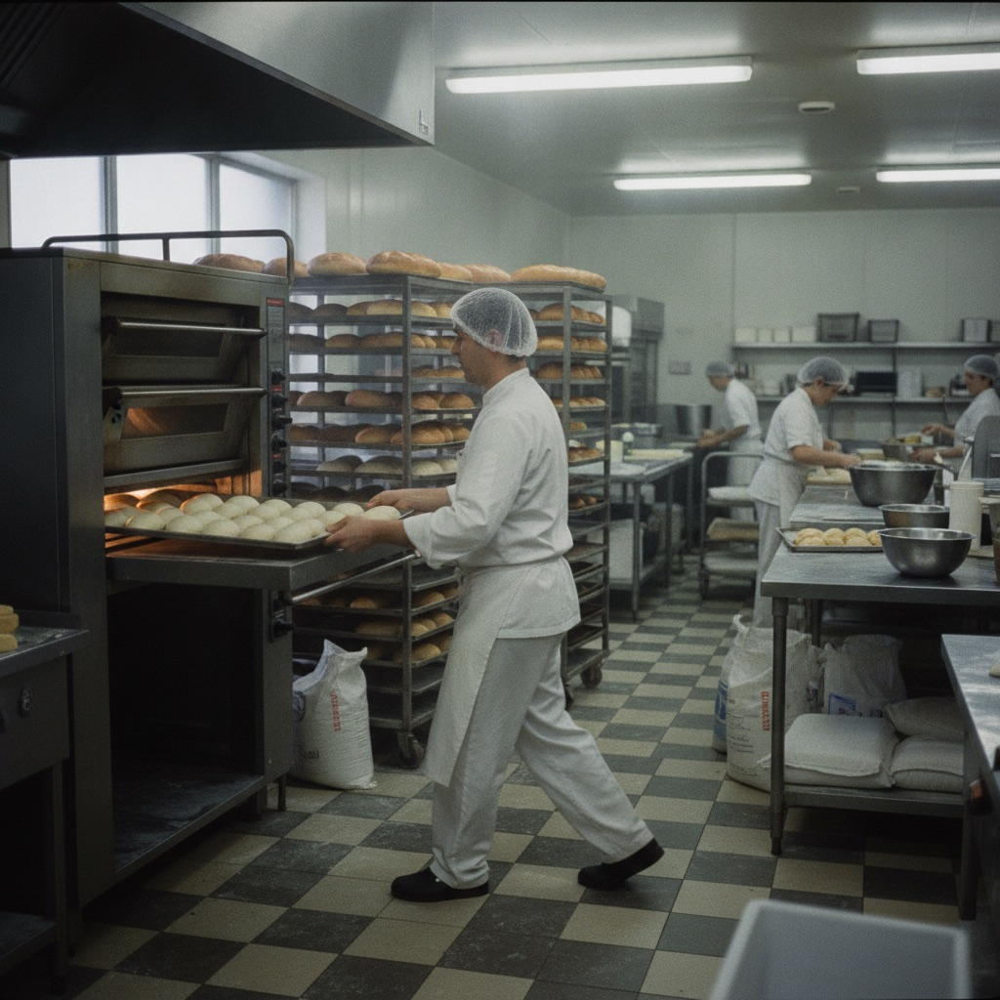

# TOEIC® Listening Practice Test 07

> 100 题 · Part 1（6）+ Part 2（25）+ Part 3（39）+ Part 4（30）· 约 45 分钟
> 音频为电脑合成（TTS），非真人录音。音频文件见 `audio/m7/`。

## PART 1 — Photographs（1–6）

For each question, you will listen to four short statements about a photograph. Select the statement that best describes what is happening in the picture.

### Q1

*照片内容*：In an open-plan office, a woman in a cardigan stands beside a large whiteboard covered with diagrams, holding a marker up as she draws an arrow between two boxes; seated colleagues watch from a nearby table.

音频：`audio/m7/p1-1.mp3`

- (A) She's erasing the whiteboard.
- (B) She's drawing a diagram on the whiteboard.
- (C) She's handing out printed reports.
- (D) She's plugging in a laptop.

**答案：B**

解析：The woman is drawing a diagram on the whiteboard with a marker, so (B) is correct. She is not erasing, handing out reports, or plugging in a laptop.

### Q2

*照片内容*：At a train station platform, a conductor in a navy uniform leans out of an open carriage door, raising one arm to signal the driver while passengers with bags wait along the edge of the platform.

音频：`audio/m7/p1-2.mp3`

- (A) The conductor is signalling with his arm.
- (B) The train is being washed at a depot.
- (C) Passengers are buying tickets from a machine.
- (D) A worker is sweeping the platform.

**答案：A**

解析：The conductor is raising his arm to signal, so (A) is correct. The train is not being washed, no one is buying tickets, and no one is sweeping.

### Q3

*照片内容*：Inside a busy commercial kitchen, a baker in a white coat and hairnet slides a tray of unbaked bread rolls into a large open oven, with racks of cooling loaves lined up behind him.

音频：`audio/m7/p1-3.mp3`

- (A) He's kneading dough on a table.
- (B) He's decorating a cake with frosting.
- (C) He's placing a tray into the oven.
- (D) He's washing baking trays in the sink.

**答案：C**

解析：The baker is sliding a tray of rolls into the oven, so (C) is correct. He is not kneading, decorating a cake, or washing trays.

### Q4

*照片内容*：On a suburban driveway, a young man in shorts crouches beside a bicycle turned upside down, using a small pump to inflate the front tire while a toolbox lies open on the pavement.

音频：`audio/m7/p1-4.mp3`

- (A) He's riding the bicycle down the street.
- (B) He's locking the bicycle to a rack.
- (C) He's washing the bicycle with a hose.
- (D) He's inflating a bicycle tire.

**答案：D**

解析：The man is pumping air into the bicycle tire, so (D) is correct. He is not riding, locking, or washing the bicycle.

### Q5

*照片内容*：In a fabric shop, a saleswoman unrolls a bolt of patterned cloth across a wide cutting table, smoothing it flat with both hands as shelves of colourful rolls rise behind her.

音频：`audio/m7/p1-5.mp3`

- (A) She's folding finished garments.
- (B) She's unrolling fabric on a table.
- (C) She's sewing a hem on a machine.
- (D) She's ringing up a sale at the till.

**答案：B**

解析：The saleswoman is unrolling fabric across the cutting table, so (B) is correct. She is not folding garments, sewing, or ringing up a sale.

### Q6

*照片内容*：At a beachfront boardwalk, a vendor hands an ice cream cone to a small child while a colourful cart with a striped umbrella stands beside them and gulls hover in the background.

音频：`audio/m7/p1-6.mp3`

- (A) The vendor is handing over an ice cream cone.
- (B) The vendor is folding up the umbrella.
- (C) The child is building a sandcastle.
- (D) A lifeguard is watching from a tower.

**答案：A**

解析：The vendor is handing an ice cream cone to the child, so (A) is correct. No sandcastle is being built, the umbrella is up, and no lifeguard is shown acting.

## PART 2 — Question-Response（7–31）

You will hear a question or statement followed by three responses. Select the best response to the question or statement.

### Q7

问句/陈述：Where do we store the spare projector bulbs?

音频：`audio/m7/p2-1.mp3`

- (A) Around a dozen of them.
- (B) In the cupboard behind reception.
- (C) Yes, they're brand new.

**答案：B**

解析：'Where' asks for a place, so 'In the cupboard behind reception' (B) is correct. (A) gives a quantity and (C) answers a yes/no question.

### Q8

问句/陈述：When will the sales figures be ready?

音频：`audio/m7/p2-2.mp3`

- (A) In the finance department.
- (B) First thing Monday morning.
- (C) About a ten percent rise.

**答案：B**

解析：'When' calls for a time, so 'First thing Monday morning' (B) is correct. (A) gives a place and (C) gives a figure.

### Q9

问句/陈述：Who ordered the extra chairs for the seminar?

音频：`audio/m7/p2-3.mp3`

- (A) The events coordinator did.
- (B) In the storage room.
- (C) About fifty of them.

**答案：A**

解析：'Who' asks for a person, so 'The events coordinator did' (A) is correct. (B) answers 'where' and (C) answers 'how many'.

### Q10

问句/陈述：Why is the parking lot blocked off today?

音频：`audio/m7/p2-4.mp3`

- (A) On the second level.
- (B) They're resurfacing the pavement.
- (C) Until about five o'clock.

**答案：B**

解析：'Why' asks for a reason, so 'They're resurfacing the pavement' (B) is correct. (A) gives a place and (C) gives a time.

### Q11

问句/陈述：How do I claim my travel expenses?

音频：`audio/m7/p2-5.mp3`

- (A) It was an expensive trip.
- (B) On the fifteenth of the month.
- (C) Submit your receipts to accounting.

**答案：C**

解析：'How' asks for a method, so 'Submit your receipts to accounting' (C) is correct. (A) echoes 'expense' and (B) gives a date.

### Q12

问句/陈述：Would you like a copy of the meeting agenda?

音频：`audio/m7/p2-6.mp3`

- (A) Yes, that would be helpful.
- (B) It's a long meeting.
- (C) In the conference room.

**答案：A**

解析：The offer is accepted with 'Yes, that would be helpful' (A). (B) comments on the meeting and (C) gives a place.

### Q13

问句/陈述：You've locked the storeroom, haven't you?

音频：`audio/m7/p2-7.mp3`

- (A) A lot of stock inside.
- (B) Near the back exit.
- (C) Yes, I locked it on my way out.

**答案：C**

解析：The tag question checks the locking, so 'Yes, I locked it on my way out' (C) is correct. (A) and (B) don't confirm it.

### Q14

问句/陈述：Can you show the new intern where the supplies are?

音频：`audio/m7/p2-8.mp3`

- (A) Sure, I'll take her now.
- (B) A fresh supply.
- (C) She started on Monday.

**答案：A**

解析：The request is met with agreement, so 'Sure, I'll take her now' (A) is correct. (B) and (C) reuse words without helping.

### Q15

问句/陈述：Do you want to fly economy or business class?

音频：`audio/m7/p2-9.mp3`

- (A) A long-haul flight.
- (B) Economy is fine for me.
- (C) At the check-in counter.

**答案：B**

解析：The choice question is answered by 'Economy is fine for me' (B). (A) describes the flight and (C) gives a place.

### Q16

问句/陈述：What time is the video call with the Berlin office?

音频：`audio/m7/p2-10.mp3`

- (A) On the tenth floor.
- (B) At three in the afternoon.
- (C) It's a large team.

**答案：B**

解析：'What time' asks for a time, so 'At three in the afternoon' (B) is correct. (A) gives a place and (C) describes the team.

### Q17

问句/陈述：How much would it cost to upgrade our internet plan?

音频：`audio/m7/p2-11.mp3`

- (A) It's quite fast already.
- (B) An extra twenty dollars a month.
- (C) In the server room.

**答案：B**

解析：'How much' asks for a price, so 'An extra twenty dollars a month' (B) is correct. (A) is a comment and (C) gives a place.

### Q18

问句/陈述：Isn't the quarterly newsletter going out today?

音频：`audio/m7/p2-12.mp3`

- (A) A well-written newsletter.
- (B) To all subscribers.
- (C) Actually, it's scheduled for Thursday.

**答案：C**

解析：The negative question checks the timing, so 'Actually, it's scheduled for Thursday' (C) is correct. (A) and (B) don't address the date.

### Q19

问句/陈述：Do you know whether the gym membership includes classes?

音频：`audio/m7/p2-13.mp3`

- (A) Yes, all classes are included.
- (B) It's a modern gym.
- (C) Just down the road.

**答案：A**

解析：The embedded yes/no question is answered by 'Yes, all classes are included' (A). (B) and (C) describe the gym instead.

### Q20

问句/陈述：Let's proofread the brochure once more before printing.

音频：`audio/m7/p2-14.mp3`

- (A) He printed a copy.
- (B) Good call, I'll read it again.
- (C) In the design folder.

**答案：B**

解析：The suggestion is accepted with 'Good call, I'll read it again' (B). (A) and (C) reuse words without responding.

### Q21

问句/陈述：Which courier delivered the package this morning?

音频：`audio/m7/p2-15.mp3`

- (A) We need more envelopes.
- (B) The one in the red van.
- (C) Yesterday afternoon.

**答案：B**

解析：'Which courier' asks you to identify one, so 'The one in the red van' (B) is correct. (A) is off-topic and (C) gives a time.

### Q22

问句/陈述：The lights in the meeting room won't turn on.

音频：`audio/m7/p2-16.mp3`

- (A) A bright room.
- (B) We're low on notepads.
- (C) Let me check the switch panel.

**答案：C**

解析：The problem invites a helpful response, so 'Let me check the switch panel' (C) is correct. (A) and (B) don't address the lights.

### Q23

问句/陈述：Has the caterer confirmed the menu yet?

音频：`audio/m7/p2-17.mp3`

- (A) No, they'll let us know tomorrow.
- (B) A tasty menu.
- (C) It serves eighty guests.

**答案：A**

解析：The yes/no question about the menu is answered by 'No, they'll let us know tomorrow' (A). (B) and (C) describe the menu instead.

### Q24

问句/陈述：Where should I hang the new floor plan?

音频：`audio/m7/p2-18.mp3`

- (A) It's very detailed.
- (B) About a meter wide.
- (C) On the wall by the elevator.

**答案：C**

解析：'Where' asks for a place, so 'On the wall by the elevator' (C) is correct. (A) is a comment and (B) gives a measurement.

### Q25

问句/陈述：The water cooler on this floor is empty, isn't it?

音频：`audio/m7/p2-19.mp3`

- (A) Yes, I'll order a refill.
- (B) In a couple of minutes.
- (C) A cold drink.

**答案：A**

解析：The tag question seeks agreement, so 'Yes, I'll order a refill' (A) is correct. (B) gives a time and (C) is unrelated.

### Q26

问句/陈述：Do you prefer the morning or the afternoon session?

音频：`audio/m7/p2-20.mp3`

- (A) It was very informative.
- (B) At the front desk.
- (C) The morning works better for me.

**答案：C**

解析：The choice question is answered by 'The morning works better for me' (C). (A) refers to a past event and (B) gives a place.

### Q27

问句/陈述：Why don't we invite the whole team to the workshop?

音频：`audio/m7/p2-21.mp3`

- (A) He teamed up with her.
- (B) A packed schedule.
- (C) That's a great idea.

**答案：C**

解析：'Why don't we' is a suggestion, so 'That's a great idea' (C) is correct. (A) reuses 'team' and (B) is a fragment.

### Q28

问句/陈述：How was the negotiation with the supplier?

音频：`audio/m7/p2-22.mp3`

- (A) We reached a fair deal.
- (B) By phone this time.
- (C) Next week, hopefully.

**答案：A**

解析：'How was it' asks for an evaluation, so 'We reached a fair deal' (A) is correct. (B) answers 'how' as method and (C) gives a future time.

### Q29

问句/陈述：Didn't we already schedule the maintenance visit?

音频：`audio/m7/p2-23.mp3`

- (A) The machine runs well.
- (B) I think it's still unconfirmed.
- (C) In the utility room.

**答案：B**

解析：The negative question is answered by 'I think it's still unconfirmed' (B). (A) is a comment and (C) gives a location.

### Q30

问句/陈述：Who's writing the minutes for today's meeting?

音频：`audio/m7/p2-24.mp3`

- (A) The assistant volunteered.
- (B) It ran a bit long.
- (C) Sometime after noon.

**答案：A**

解析：'Who' asks for a person, so 'The assistant volunteered' (A) is correct. (B) comments on the meeting and (C) gives a time.

### Q31

问句/陈述：I'd be happy to help you set up your new workstation.

音频：`audio/m7/p2-25.mp3`

- (A) It arrived yesterday.
- (B) She set the alarm.
- (C) That would be wonderful, thank you.

**答案：C**

解析：The friendly offer is accepted with 'That would be wonderful, thank you' (C). (A) is a comment and (B) reuses 'set' without answering.

## PART 3 — Conversations（32–70）

You will hear several conversations between two or more people. You will be asked to answer three questions about what the speakers say. Select the best response.

### Questions 32–34

音频：`audio/m7/p3-1.mp3`

**Copier models**：Model Speed Color Price X100 30 ppm Mono $900 X200 25 ppm Color $1,500 X300 45 ppm Color $1,900 X400 60 ppm Color $2,800

**录音原文：**

> W: Devon, we've been approved to buy a new copier for the print room. I've got the supplier's spec sheet here.
> M: Good. The main thing is it has to print in colour — the marketing team keeps asking for colour brochures.
> W: Agreed. And it needs to be fast; the old one crawls. I'd want at least forty pages a minute.
> M: And we've got a two-thousand-dollar ceiling. So: colour, at least forty a minute, and under two thousand.
> W: Only one model checks all three boxes, then. I'll put the order in.

**Q32.** What are the speakers buying?
- (A) A new copier
- (B) New computers
- (C) Office furniture
- (D) A home printer

答案：**A**　解析：They've been approved 'to buy a new copier for the print room.'

**Q33.** What does the man say is the most important feature?
- (A) Color printing
- (B) Low noise
- (C) A warranty
- (D) A small size

答案：**A**　解析：He says 'the main thing is it has to print in colour.'

**Q34.** Look at the graphic. Which model will they most likely order?
- (A) X100
- (B) X200
- (C) X300
- (D) X400

答案：**C**　解析：They need color, at least 40 ppm, and under $2,000. X100 is mono; X200 is only 25 ppm; X400 is $2,800. X300 (color, 45 ppm, $1,900) meets all three.

### Questions 35–37

音频：`audio/m7/p3-2.mp3`

**录音原文：**

> W: Hello, I'm calling about order five-oh-eight — a case of drinking glasses for our restaurant. When it arrived this morning, six of the twenty-four glasses were cracked.
> M: I'm so sorry to hear that. Let me pull up the order. It sounds like the box wasn't packed with enough padding for shipping.
> W: Possibly. Either way, I need six replacements — we open for a big booking on Saturday.
> M: Of course. I'll ship six new glasses today by express so they reach you Thursday, and there's no charge. Please keep the broken ones until the new box arrives, just for our records.
> W: That works. As long as they're here before Saturday, we'll be fine.

**Q35.** Why is the woman calling?
- (A) To place a new order
- (B) To cancel an order
- (C) To change an address
- (D) To report damaged items

答案：**D**　解析：She says 'six of the twenty-four glasses were cracked.'

**Q36.** What does the man think caused the problem?
- (A) The wrong item was sent
- (B) The delivery was late
- (C) The box lacked enough padding
- (D) The order was duplicated

答案：**C**　解析：He says 'the box wasn't packed with enough padding for shipping.'

**Q37.** What does the woman imply when she says, "As long as they're here before Saturday, we'll be fine"?
- (A) She will accept the replacements if they arrive in time
- (B) She wants a full refund instead
- (C) She thinks Thursday is too late
- (D) She plans to cancel the order

答案：**A**　解析：She accepts the replacements on the condition that they arrive before her Saturday booking.

### Questions 38–40

音频：`audio/m7/p3-3.mp3`

**录音原文：**

> M: Good afternoon. I've got a car booked to collect me from the airport this Friday at three, but my flight's been moved, so I'll now land at eleven in the morning.
> W: No problem, let me update that. I've changed your pickup to eleven-fifteen to allow time for baggage. The fare stays the same.
> M: Thank you. One more thing — could the driver stop at my hotel first, then take me on to the conference centre?
> W: Certainly. I'll add the hotel as a first stop and note it for the driver. There's a small charge for the extra stop, is that alright?
> M: That's fine. I'll look out for the driver at arrivals, then.

**Q38.** What does the man want to change?
- (A) The pickup time
- (B) The drop-off city
- (C) The type of car
- (D) The payment method

答案：**A**　解析：His flight moved, so he needs the pickup changed from three to the morning.

**Q39.** What extra request does the man make?
- (A) A larger vehicle
- (B) An earlier driver
- (C) A child seat
- (D) A stop at his hotel first

答案：**D**　解析：He asks the driver to 'stop at my hotel first, then take me on to the conference centre.'

**Q40.** What does the woman say about the extra stop?
- (A) It is not allowed
- (B) There is a small charge for it
- (C) It will delay the trip by an hour
- (D) The driver must approve it

答案：**B**　解析：She says 'there's a small charge for the extra stop.'

### Questions 41–43

音频：`audio/m7/p3-4.mp3`

**录音原文：**

> M: Thanks for gathering. The new catalogue shoot is in two weeks, and I want everything nailed down today. Freya, how's the shot list looking?
> W: It's nearly final — forty products across three sets. I just need the new packaging samples from Ronan's team before I can lock the styling.
> M: Ronan, when will those samples be ready?
> M2: Monday at the latest. But I'll be honest — forty products in a single day is a stretch. I'd rather split it over two days than rush and end up with flat, careless photos.
> M: Fair enough. Freya, can we book the studio for two days?
> W: Yes, and honestly the extra time will make the shots much stronger.

**Q41.** What are the speakers planning?
- (A) A product catalogue photo shoot
- (B) A store opening
- (C) A press conference
- (D) A packaging redesign

答案：**A**　解析：The man says 'the new catalogue shoot is in two weeks.'

**Q42.** What does Freya still need?
- (A) A larger studio
- (B) The new packaging samples
- (C) A photographer
- (D) Client approval

答案：**B**　解析：She says she 'just need[s] the new packaging samples from Ronan's team.'

**Q43.** What does Ronan mean when he says he'd "rather split it over two days"?
- (A) He thinks doing forty products in one day would hurt the quality
- (B) He wants to cancel the shoot
- (C) He needs more products
- (D) He cannot attend on the first day

答案：**A**　解析：He worries forty products in one day would produce 'flat, careless photos,' so he wants more time.

### Questions 44–46

音频：`audio/m7/p3-5.mp3`

**录音原文：**

> W: Thanks for coming so quickly. The walk-in refrigerator in the kitchen isn't holding temperature — it's been climbing since last night, and I'm worried about the stock.
> M: Let me check it out. Right, the thermostat has failed, so the compressor isn't kicking in when it should. That's why it's warming up.
> W: Can you fix it today? We've got a fully booked dinner service tonight.
> M: I can — I carry that thermostat on the van, so it's about a ninety-minute job. In the meantime, I'd move anything perishable into your backup fridge so nothing spoils.
> W: Good idea. I'll get the kitchen team to shift the fresh stock over right now.

**Q44.** What problem are the speakers discussing?
- (A) An oven that won't heat
- (B) A power outage
- (C) A blocked sink
- (D) A walk-in refrigerator not cooling

答案：**D**　解析：'The walk-in refrigerator in the kitchen isn't holding temperature.'

**Q45.** What does the man say caused the problem?
- (A) A failed thermostat
- (B) A broken door seal
- (C) A refrigerant leak
- (D) A tripped breaker

答案：**A**　解析：He says 'the thermostat has failed, so the compressor isn't kicking in.'

**Q46.** What will the woman do in the meantime?
- (A) Cancel the dinner service
- (B) Move perishable stock to a backup fridge
- (C) Order a new refrigerator
- (D) Turn off the kitchen

答案：**B**　解析：She'll have the kitchen team 'shift the fresh stock over' to the backup fridge.

### Questions 47–49

音频：`audio/m7/p3-6.mp3`

**录音原文：**

> W: Trevor, I wanted to ask about getting a standing desk. I've been having a lot of back pain from sitting all day, and my physiotherapist suggested I try standing more.
> M: I'm sorry to hear about the back pain. We've actually got a small budget for ergonomic equipment, so that shouldn't be a problem.
> W: That's a relief. I don't need anything fancy — just one I can raise and lower during the day.
> M: That's exactly what the adjustable ones do. I'll have facilities order one this week. If it helps, we can look at proper chairs for the rest of the team too.
> W: Thank you. I really think it'll make a difference.

**Q47.** What is the woman requesting?
- (A) A pay raise
- (B) A standing desk
- (C) Time off work
- (D) A new office

答案：**B**　解析：She asks 'about getting a standing desk.'

**Q48.** Why does the woman want it?
- (A) To have more space
- (B) Because of back pain from sitting
- (C) To store more files
- (D) To be near a window

答案：**B**　解析：She says she's had 'a lot of back pain from sitting all day.'

**Q49.** What does the man imply about the request?
- (A) It will be difficult to approve
- (B) There is budget available for it
- (C) She must pay for it herself
- (D) It is against policy

答案：**B**　解析：He says there's 'a small budget for ergonomic equipment, so that shouldn't be a problem.'

### Questions 50–52

音频：`audio/m7/p3-7.mp3`

**录音原文：**

> M: Hi, I left my bike in for a service last week — the name's Kavanagh. The gears were slipping something awful. Is it ready?
> W: Let me find your ticket. Here we are. Good news — it wasn't the gears themselves; a cable had just stretched and needed adjusting. So it came in well under the estimate.
> M: Oh, that's a relief. I was bracing myself for a whole new gear set.
> W: Not at all. It's tuned up and we test-rode it this morning — shifts perfectly now. The total's forty dollars instead of the hundred and twenty we quoted.
> M: Brilliant. I'll take it now, thanks a million.

**Q50.** Why is the man at the shop?
- (A) To buy a new bike
- (B) To return a purchase
- (C) To pick up a serviced bike
- (D) To ask about a warranty

答案：**C**　解析：He left his bike 'in for a service' and asks if it's ready.

**Q51.** What was actually wrong with the bike?
- (A) The gears were broken
- (B) The wheel was bent
- (C) A cable had stretched
- (D) The brakes had failed

答案：**C**　解析：The associate says 'a cable had just stretched and needed adjusting.'

**Q52.** What does the woman say about the cost?
- (A) It is higher than the estimate
- (B) It has not been calculated
- (C) It is covered by warranty
- (D) It is lower than the estimate

答案：**D**　解析：The total is 'forty dollars instead of the hundred and twenty we quoted.'

### Questions 53–55

音频：`audio/m7/p3-8.mp3`

**Internet plans**：Plan Speed Price Basic 100 Mbps $80 Plus 300 Mbps $130 Pro 500 Mbps $180 Ultra 1000 Mbps $300

**录音原文：**

> M: Nadia, we need to upgrade the office internet. The video calls keep freezing on our current connection.
> W: I've got the provider's plans here. What speed do we actually need?
> M: For smooth video calls with the whole team, the provider recommended at least five hundred megabits per second.
> W: Okay, and finance capped the monthly cost at two hundred dollars.
> M: Right. So we need at least five hundred megabits and it has to stay under two hundred a month. Let's take the plan that fits.

**Q53.** Why do the speakers want to upgrade the internet?
- (A) Because video calls keep freezing
- (B) To save money
- (C) To add more phone lines
- (D) To get a discount

答案：**A**　解析：The man says 'the video calls keep freezing on our current connection.'

**Q54.** What is the monthly budget limit?
- (A) $80
- (B) $130
- (C) $200
- (D) $300

答案：**C**　解析：The woman says 'finance capped the monthly cost at two hundred dollars.'

**Q55.** Look at the graphic. Which plan will they most likely choose?
- (A) Basic
- (B) Plus
- (C) Pro
- (D) Ultra

答案：**C**　解析：They need at least 500 Mbps and under $200/month. Basic and Plus are too slow; Ultra is $300; Pro (500 Mbps, $180) fits both.

### Questions 56–58

音频：`audio/m7/p3-9.mp3`

**录音原文：**

> W: Right, the team offsite is six weeks out, and I wanted the three of us to settle the details. Callum, did you look into venues?
> M: I did. There's a lakeside lodge that's gorgeous but a two-hour drive, and a conference hotel just twenty minutes from the office.
> W2: The lodge looks stunning, but two hours each way eats into a one-day event. With the hotel, we'd get far more actual time together.
> W: That's a good point. Callum, does the hotel have a room big enough for a workshop and breakout spaces?
> M: It does — a main room plus two smaller rooms, which is exactly what we need.
> W: Then let's book the hotel. I'll reserve it this week before the date's taken.

**Q56.** What are the speakers planning?
- (A) A team offsite
- (B) A client dinner
- (C) A product launch
- (D) A hiring event

答案：**A**　解析：The woman refers to 'the team offsite' six weeks out.

**Q57.** Why do they choose the hotel over the lodge?
- (A) It is cheaper
- (B) It is much closer, leaving more time for the event
- (C) It has better food
- (D) It is by a lake

答案：**B**　解析：The colleague notes the lodge's two-hour drive 'eats into a one-day event,' while the hotel gives 'more actual time together.'

**Q58.** What does Callum confirm about the hotel?
- (A) It has a pool
- (B) It is fully booked
- (C) It offers free parking
- (D) It has a main room plus breakout rooms

答案：**D**　解析：He says it has 'a main room plus two smaller rooms.'

### Questions 59–61

音频：`audio/m7/p3-10.mp3`

**录音原文：**

> M: Hi, I'm working from home today and I can't connect to the company VPN. It just spins and then times out every time.
> W: Let me check your account. Ah — we updated the VPN software last night, and your laptop is still running the old version, which the server no longer accepts.
> M: That would explain it. I've got files on the internal server I need for a report this afternoon.
> W: No problem. I'll push the update to your laptop remotely now. Once it installs, restart the machine and the VPN should connect straight away. Give it about ten minutes.
> M: Great, I'll restart once you give me the go-ahead.

**Q59.** What problem is the man experiencing?
- (A) His laptop won't turn on
- (B) His email is full
- (C) He cannot connect to the VPN
- (D) His files were deleted

答案：**C**　解析：He 'can't connect to the company VPN.'

**Q60.** What does the woman say caused the problem?
- (A) A weak home connection
- (B) A server outage
- (C) A forgotten password
- (D) His VPN software is out of date

答案：**D**　解析：She says his laptop 'is still running the old version, which the server no longer accepts.'

**Q61.** What does the woman tell the man to do?
- (A) Buy a new laptop
- (B) Reset his password
- (C) Restart his laptop after the update installs
- (D) Come into the office

答案：**C**　解析：She says once the update installs, 'restart the machine.'

### Questions 62–64

音频：`audio/m7/p3-11.mp3`

**录音原文：**

> W: I've been going over last quarter's lead numbers, and the webinars brought in nearly three times as many qualified leads as the trade shows — and cost a fraction as much.
> M: I'm not surprised. A trade show ties you to one city on one day, but anyone in the world can join a webinar from their desk.
> W: Exactly. So for next year I'm thinking we run more webinars and cut back to just one or two big trade shows. Your take?
> M: I'm all for it. I'd run a monthly webinar series on the topics customers ask about most. I can map out the first quarter's topics by next week.
> W: Perfect — send them over and I'll get the team's input.

**Q62.** What is the conversation mainly about?
- (A) Whether to focus on webinars or trade shows
- (B) Hiring an events coordinator
- (C) Redesigning the booth
- (D) Cutting the travel budget

答案：**A**　解析：They discuss running more webinars and cutting back on trade shows for next year.

**Q63.** Why does the man think webinars generate more leads?
- (A) They are cheaper to produce
- (B) They target older customers
- (C) They are shorter
- (D) Anyone can join from anywhere, not just one city

答案：**D**　解析：He says a trade show 'ties you to one city on one day,' but anyone can join a webinar from their desk.

**Q64.** What does the man say he will do?
- (A) Book two trade shows
- (B) Map out topics for a webinar series
- (C) Hire a new specialist
- (D) Cancel all events

答案：**B**　解析：He offers to 'map out the first quarter's topics by next week.'

### Questions 65–67

音频：`audio/m7/p3-12.mp3`

**录音原文：**

> M: Excuse me — I just joined last week. I drive an electric car, and someone said the office has charging points in the car park. Is that right?
> W: Yes, there are six charging bays by the north wall. You register your car on the staff app and it lets you book a two-hour slot.
> M: That's handy. Do I just turn up and plug in, or do I need to book ahead?
> W: You really do need to book — there are only six points and a lot of electric cars now, so they're usually fully reserved by mid-morning.
> M: Good to know. I'll register today and book a morning slot.

**Q65.** What is the man asking about?
- (A) A parking permit
- (B) A carpool scheme
- (C) Electric-car charging points
- (D) Bus routes

答案：**C**　解析：He asks whether 'the office has charging points in the car park.'

**Q66.** How does the man reserve a charging slot?
- (A) By emailing reception
- (B) By asking his manager
- (C) By paying at the gate
- (D) By booking a slot on the staff app

答案：**D**　解析：She says you 'register your car on the staff app and it lets you book a two-hour slot.'

**Q67.** Why does the woman say the man should book ahead?
- (A) The chargers are often broken
- (B) The bays fill up because demand is high
- (C) The app is slow
- (D) The car park is far away

答案：**B**　解析：She warns the bays are 'usually fully reserved by mid-morning.'

### Questions 68–70

音频：`audio/m7/p3-13.mp3`

**录音原文：**

> W: Welcome aboard, both of you. This morning I'll cover our guest-service standards, and this afternoon you'll shadow a supervisor on shift. Leo, you're joining the front desk, correct?
> M: That's right. I'm a little nervous about the booking system — I've never used this reservation software before.
> W: Don't worry, that's exactly what this morning covers. By lunch you'll be comfortable checking guests in and handling reservations. Owen, you're in the restaurant, so you'll use the same system but focus on table bookings and billing.
> M2: Got it. Will we get our staff key cards today, or does that come later?
> W: You'll each get a temporary card before lunch, and security will program your permanent ones this afternoon. Any questions before we start? No? Let's begin.

**Q68.** What is mainly happening in the conversation?
- (A) A job interview
- (B) A guest complaint
- (C) An orientation for new employees
- (D) A hotel inspection

答案：**C**　解析：The trainer welcomes two new hires and outlines guest-service training and shadowing.

**Q69.** What is Leo nervous about?
- (A) Meeting guests
- (B) Using the reservation software
- (C) Finding the hotel
- (D) The length of his shift

答案：**B**　解析：He says he's 'never used this reservation software before.'

**Q70.** When will the new hires get their permanent key cards?
- (A) Before lunch
- (B) At the end of the week
- (C) The next morning
- (D) In the afternoon

答案：**D**　解析：They get a temporary card before lunch; security programs the permanent ones 'this afternoon.'

## PART 4 — Talks（71–100）

You will hear several talks given by a single speaker. You will be asked to answer three questions about what the speaker says. Select the best response.

### Questions 71–73 · Announcement

音频：`audio/m7/p4-1.mp3`

**Morning workshops**：Workshop Room Public Speaking Room 101 Data Basics Room 102 Team Leadership Room 103 Time Management Room 104

**录音原文：**

> Good morning, delegates, and welcome to day one of the Crossroads Professional Conference. A quick note before the morning sessions begin. The projector in the room assigned to our Team Leadership workshop has failed overnight, and our technicians can't fix it in time. So that session will move next door, into the room currently listed for the Time Management workshop. In turn, Time Management will take over the Team Leadership room, which does not require a projector. The other two workshops are unaffected. Please double-check the digital sign outside each door before you go in, and grab a coffee from the lobby on your way. Enjoy the conference.

**Q71.** What is the main purpose of the announcement?
- (A) To announce a room change for a workshop
- (B) To cancel the conference
- (C) To introduce a keynote speaker
- (D) To hand out awards

答案：**A**　解析：A projector failure means the Team Leadership session 'will move next door.'

**Q72.** Why is the change necessary?
- (A) A speaker is ill
- (B) The room is too small
- (C) A pipe burst
- (D) A projector has failed

答案：**D**　解析：'The projector in the room assigned to our Team Leadership workshop has failed overnight.'

**Q73.** Look at the graphic. Which room will the Team Leadership workshop now use?
- (A) Room 101
- (B) Room 102
- (C) Room 103
- (D) Room 104

答案：**D**　解析：It moves into the room listed for Time Management, which the board shows as Room 104.

### Questions 74–76 · Voicemail

音频：`audio/m7/p4-2.mp3`

**录音原文：**

> Hi, this is Dana calling from Fairway Auto Service about your silver sedan. Good news and a bit of not-so-good news. The brake pads you asked us to replace are done, and the car's running smoothly. However, while we had it up on the lift, our mechanic noticed that one of your front tires is worn right down to the tread markers, which really isn't safe for the highway. We'd recommend replacing it before you drive far. We have a matching tire in stock and could fit it this afternoon for about ninety dollars. Give us a ring back if you'd like us to go ahead. Otherwise, your car's ready for pickup anytime after four.

**Q74.** Why is the speaker calling?
- (A) To report on a car repair
- (B) To sell a new vehicle
- (C) To schedule an inspection
- (D) To confirm an insurance claim

答案：**A**　解析：Dana calls 'from Fairway Auto Service' about the customer's sedan and its repair.

**Q75.** What problem did the mechanic discover?
- (A) A cracked windshield
- (B) A worn front tire
- (C) A dead battery
- (D) An oil leak

答案：**B**　解析：'One of your front tires is worn right down to the tread markers.'

**Q76.** What does the speaker ask the customer to do?
- (A) Bring the car back next week
- (B) Call back to approve the extra work
- (C) Pay online
- (D) Pick up the car before four

答案：**B**　解析：'Give us a ring back if you'd like us to go ahead' with the new tire.

### Questions 77–79 · Advertisement

音频：`audio/m7/p4-3.mp3`

**录音原文：**

> Too busy to plan dinner? Let Harvest Box take the stress out of cooking. Every week we deliver a chilled box of fresh, pre-measured ingredients and easy recipe cards straight to your door — no more last-minute trips to the shop. Each meal takes just thirty minutes to prepare, and our menu changes weekly, with vegetarian and gluten-free options always available. Sign up this week using the code FRESH and your first two boxes ship completely free. You can pause or skip any week with a single tap in our app, so it fits around your life, not the other way around. Visit harvestbox dot com and taste the difference tonight.

**Q77.** What service is being advertised?
- (A) A restaurant reservation app
- (B) A cooking class
- (C) A grocery delivery of ingredients and recipes
- (D) A farm tour

答案：**C**　解析：Harvest Box delivers 'fresh, pre-measured ingredients and easy recipe cards.'

**Q78.** What does the code FRESH give new customers?
- (A) A free cookbook
- (B) A discount on the app
- (C) An extra meal each week
- (D) Their first two boxes free

答案：**D**　解析：'Sign up this week using the code FRESH and your first two boxes ship completely free.'

**Q79.** According to the ad, what can customers do through the app?
- (A) Order takeout
- (B) Pause or skip any week
- (C) Call a chef
- (D) Rate local farms

答案：**B**　解析：'You can pause or skip any week with a single tap in our app.'

### Questions 80–82 · Excerpt from a meeting

音频：`audio/m7/p4-4.mp3`

**录音原文：**

> Right, before everyone rushes off, I've got an update on our leave policy that I think you'll like. Starting in April, we're adding two extra days of paid leave a year that you can use purely for your wellbeing — no doctor's note, no explanation needed. We're calling them recharge days. The idea came straight from your responses to last year's staff survey, where so many of you said you wanted more flexibility. To book one, just mark it in the shared calendar at least a day ahead so your team knows you'll be out. Managers, please make sure your people actually feel free to use them. That's all — thanks, everyone.

**Q80.** What is the announcement mainly about?
- (A) A new type of paid leave
- (B) A change in office hours
- (C) A salary increase
- (D) A new health insurance plan

答案：**A**　解析：The company is 'adding two extra days of paid leave a year' called recharge days.

**Q81.** Where did the idea for the change come from?
- (A) A manager's proposal
- (B) A government rule
- (C) Last year's staff survey
- (D) A competitor's policy

答案：**C**　解析：'The idea came straight from your responses to last year's staff survey.'

**Q82.** What must employees do to book a recharge day?
- (A) Submit a doctor's note
- (B) Mark it in the shared calendar a day ahead
- (C) Email human resources
- (D) Get written approval

答案：**B**　解析：'Just mark it in the shared calendar at least a day ahead so your team knows.'

### Questions 83–85 · Radio broadcast

音频：`audio/m7/p4-5.mp3`

**录音原文：**

> You're listening to the midday bulletin. Our top local story: the Maple Street Bridge, closed for repairs since early spring, will finally reopen to traffic tomorrow morning. City engineers say the eight-month project has replaced the ageing steel supports and added a wide new lane for cyclists and pedestrians. Drivers who've endured the lengthy detour around the industrial park will be relieved, though officials warn that speed limits on the bridge will remain reduced for the first two weeks while final line-painting is completed. A small ceremony with the mayor is planned for eight o'clock. We'll bring you live coverage. After the break, we turn to this weekend's forecast.

**Q83.** What is the main news story?
- (A) A road accident
- (B) A new industrial park
- (C) A cycling competition
- (D) A bridge reopening after repairs

答案：**D**　解析：'The Maple Street Bridge... will finally reopen to traffic tomorrow morning.'

**Q84.** What has been added to the bridge?
- (A) A toll booth
- (B) A second level
- (C) A wide lane for cyclists and pedestrians
- (D) A rail line

答案：**C**　解析：The project 'added a wide new lane for cyclists and pedestrians.'

**Q85.** What do officials warn drivers about?
- (A) Reduced speed limits for the first two weeks
- (B) A weight restriction
- (C) Frequent closures
- (D) A new toll charge

答案：**A**　解析：'Speed limits on the bridge will remain reduced for the first two weeks.'

### Questions 86–88 · Tour information

音频：`audio/m7/p4-6.mp3`

**录音原文：**

> Good afternoon, and thank you for joining today's tour of the Merryweather, one of the last wooden sailing ships of her kind still afloat. A few points before we climb aboard. The deck can be uneven and the doorways below are low, so please mind your head and hold the handrails on the ladders. We'll begin on the upper deck, move down to the captain's quarters, and end in the cargo hold, where a short film explains the ship's trading history. I'm afraid the crow's nest at the top of the mast is not open to visitors for safety reasons. Once we finish, the gift shop on the pier stocks model kits of the very ship you're standing on.

**Q86.** What are the listeners touring?
- (A) A historic sailing ship
- (B) A naval museum
- (C) A shipbuilding factory
- (D) A lighthouse

答案：**A**　解析：The tour is of 'the Merryweather, one of the last wooden sailing ships... still afloat.'

**Q87.** What are the listeners asked to be careful about?
- (A) Loud noises
- (B) Wet paint
- (C) Slippery grass
- (D) Low doorways and uneven decks

答案：**D**　解析：'The deck can be uneven and the doorways below are low, so please mind your head.'

**Q88.** What part of the ship is closed to visitors?
- (A) The captain's quarters
- (B) The cargo hold
- (C) The crow's nest
- (D) The upper deck

答案：**C**　解析：'The crow's nest at the top of the mast is not open to visitors for safety reasons.'

### Questions 89–91 · Telephone message

音频：`audio/m7/p4-7.mp3`

**录音原文：**

> Hi Marcus, it's Yuki from the software vendor, Bright Ledger. I'm calling to confirm the details for your team's system upgrade this weekend. We'll begin the migration on Saturday at ten in the evening, once your staff have logged off, and everything should be back up by Sunday afternoon. During that window, no one will be able to access the accounting platform, so please remind your finance team to save any open work before Friday close. One thing I need from you: could you send me the list of user email addresses by Thursday so we can set up their new logins? Call me back if anything's unclear. Thanks, Marcus.

**Q89.** What is the purpose of the call?
- (A) To confirm details of a system upgrade
- (B) To sell new software
- (C) To report a billing error
- (D) To cancel a subscription

答案：**A**　解析：Yuki calls 'to confirm the details for your team's system upgrade this weekend.'

**Q90.** What does the speaker say will happen during the upgrade window?
- (A) The office will close
- (B) The accounting platform will be inaccessible
- (C) New staff will be hired
- (D) Prices will change

答案：**B**　解析：'No one will be able to access the accounting platform' during the migration.

**Q91.** What does the speaker need from Marcus by Thursday?
- (A) A signed contract
- (B) A payment
- (C) A list of user email addresses
- (D) A meeting room

答案：**C**　解析：'Could you send me the list of user email addresses by Thursday.'

### Questions 92–94 · Speech

音频：`audio/m7/p4-8.mp3`

**录音原文：**

> Thank you, and what an honour it is to stand here tonight. When our little bakery accepted this Small Business of the Year award, I couldn't help thinking back to our first morning, when we sold exactly three loaves of bread and gave the rest away. None of this would have happened without our regular customers, who told their neighbours about us, and without a team that shows up before sunrise every single day to knead dough by hand. This trophy really belongs to all of them. To celebrate, tomorrow every coffee at our shop is on the house. Thank you again to the chamber of commerce for this recognition. It means the world to us.

**Q92.** Why is the speaker giving this speech?
- (A) To open a new bakery
- (B) To announce a closure
- (C) To launch a product
- (D) To accept a business award

答案：**D**　解析：'Our little bakery accepted this Small Business of the Year award.'

**Q93.** What does the speaker say about the early days of the business?
- (A) It was an instant success
- (B) They opened several shops
- (C) They had many investors
- (D) They sold only three loaves the first morning

答案：**D**　解析：'Our first morning, when we sold exactly three loaves of bread and gave the rest away.'

**Q94.** How does the speaker plan to celebrate?
- (A) By giving free coffee the next day
- (B) By closing early
- (C) By hiring more staff
- (D) By holding a sale

答案：**A**　解析：'Tomorrow every coffee at our shop is on the house.'

### Questions 95–97 · Instructions

音频：`audio/m7/p4-9.mp3`

**录音原文：**

> Attention, all staff, this is a scheduled fire drill. Please stop what you're doing and prepare to leave the building calmly. Do not use the elevators; take the nearest marked stairwell instead. As you exit, floor wardens in orange vests will direct you to the assembly point, which today is the far side of the staff car park, not the usual front lawn, because of the resurfacing work out front. Once you arrive, find your department's marker and wait for your name to be checked off the list. Please do not re-enter the building until a warden gives the all-clear. Remember, moving quickly is good, but moving safely is what matters most.

**Q95.** What is happening?
- (A) A scheduled fire drill
- (B) A power outage
- (C) A building inspection
- (D) A staff meeting

答案：**A**　解析：'This is a scheduled fire drill,' and staff are told to leave the building.

**Q96.** Why is the assembly point different today?
- (A) Rain is expected
- (B) Resurfacing work is being done out front
- (C) The car park is closed
- (D) A delivery is arriving

答案：**B**　解析：The point is the car park, not the front lawn, 'because of the resurfacing work out front.'

**Q97.** What are staff told to do once they reach the assembly point?
- (A) Return to their desks
- (B) Call their manager
- (C) Find their department's marker and wait to be checked off
- (D) Sign a new form

答案：**C**　解析：'Find your department's marker and wait for your name to be checked off the list.'

### Questions 98–100 · Announcement

音频：`audio/m7/p4-10.mp3`

**Tonight's award order**：Award Slot Newcomer of the Year First Best Design Second Community Choice Third Lifetime Achievement Fourth

**录音原文：**

> Ladies and gentlemen, welcome to the annual Craft Guild Awards. One small adjustment to tonight's running order before we begin. The presenter for our Best Design award has been caught in traffic and won't arrive for another twenty minutes or so. Rather than hold everything up, we'll go ahead and present the Community Choice award in that second slot instead, and we'll bring Best Design back once its presenter is here. So, to be clear, the award you'll see presented second tonight is Community Choice. Everything else runs as printed in your programme. Please take your seats, silence your phones, and let's get this celebration under way.

**Q98.** What event is taking place?
- (A) A graduation
- (B) A product launch
- (C) A charity auction
- (D) An awards ceremony

答案：**D**　解析：The speaker welcomes guests to 'the annual Craft Guild Awards.'

**Q99.** Why is the order being changed?
- (A) A winner declined
- (B) A presenter is stuck in traffic
- (C) A category was removed
- (D) The venue changed

答案：**B**　解析：'The presenter for our Best Design award has been caught in traffic.'

**Q100.** Look at the graphic. Which award will now be presented second?
- (A) Newcomer of the Year
- (B) Best Design
- (C) Community Choice
- (D) Lifetime Achievement

答案：**C**　解析：Community Choice takes the second slot in place of Best Design.

---

题目来源：toeicmocktests.com（公开免费练习材料）。TOEIC® / ETS® 为 ETS 注册商标，本项目与 ETS 无关联。仅供个人学习使用。
