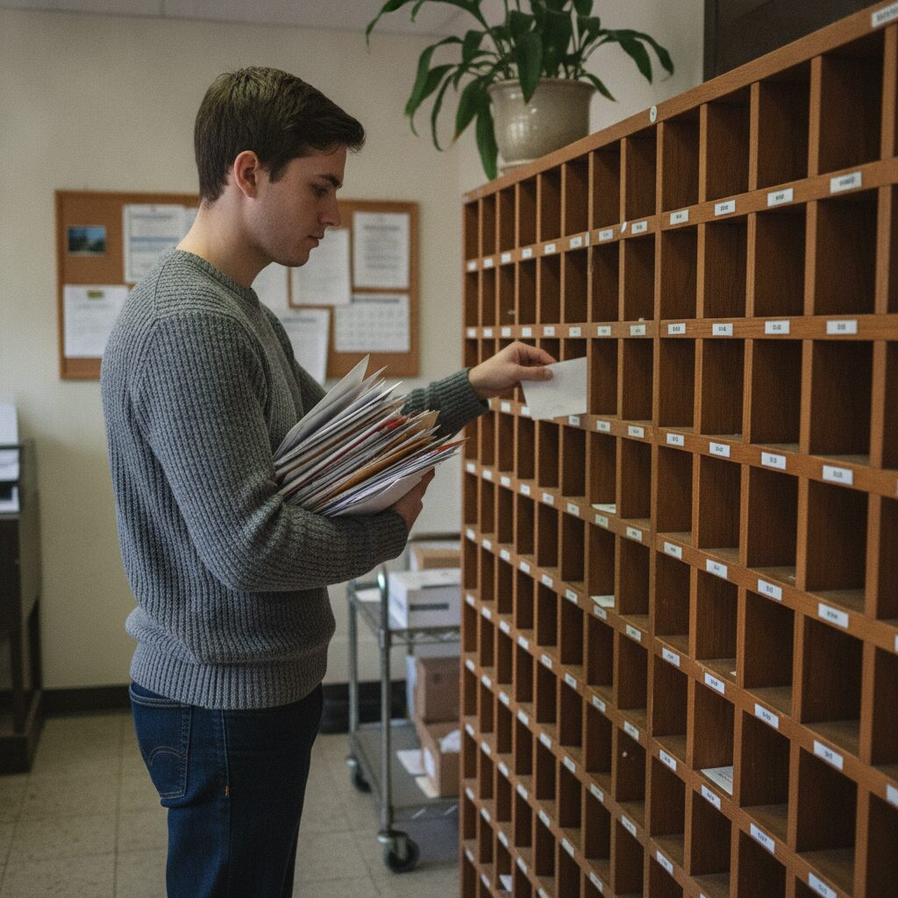
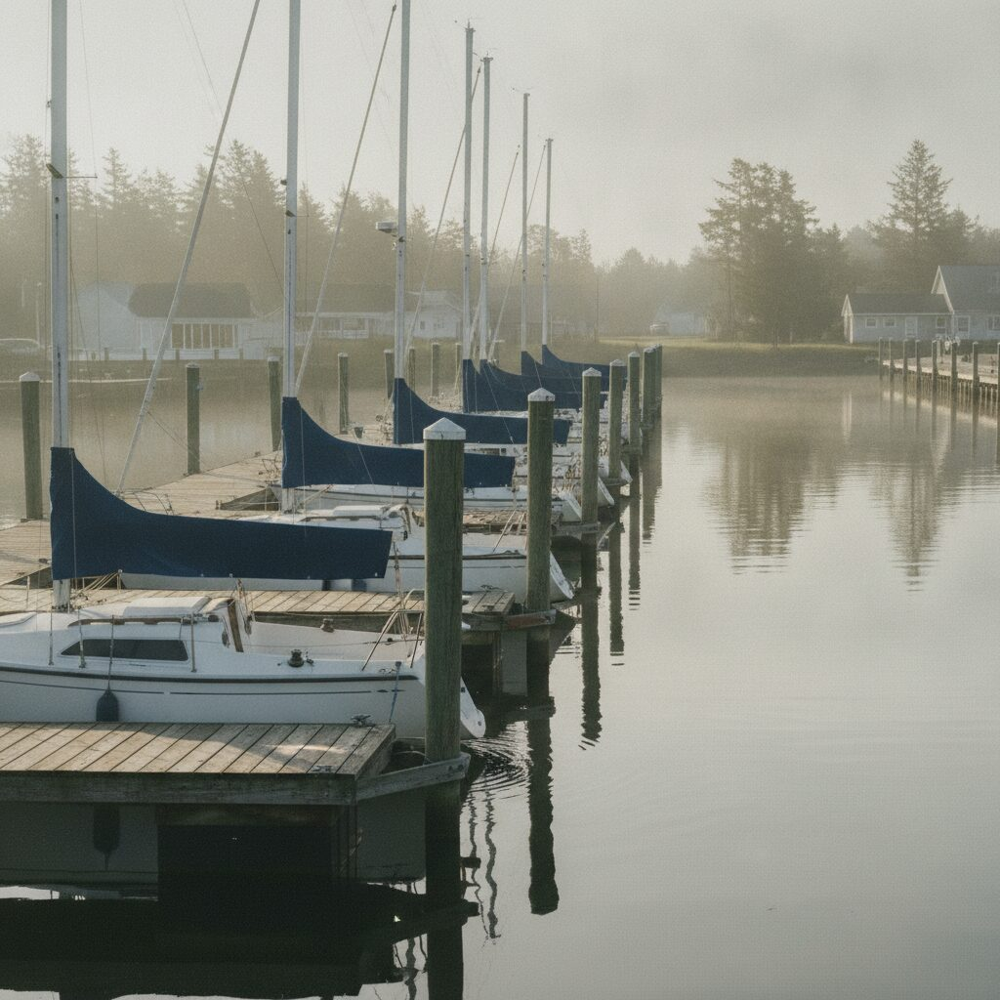
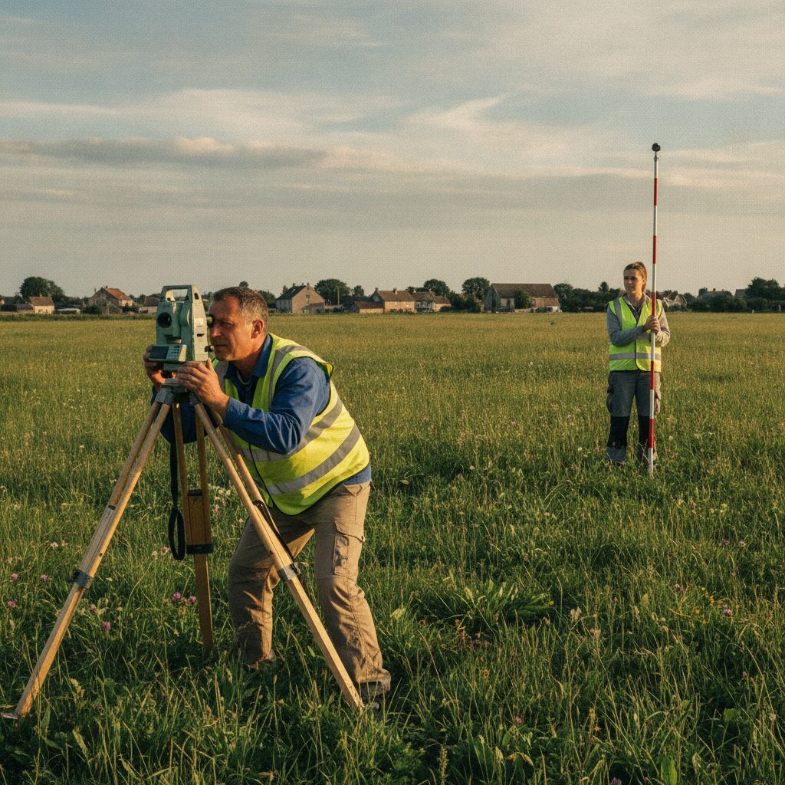

# TOEIC® Listening Practice Test 09

> 100 题 · Part 1（6）+ Part 2（25）+ Part 3（39）+ Part 4（30）· 约 45 分钟
> 音频为电脑合成（TTS），非真人录音。音频文件见 `audio/m9/`。

## PART 1 — Photographs（1–6）

For each question, you will listen to four short statements about a photograph. Select the statement that best describes what is happening in the picture.

### Q1

*照片内容*：In a small company mailroom, a young man in a gray sweater stands facing a wall of wooden pigeonhole slots, sliding envelopes one by one into the labeled compartments while holding a stack of letters in his other hand.

音频：`audio/m9/p1-1.mp3`

- (A) He's sealing an envelope at a desk.
- (B) He's placing mail into compartments.
- (C) He's weighing a parcel on a scale.
- (D) He's pushing a cart down a hallway.

**答案：B**

解析：The man is sliding envelopes into the labeled slots on the wall, so (B) is correct. He is standing at the slots, not sealing envelopes at a desk (A), weighing a parcel (C), or pushing a cart (D).

### Q2

*照片内容*：At a quiet marina early in the morning, a row of white sailboats is moored along a wooden dock, their sails folded and wrapped in blue covers; the water is calm and no people are visible.

音频：`audio/m9/p1-2.mp3`

- (A) Sails are being raised on the boats.
- (B) Passengers are boarding a ferry.
- (C) A boat is being pulled out of the water.
- (D) Some boats are tied up at a dock.

**答案：D**

解析：The sailboats are moored, or tied up, along the dock, so (D) is correct. No one appears in the photo, so nothing is being raised (A) or pulled out of the water (C), and there are no passengers or ferry (B).

### Q3

*照片内容*：In an optician's shop, a young woman tries on a pair of black eyeglass frames while looking into a small round mirror on the counter; an optician stands beside her holding another pair, and the wall behind them is lined with displays of frames.

音频：`audio/m9/p1-3.mp3`

- (A) A customer is trying on some glasses.
- (B) The optician is locking a display case.
- (C) The woman is paying at the register.
- (D) Frames are being packed into boxes.

**答案：A**

解析：The woman is checking a pair of frames in the mirror, so (A) is correct. The optician is holding glasses, not locking a case (B), the woman is not paying (C), and no frames are being packed (D).

### Q4

*照片内容*：On a grassy hilltop overlooking the red rooftops of an old town, a woman sits on a folding stool in front of a wooden easel, painting the view with a small brush while an open box of paints rests on the grass beside her.

音频：`audio/m9/p1-4.mp3`

- (A) She's repairing a roof.
- (B) She's folding up a stool.
- (C) She's painting a landscape.
- (D) She's hanging a picture in a gallery.

**答案：C**

解析：The woman is painting the view of the town on her easel, so (C) is correct. The rooftops are only in the distance (A), she is sitting on the stool rather than folding it (B), and she is outdoors, not in a gallery (D).

### Q5

*照片内容*：In a bright event space with floor-to-ceiling windows, about a dozen guests in business clothes stand in small groups around tall round tables, chatting while holding drinks and small plates of food.

音频：`audio/m9/p1-5.mp3`

- (A) Some people are gathered around high tables.
- (B) The guests are sitting down to dinner.
- (C) Chairs are being set up in rows.
- (D) A woman is giving a speech at a podium.

**答案：A**

解析：The guests are standing in small groups at tall tables, so (A) is correct. No one is seated for dinner (B), no chairs are being arranged (C), and nobody is giving a speech (D).

### Q6

*照片内容*：In an open grassy field at the edge of a town, two land surveyors in bright yellow vests are at work: one looks through a measuring instrument mounted on a tripod, while the other stands farther away holding up a tall striped pole.

音频：`audio/m9/p1-6.mp3`

- (A) They're putting up a wooden fence.
- (B) One of the workers is planting a tree.
- (C) They're folding up a tripod.
- (D) One of the workers is looking through an instrument.

**答案：D**

解析：One surveyor is looking through the instrument on the tripod, so (D) is correct. The tripod is in use, not being folded up (C), and no one is building a fence (A) or planting a tree (B).

## PART 2 — Question-Response（7–31）

You will hear a question or statement followed by three responses. Select the best response to the question or statement.

### Q7

问句/陈述：Who's organizing the farewell lunch for Kristof?

音频：`audio/m9/p2-1.mp3`

- (A) In the private dining room.
- (B) Yes, he's leaving on Friday.
- (C) Didn't Ms. Brannigan offer to do that?

**答案：C**

解析：The 'who' question is answered indirectly: (C) suggests that Ms. Brannigan is organizing it by asking whether she offered. (A) gives a place, and (B) wrongly answers with 'yes' and only says when Kristof is leaving.

### Q8

问句/陈述：This package was left at our reception desk by mistake.

音频：`audio/m9/p2-2.mp3`

- (A) Let me check whose name is on the label.
- (B) We packed it very carefully.
- (C) The reception starts at seven.

**答案：A**

解析：The speaker reports a misdelivered package, and (A) offers a sensible next step: checking the label to find the owner. (B) plays on 'package' with 'packed', and (C) uses 'reception' in its other meaning, a formal party.

### Q9

问句/陈述：Would you rather meet the architects on Monday or Tuesday?

音频：`audio/m9/p2-3.mp3`

- (A) They designed the new library.
- (B) I'm away on business all week, actually.
- (C) Yes, we've met before.

**答案：B**

解析：Neither day is chosen, but (B) is the logical reply: the speaker is away all week, so another time is needed. (A) only describes the architects' work, and (C) wrongly answers a choice question with 'yes'.

### Q10

问句/陈述：When is the new carpet being installed in the lobby?

音频：`audio/m9/p2-4.mp3`

- (A) A soft gray color.
- (B) Not until the painters have finished.
- (C) In the main lobby, near the entrance.

**答案：B**

解析：'When' asks about timing, and (B) answers it indirectly: the carpet will go in after the painting is done. (A) describes the carpet's color, and (C) repeats 'lobby' to give a location.

### Q11

问句/陈述：Aren't you giving a speech at the dinner tonight?

音频：`audio/m9/p2-5.mp3`

- (A) The dinner was delicious.
- (B) Yes, I gave it to her this morning.
- (C) Only a short one, to thank the organizers.

**答案：C**

解析：The negative question checks whether the listener is speaking, and (C) confirms it: just a short speech of thanks. (A) uses the past tense to comment on the meal, and (B) repeats 'give' in an unrelated sense.

### Q12

问句/陈述：Where did you get the figures for this chart?

音频：`audio/m9/p2-6.mp3`

- (A) Akosua put them together, not me.
- (B) Around three hundred units.
- (C) Yes, it's a bar chart.

**答案：A**

解析：'Where did you get' asks for a source, and (A) redirects the question to Akosua, who compiled the figures. (B) gives a number, playing on 'figures', and (C) wrongly begins with 'yes' and only describes the chart.

### Q13

问句/陈述：Could you sign for a delivery if it arrives while I'm at lunch?

音频：`audio/m9/p2-7.mp3`

- (A) Sure, I'll be at my desk all afternoon.
- (B) The new sign is above the door.
- (C) I had a sandwich, thanks.

**答案：A**

解析：The request is accepted in (A): the listener will be at the desk to sign for it. (B) repeats 'sign' with its other meaning, a posted notice, and (C) picks up on 'lunch' without answering the request.

### Q14

问句/陈述：How do I get a replacement ID card?

音频：`audio/m9/p2-8.mp3`

- (A) It expires next year.
- (B) By credit card, please.
- (C) Fill out a form at the security office.

**答案：C**

解析：'How' asks for a method, so (C), filling out a form at the security office, is correct. (A) gives an expiry date, and (B) repeats 'card' but refers to a way of paying.

### Q15

问句/陈述：You've met our new accountant, haven't you?

音频：`audio/m9/p2-9.mp3`

- (A) The meeting's at nine o'clock.
- (B) Not yet, but I hear she's very experienced.
- (C) The account was closed last year.

**答案：B**

解析：The tag question asks whether the listener has met the accountant, and (B) says not yet while adding a comment about her. (A) uses 'meeting', which sounds like 'met', and (C) uses the similar-sounding 'account'.

### Q16

问句/陈述：Why are there so many people outside the building?

音频：`audio/m9/p2-10.mp3`

- (A) About fifty, I'd say.
- (B) Yes, it's a tall building.
- (C) A tour bus just dropped them off.

**答案：C**

解析：'Why' asks for a reason, and (C) explains that a tour bus has just dropped the people off. (A) answers 'how many', and (B) wrongly begins with 'yes' and describes the building.

### Q17

问句/陈述：Have you tried the new noodle restaurant across the street?

音频：`audio/m9/p2-11.mp3`

- (A) Not yet, is it any good?
- (B) Just across the bridge.
- (C) He tried his best.

**答案：A**

解析：The yes/no question is answered by (A), 'Not yet', followed by a natural question about the restaurant. (B) repeats 'across' to give a location, and (C) repeats 'tried' with a different meaning.

### Q18

问句/陈述：What did the inspector say about the fire exits?

音频：`audio/m9/p2-12.mp3`

- (A) Through the door on the left.
- (B) They passed, with only one minor note.
- (C) Every year in March.

**答案：B**

解析：The question asks what the inspector said, and (B) reports the result: the exits passed with one small comment. (A) gives directions, playing on 'exits', and (C) gives a time.

### Q19

问句/陈述：Can I get you something to drink while you wait?

音频：`audio/m9/p2-13.mp3`

- (A) We'll have to wait and see.
- (B) Just some water would be great.
- (C) Yes, I drank it all.

**答案：B**

解析：The offer is accepted politely in (B). (A) repeats 'wait' in an expression about an uncertain outcome, and (C) uses 'drank', a form of 'drink', to talk about something already finished.

### Q20

问句/陈述：Which route should I take to avoid the roadwork?

音频：`audio/m9/p2-14.mp3`

- (A) The work finished yesterday, actually.
- (B) I'll try to avoid it next time.
- (C) It took about an hour.

**答案：A**

解析：The question assumes there is roadwork, and (A) indirectly answers that no detour is needed because the work is finished. (B) repeats 'avoid' without naming a route, and (C) repeats 'take' in the past tense to talk about time.

### Q21

问句/陈述：The vending machine on this floor just took my money.

音频：`audio/m9/p2-15.mp3`

- (A) It's on the second floor.
- (B) I'll take the stairs instead.
- (C) The facilities office can give you a refund.

**答案：C**

解析：The speaker describes a problem, and (C) offers a solution: getting a refund from the facilities office. (A) repeats 'floor' to give a location, and (B) repeats 'take' in an unrelated way.

### Q22

问句/陈述：Do you know who left these boxes in the hallway?

音频：`audio/m9/p2-16.mp3`

- (A) Probably the movers who were here this morning.
- (B) Yes, I left early.
- (C) Large cardboard ones.

**答案：A**

解析：The embedded 'who' question is answered by (A), which names the likely people, the movers. (B) repeats 'left' with a different meaning, and (C) describes the boxes instead of saying who left them.

### Q23

问句/陈述：How many people have signed up for the first-aid course?

音频：`audio/m9/p2-17.mp3`

- (A) Yes, I signed the form.
- (B) It lasts two full days.
- (C) I'll check the list for you.

**答案：C**

解析：Rather than giving a number, (C) offers to check the sign-up list, a natural indirect reply. (A) repeats 'sign' and wrongly answers with 'yes', and (B) says how long the course lasts.

### Q24

问句/陈述：Why don't we offer free delivery on orders over fifty dollars?

音频：`audio/m9/p2-18.mp3`

- (A) It was delivered on Friday.
- (B) That might attract more online customers.
- (C) Fifty dollars an hour.

**答案：B**

解析：'Why don't we' introduces a suggestion, and (B) responds positively by naming a benefit. (A) repeats 'deliver' in the past tense, and (C) repeats 'fifty dollars' in a different context.

### Q25

问句/陈述：Shouldn't the technicians be here by now?

音频：`audio/m9/p2-19.mp3`

- (A) Their van got stuck in traffic.
- (B) Yes, it's right here.
- (C) A technical problem.

**答案：A**

解析：The negative question expresses surprise that the technicians are late, and (A) explains the delay. (B) repeats 'here' but refers to an object, and (C) uses the similar-sounding 'technical'.

### Q26

问句/陈述：Whose name should I put on the restaurant booking?

音频：`audio/m9/p2-20.mp3`

- (A) For six people at eight.
- (B) Yes, I've booked it.
- (C) Put it under Ms. Fujita's.

**答案：C**

解析：'Whose name' asks for a person, so (C), Ms. Fujita, is correct. (A) gives booking details but no name, and (B) wrongly answers with 'yes'.

### Q27

问句/陈述：Are the new laptops for the sales team or the designers?

音频：`audio/m9/p2-21.mp3`

- (A) Sales are up this month.
- (B) They're very light.
- (C) Some of each, I believe.

**答案：C**

解析：The choice question is answered by (C): the laptops are for both groups. (A) repeats 'sales' in another sense, and (B) describes the laptops instead of saying who will get them.

### Q28

问句/陈述：How long have you been working at the Prague office?

音频：`audio/m9/p2-22.mp3`

- (A) It's a long way from here.
- (B) Almost six years now.
- (C) I'll work late tonight.

**答案：B**

解析：'How long' asks about a period of time, so (B) is correct. (A) repeats 'long' to talk about distance, and (C) repeats 'work' without answering.

### Q29

问句/陈述：The new menu in the staff canteen is much healthier, isn't it?

音频：`audio/m9/p2-23.mp3`

- (A) And the portions are bigger, too.
- (B) Yes, I've been healthy all year.
- (C) In the basement, next to the gym.

**答案：A**

解析：The tag question invites agreement, and (A) agrees by adding another positive point. (B) repeats 'healthy' to talk about the speaker's own health, and (C) gives a location.

### Q30

问句/陈述：When do you expect the contractor's estimate?

音频：`audio/m9/p2-24.mp3`

- (A) An estimated five hundred guests.
- (B) He promised it by Friday.
- (C) I expected more.

**答案：B**

解析：'When' asks for a time, and (B) gives one: the contractor promised the estimate by Friday. (A) repeats 'estimate' in a different form, and (C) repeats 'expect' without giving a time.

### Q31

问句/陈述：I heard the Jakarta branch is hiring three more engineers.

音频：`audio/m9/p2-25.mp3`

- (A) Prices are higher than last year.
- (B) Yes, I heard a loud noise.
- (C) Maybe I should apply for a transfer.

**答案：C**

解析：The speaker shares news about job openings, and (C) responds naturally by considering a transfer. (A) uses 'higher', which sounds like 'hiring', and (B) repeats 'heard' in an unrelated way.

## PART 3 — Conversations（32–70）

You will hear several conversations between two or more people. You will be asked to answer three questions about what the speakers say. Select the best response.

### Questions 32–34

音频：`audio/m9/p3-1.mp3`

**录音原文：**

> W: Lachlan, it's Gemma at dispatch. The temperature monitor on your trailer just sent us an alert. It's reading six degrees, and that load of yogurt has to stay below four.
> M: Yeah, I noticed it creeping up about twenty minutes ago. I reckon the rubber seal on the back door got torn when the forklift bumped it at my last drop-off. There's a gap down in one corner.
> W: We can't let it get any warmer, or the store won't accept the delivery. How far are you from the Westbury depot?
> M: About fifteen minutes, if the motorway stays clear.
> W: Then go straight there. I'll call ahead and have them get a spare refrigerated trailer ready, so you can move the pallets across and keep going with your route.
> M: No worries. I'll take some photos of the damaged seal while they're swapping it over.

**Q32.** What problem does the woman report?
- (A) A delivery address is incorrect
- (B) A driver is behind schedule
- (C) A trailer is too warm
- (D) Some pallets are missing

答案：**C**　解析：The woman says the monitor reads six degrees but the yogurt 'has to stay below four,' so the trailer is too warm (C). Nothing suggests a wrong address (A), a delay (B), or missing pallets (D).

**Q33.** What does the man say caused the problem?
- (A) A door seal was damaged at an earlier stop
- (B) A cooling unit ran out of fuel
- (C) A monitor was installed incorrectly
- (D) A door was left open overnight

答案：**A**　解析：He thinks 'the rubber seal on the back door got torn when the forklift bumped it' at his last drop-off (A). He mentions the door, but not that it was left open (D), and he says nothing about fuel (B) or a faulty monitor (C).

**Q34.** What does the woman say she will do?
- (A) Contact the customer about a delay
- (B) Send a mechanic to the man's location
- (C) File an insurance claim
- (D) Have a replacement trailer prepared

答案：**D**　解析：She will 'call ahead and have them get a spare refrigerated trailer ready' at the depot (D). The man, not the woman, will take photos of the seal, and no one mentions an insurance claim (C), a mechanic (B), or calling the customer (A).

### Questions 35–37

音频：`audio/m9/p3-2.mp3`

**录音原文：**

> W: Dwayne, I've just pulled twenty tiles from this morning's batch of glazed wall tiles for testing, and six of them have hairline cracks along the edges.
> M: Six out of twenty? That's way above our limit. Is it the whole batch or just certain pallets?
> W: So far, only the tiles that came out of kiln three. I checked its temperature log, and it dropped sharply for about ten minutes overnight, so they probably cooled too quickly.
> M: That kiln's been having sensor problems since the spring. The trouble is, the order for the hotel renovation project is supposed to ship on Thursday.
> W: And the client's inspector checks every single crate when it arrives.
> M: Right. Okay, let's hold everything that came out of kiln three, and I'll have maintenance replace that sensor before tonight's firing. Could you photograph the cracked tiles and send the pictures to the engineering team?

**Q35.** What are the speakers mainly discussing?
- (A) Defective products
- (B) A late shipment
- (C) A hotel renovation
- (D) A new kiln design

答案：**A**　解析：The woman found 'hairline cracks' in six of twenty tiles, and the speakers discuss the cause (A). The hotel renovation is only the project the order is for (C), the shipment has not been delayed yet (B), and no new kiln design is mentioned (D).

**Q36.** What does the woman imply when she says, "the client's inspector checks every single crate"?
- (A) The order should be shipped early
- (B) She plans to visit the client in person
- (C) The inspection will take several days
- (D) Damaged tiles would probably be noticed

答案：**D**　解析：Because every crate is inspected, cracked tiles would not go unnoticed, so the batch cannot ship as it is (D). The man's reply, to hold the tiles from kiln three, confirms this. She says nothing about shipping early (A), visiting the client (B), or how long the inspection takes (C).

**Q37.** What does the man ask the woman to do?
- (A) Repair a temperature sensor
- (B) Contact the hotel
- (C) Reschedule a delivery
- (D) Send photographs to engineers

答案：**D**　解析：He asks her to 'photograph the cracked tiles and send the pictures to the engineering team' (D). Maintenance, not the woman, will replace the sensor (A), and contacting the hotel (B) or rescheduling (C) is not requested.

### Questions 38–40

音频：`audio/m9/p3-3.mp3`

**录音原文：**

> W: Hello, I checked out of your hotel yesterday morning, room four-twelve, and I think I left my tablet in the drawer of the bedside table. My name's Ilona Varga.
> M: Let me check our lost-property log, Ms. Varga. Yes, housekeeping handed in a silver tablet in a black case from that room. We're keeping it in the safe at reception.
> W: Oh, what a relief. The trouble is, I've already flown home to Winnipeg.
> M: That's no problem at all. We can send it to you by courier. The shipping cost would be charged to the card you used during your stay, and it normally takes two or three working days.
> W: That's fine. Actually, could you send it to my office instead of my home address? There's always someone at the front desk there to sign for packages.
> M: Certainly. If you email me the address, I'll send you the tracking number as soon as it's on its way.

**Q38.** Why is the woman calling?
- (A) To book another stay
- (B) To ask about an item she left behind
- (C) To dispute a charge on her bill
- (D) To complain about housekeeping

答案：**B**　解析：She thinks she 'left my tablet in the drawer' of her room (B). Housekeeping is mentioned only because the staff found the tablet (D), and she neither books a stay (A) nor questions her bill (C).

**Q39.** What does the man say about the shipping cost?
- (A) It will be waived
- (B) It must be paid in cash
- (C) It will be charged to the woman's card
- (D) It depends on the weight of the package

答案：**C**　解析：He says the cost 'would be charged to the card you used during your stay' (C). He does not offer free shipping (A), ask for cash (B), or mention weight (D).

**Q40.** What does the woman ask the man to do?
- (A) Call her when the package arrives
- (B) Keep the item until her next visit
- (C) Send the item to her workplace
- (D) Use a faster delivery service

答案：**C**　解析：She asks him to 'send it to my office instead of my home address' (C). The man offers a tracking number, not a phone call (A), she wants the tablet shipped now rather than held (B), and she does not ask for faster delivery (D).

### Questions 41–43

音频：`audio/m9/p3-4.mp3`

**录音原文：**

> M1: Hi, we'd like to apply for a mobile food vendor permit. My business partner and I are starting a food truck, and we're hoping to park near the Saturday market in Fenton Square.
> W: Of course. Have you filled in the application online? It has to be submitted together with a fire safety certificate for the truck's cooking equipment.
> M2: We've done the form, but that's the first we've heard about a certificate. Tariq, did the dealer give us anything like that when we bought the truck?
> M1: No, just the vehicle registration. How do we get one?
> W: The fire department has to inspect the equipment, and they're quite busy at this time of year, so I'd book an inspection as soon as you can. Once everything's in, the permit takes ten working days to process.
> M2: Then let's ring the fire department this afternoon. We really want to be open in time for the summer festival.

**Q41.** What are the men applying for?
- (A) A space at a weekend market
- (B) Permission to sell food from a vehicle
- (C) A loan to start a business
- (D) A license to hold a festival

答案：**B**　解析：They want 'a mobile food vendor permit' for their food truck (B). They hope to park near a market (A) and to open before a festival (D), but neither is what they are applying for, and no loan is mentioned (C).

**Q42.** What document are the men missing?
- (A) A vehicle registration
- (B) A safety certificate
- (C) A business plan
- (D) A rental agreement

答案：**B**　解析：The clerk says the form must come with 'a fire safety certificate,' which the men did not know about (B). They already have the vehicle registration (A), and a business plan (C) or rental agreement (D) is never mentioned.

**Q43.** What do the men decide to do?
- (A) Submit the form in person
- (B) Open after the summer festival
- (C) Ask the truck dealer for help
- (D) Arrange an equipment inspection

答案：**D**　解析：One man says, 'let's ring the fire department this afternoon,' to book the inspection the clerk recommended (D). They want to open before the festival, not after (B), and the dealer (C) is mentioned only when they check what paperwork they received.

### Questions 44–46

音频：`audio/m9/p3-5.mp3`

**录音原文：**

> W: Okay, the new shrink-wrapping machine is being delivered on Friday afternoon. Alistair, can your team install it over the weekend so Line Two is up and running on Monday?
> M1: We can, but the manufacturer's technician has to be here to set it up, and he's only available on Saturday. So we'd need the line shut down from Friday evening.
> W: That's fine. We've built up extra stock this week to cover it. Raul, anything from the safety side?
> M2: Yes. This machine has a heated sealing bar, so nobody should operate it until they've been trained on the new lockout procedure. I'd want a short session for the operators before they start.
> W: Then let's start Monday's first shift an hour later than usual and do the training first. I'll let the operators know today.

**Q44.** What is scheduled to arrive on Friday?
- (A) A technician
- (B) Some extra stock
- (C) A safety inspector
- (D) A new machine

答案：**D**　解析：The woman says 'the new shrink-wrapping machine is being delivered on Friday afternoon' (D). The technician comes on Saturday (A), the extra stock was already produced this week (B), and no inspector is mentioned (C).

**Q45.** What does Alistair say about the manufacturer's technician?
- (A) He has already visited the factory
- (B) He can only come on one day
- (C) He will train the operators
- (D) He needs to order a part

答案：**B**　解析：Alistair says the technician is 'only available on Saturday' (B). Raul wants the operators trained, but the technician is not said to lead the training (C), and no earlier visit (A) or missing part (D) is mentioned.

**Q46.** What does the woman decide to do?
- (A) Delay the start of a shift
- (B) Hire additional operators
- (C) Postpone the installation
- (D) Cancel a weekend order

答案：**A**　解析：She decides to 'start Monday's first shift an hour later than usual' so the training can happen first (A). The installation still goes ahead this weekend (C), and hiring (B) and canceled orders (D) are not mentioned.

### Questions 47–49

音频：`audio/m9/p3-6.mp3`

**录音原文：**

> M: Good morning. This is Desmond from Bluefinch Coach Tours. We've got a group of forty-two passengers coming through your town next Wednesday, and we'd love to stop at your restaurant for lunch.
> W: We'd be happy to have you. What time would you arrive?
> M: Around twelve-thirty. The catch is, the driver has to be back on the road by one-fifteen, so we've only got forty-five minutes.
> W: In that case, I'd recommend our set lunch rather than the full menu. Guests choose one of three main courses, and we serve everyone at the same time.
> M: That sounds ideal. I could collect everyone's choices on the coach and send them through beforehand.
> W: Please do. If we have them by Monday, the kitchen can have everything ready when you walk in. I'll also reserve our back dining room so your group can sit together.

**Q47.** Who most likely is the man?
- (A) A bus driver
- (B) A restaurant owner
- (C) A chef
- (D) A tour company employee

答案：**D**　解析：He introduces himself as 'Desmond from Bluefinch Coach Tours' and is organizing a stop for his passengers (D). He mentions the driver as someone else (A), and it is the woman who works at the restaurant (B, C).

**Q48.** What is the man concerned about?
- (A) The time available for the meal
- (B) The price of the set lunch
- (C) Some passengers' dietary needs
- (D) Parking space for the coach

答案：**A**　解析：He says the driver must leave by one-fifteen, 'so we've only got forty-five minutes' (A). He does not ask about cost (B), special diets (C), or parking (D).

**Q49.** What does the woman say she will do?
- (A) Extend the restaurant's opening hours
- (B) Offer the driver a free meal
- (C) Print a special menu
- (D) Reserve a separate room for the group

答案：**D**　解析：She will 'reserve our back dining room so your group can sit together' (D). She recommends the set lunch but says nothing about printing a menu (C), changing opening hours (A), or a free meal (B).

### Questions 50–52

音频：`audio/m9/p3-7.mp3`

**录音原文：**

> W: Nikhil, customer service tells me complaints about wrong items being shipped have doubled since we rearranged the shelves last month. Any idea why?
> M: I've been looking into it. When we moved the best-selling products closer to the packing stations, several of them ended up right next to items in almost identical packaging. The phone chargers and the cable adapters, for instance, both come in small gray boxes.
> W: So the pickers grab the wrong box when they're in a hurry.
> M: That's my guess. If we put the look-alike items in separate aisles and add colored labels to the shelves, it should get rid of most of the errors. My team could do it over a weekend.
> W: Well, the holiday rush starts in two weeks.
> M: Then I'll schedule it for this Saturday and send you the new layout plan tomorrow.

**Q50.** What problem are the speakers discussing?
- (A) An increase in shipping errors
- (B) A shortage of warehouse staff
- (C) Damage to some packaging
- (D) A delay in a product launch

答案：**A**　解析：Complaints 'about wrong items being shipped have doubled' (A). Packaging comes up only because some boxes look alike, not because it is damaged (C), and staffing (B) and product launches (D) are not mentioned.

**Q51.** According to the man, what has caused the problem?
- (A) Pickers have not been properly trained
- (B) Similar-looking products are stored side by side
- (C) Some shelf labels have fallen off
- (D) The packing stations are too far away

答案：**B**　解析：He says several products 'ended up right next to items in almost identical packaging' (B). Colored labels are his proposed fix, not something that went missing (C), and the products were moved closer to the packing stations, not farther away (D). Training (A) is not mentioned.

**Q52.** Why does the woman say, "the holiday rush starts in two weeks"?
- (A) To indicate that the work should be done soon
- (B) To explain why more staff will be hired
- (C) To suggest postponing the changes
- (D) To complain about a delivery schedule

答案：**A**　解析：By pointing out that the busy season is only two weeks away, she signals that the fix cannot wait (A), and the man responds by scheduling it for 'this Saturday.' She is not suggesting a delay (C), and hiring (B) and delivery schedules (D) are not discussed.

### Questions 53–55

音频：`audio/m9/p3-8.mp3`

**录音原文：**

> W: Hi, I run a small music shop on Calloway Street, and one of my neighbors said the city is offering grants to fix up storefronts. Is that right?
> M: Yes, that's our Main Street Revival program. It covers half the cost of exterior improvements, things like new signs, awnings, lighting, or paint, up to five thousand dollars per business.
> W: That's great news. My sign has faded, and the awning is torn. What do I need to apply?
> M: You'll need written quotes from two licensed contractors and some photos of the building as it looks now. Applications for this round close at the end of the month.
> W: That's only two and a half weeks away, and contractors around here can take ages to get back to you.
> M: A lot of applicants have told us that. So we've posted a list on our website of approved contractors who've agreed to provide quotes within a week.
> W: Perfect. I'll go through it tonight.

**Q53.** What is the conversation mainly about?
- (A) A new parking regulation
- (B) A city funding program
- (C) A street repair project
- (D) A business license renewal

答案：**B**　解析：They discuss the city's 'Main Street Revival program,' which pays half the cost of storefront improvements (B). The program covers the outside of shops, not street repairs (C), and parking (A) and licenses (D) are not mentioned.

**Q54.** What does the man say applicants must provide?
- (A) A business plan
- (B) Proof of insurance
- (C) Price estimates from contractors
- (D) A letter from a neighbor

答案：**C**　解析：Applicants need 'written quotes from two licensed contractors' (C), along with photos. A neighbor only told the woman about the program (D), and a business plan (A) or insurance (B) is not required.

**Q55.** According to the man, what is available on the city's website?
- (A) An application form
- (B) A map of eligible streets
- (C) A list of contractors
- (D) Examples of completed projects

答案：**C**　解析：He says the city has 'posted a list on our website of approved contractors' (C). Application forms (A), maps (B), and examples of past projects (D) are not mentioned.

### Questions 56–58

音频：`audio/m9/p3-9.mp3`

**录音原文：**

> M: Thanks for coming. As you know, we installed the self-service check-in kiosks in the lobby last month. Valentina, how are guests reacting?
> W1: Business travelers love them. Most of them are checked in within two minutes. But a lot of our weekend guests, especially families and older visitors, still line up at the front desk.
> M: Akiko, you manage the front desk. Is that line getting long?
> W2: On Friday evenings, yes. We cut one receptionist from the evening shift when the kiosks arrived, so there's only one person at the desk now. Some guests wait twenty minutes.
> M: That's not the first impression we want to give. Any suggestions?
> W1: What if someone stood beside the kiosks on Friday evenings to walk guests through them? Most people only need help the first time.
> M: Good idea. Akiko, could you work out a schedule for that, starting this week?
> W2: Of course. I'll have it ready by tomorrow.

**Q56.** What are the speakers mainly discussing?
- (A) Guests' use of new check-in machines
- (B) A change in room rates
- (C) Training for new receptionists
- (D) Complaints about the hotel restaurant

答案：**A**　解析：The manager asks how guests are reacting to the new 'self-service check-in kiosks' (A). Receptionists come up in connection with staffing levels, not training (C), and room rates (B) and the restaurant (D) are never mentioned.

**Q57.** According to Akiko, why do some guests wait a long time?
- (A) The kiosks often break down
- (B) Many guests arrive without reservations
- (C) Fewer employees work at the front desk
- (D) Guests must fill out several forms

答案：**C**　解析：Akiko says one receptionist was cut from the evening shift, 'so there's only one person at the desk now' (C). Nothing suggests the kiosks break down (A), and reservations (B) and forms (D) are not mentioned.

**Q58.** What does Valentina suggest?
- (A) Removing some of the kiosks
- (B) Offering discounts to weekend guests
- (C) Opening the front desk earlier
- (D) Having an employee help guests at the kiosks

答案：**D**　解析：Valentina proposes that 'someone stood beside the kiosks on Friday evenings to walk guests through them' (D). She does not suggest removing kiosks (A), discounts (B), or longer desk hours (C).

### Questions 59–61

音频：`audio/m9/p3-10.mp3`

**录音原文：**

> W: Hello, this is Freda Holmberg from Copley Housewares. Two of our deliveries to your distribution center were turned away this week, and our driver was told the pallet labels were the problem.
> M: Yes, I saw those reports. Since the first of this month, we've required a barcode label showing the purchase-order number on two sides of every pallet. Your pallets only had one label, on top.
> W: But we've used the same labels for years without any trouble.
> M: I understand. The new rule was announced in our supplier newsletter in March, but I'm happy to email you the full label specifications right now.
> W: Please do. We've got another shipment going out on Thursday, and I'd like to get it right this time.
> M: I'll send it straight away. And once your next shipment arrives labeled correctly, I can reschedule the two refused deliveries for Friday.

**Q59.** Why is the woman calling?
- (A) Some deliveries were rejected
- (B) An invoice contains an error
- (C) A driver arrived late
- (D) A purchase order was canceled

答案：**A**　解析：She says two deliveries 'were turned away this week' (A). The purchase-order number is mentioned only as information required on the labels (D), and nothing is said about an invoice (B) or a late driver (C).

**Q60.** Why does the woman say, "we've used the same labels for years without any trouble"?
- (A) To recommend a label supplier
- (B) To express surprise that the labels were rejected
- (C) To suggest that the driver made a mistake
- (D) To explain why she ordered new labels

答案：**B**　解析：She is surprised that labels that always worked before caused the deliveries to be refused (B), and the man responds by explaining that the rule is new. She does not recommend a supplier (A), blame the driver (C), or mention ordering labels (D).

**Q61.** What does the man offer to do?
- (A) Waive a delivery fee
- (B) Send a document with requirements
- (C) Print new labels for the woman's company
- (D) Speak with the woman's driver

答案：**B**　解析：He offers to 'email you the full label specifications' (B). He also offers to reschedule the refused deliveries, but he does not mention fees (A), printing labels (C), or speaking with the driver (D).

### Questions 62–64

音频：`audio/m9/p3-11.mp3`

**Warehouse floor plan**：Area 1 Loading docks Area 2 Bulk storage Area 3 Returns processing Area 4 Equipment charging

**录音原文：**

> W: Rhys, holiday orders are expected to triple starting next week, so we're bringing in six temporary packing tables. I'm trying to work out where to put them.
> M: Well, they should be close to the loading docks, so the packed boxes don't have to travel far.
> W: Agreed. But bulk storage is completely full at the moment.
> M: What about the returns area? Since the new returns policy started, we've been processing about half as many items, so half that space is sitting empty. And it's right beside the docks.
> W: Good thinking. Let's set the tables up there. Could your team move the returns shelving over to one side on Friday?
> M: Sure, but we'll need the forklift for the heavy shelves, and it's booked for unloading deliveries all Friday morning.
> W: Then do it in the afternoon. I'll let the receiving team know.

**Q62.** What does the woman say will happen next week?
- (A) A new manager will start
- (B) Some equipment will be repaired
- (C) The warehouse will close early
- (D) The number of orders will increase

答案：**D**　解析：She says 'holiday orders are expected to triple starting next week' (D). A new manager (A), repairs (B), and early closing (C) are not mentioned.

**Q63.** Look at the graphic. Where will the packing tables be set up?
- (A) Area 1
- (B) Area 2
- (C) Area 3
- (D) Area 4

答案：**C**　解析：They agree to use the returns area because it is half empty and next to the docks. On the floor plan, Returns processing is Area 3 (C). Area 1 is the loading docks themselves (A), and Area 2, bulk storage, is full (B).

**Q64.** Why can't the shelves be moved on Friday morning?
- (A) The staff will be in a training session
- (B) A machine will be in use
- (C) A delivery will block the area
- (D) The shelves are still full of items

答案：**B**　解析：The man says they need the forklift, but 'it's booked for unloading deliveries all Friday morning' (B). The deliveries keep the forklift busy rather than blocking the area (C), and training (A) and full shelves (D) are not mentioned.

### Questions 65–67

音频：`audio/m9/p3-12.mp3`

**Weekly production report**：Line Product Units produced 1 Water bottles 12,400 2 Bottle caps 15,800 3 Food containers 13,100 4 Storage bins 6,300

**录音原文：**

> W: Leonard, I'm going over this week's production report before I send it to head office, and one of the numbers doesn't make sense.
> M: Oh? Which one?
> W: The food containers. That line was stopped for two whole days while the new molds were fitted, but it shows more units than the water-bottle line, which ran all week.
> M: You're right, that can't be correct. I'd guess the counter wasn't reset after Monday's trial run. All of those trial pieces were thrown away.
> W: Can you get me the real figure? The report has to go out by four o'clock.
> M: Of course. I'll go through the shift sheets and the scrap log and email you the corrected number within the hour.

**Q65.** What is the woman preparing to do?
- (A) Order new molds
- (B) Inspect a production line
- (C) Submit a report
- (D) Hire additional staff

答案：**C**　解析：She is checking the production report 'before I send it to head office' (C). The new molds have already been fitted (A), and inspections (B) and hiring (D) are not discussed.

**Q66.** Look at the graphic. Which figure does the woman believe is incorrect?
- (A) 12,400
- (B) 15,800
- (C) 13,100
- (D) 6,300

答案：**C**　解析：She questions the number for food containers, which the report shows as 13,100 (C). The water-bottle line's 12,400 (A) is the figure she compares it with, and she does not question 15,800 (B) or 6,300 (D).

**Q67.** What does the man say he will do?
- (A) Check some records
- (B) Repair a counter
- (C) Call head office
- (D) Restart a production line

答案：**A**　解析：He will 'go through the shift sheets and the scrap log' to find the right number (A). He thinks the counter was not reset, but he does not say it needs repairing (B), and calling head office (C) or restarting a line (D) is not mentioned.

### Questions 68–70

音频：`audio/m9/p3-13.mp3`

**Civic Service Center: counter directory**：Counter Service 1 Building and sign permits 2 Business licenses 3 Parking permits 4 Property tax payments

**录音原文：**

> M: Morning. I run an optician's shop, and we're moving to a new location on Hollis Road next month. I need to update my business license with the new address, and I'd also like to put up a sign at the new place.
> W: Normally, you'd go straight to the business license counter for an address change. But since you're putting up a sign, the sign permit has to be approved first. The license office won't update your address until the permit's been issued.
> M: Right, so I start with the permit, then.
> W: Exactly. Do you have a drawing of the sign with its measurements? They'll ask to see one.
> M: I've got it on my phone. Can I just show them that?
> W: I'm afraid they need a printed copy. There's a public printer by the entrance you can use for twenty cents a page.
> M: Great, I'll print it out before I join the queue.

**Q68.** What is the man planning to do next month?
- (A) Open a second shop
- (B) Move his business
- (C) Renovate his storefront
- (D) Hire a sign designer

答案：**B**　解析：He says 'we're moving to a new location on Hollis Road next month' (B). He wants a sign for the new location, but he is not renovating (C), opening another shop (A), or hiring a designer (D).

**Q69.** Look at the graphic. Which counter will the man go to first?
- (A) Counter 1
- (B) Counter 2
- (C) Counter 3
- (D) Counter 4

答案：**A**　解析：The woman explains that the sign permit must be approved before the license can be updated, so he will start with sign permits, which the directory lists at Counter 1 (A). Counter 2, business licenses (B), is where he goes only after the permit is issued.

**Q70.** What will the man most likely do next?
- (A) Email a file to the office
- (B) Pay a license fee
- (C) Measure his new sign
- (D) Print a drawing

答案：**D**　解析：Because the counter needs 'a printed copy,' he says he will 'print it out' at the public printer (D). The measurements are already on the drawing (C), and no email (A) or license fee (B) is mentioned.

## PART 4 — Talks（71–100）

You will hear several talks given by a single speaker. You will be asked to answer three questions about what the speaker says. Select the best response.

### Questions 71–73 · Telephone message

音频：`audio/m9/p4-1.mp3`

**录音原文：**

> Hello, this message is for Mr. Dario Venturi at Tamarind Café. It's Bronwen Pask calling from the licensing office at Hollowmere Borough Council. Thank you for your application to put tables and chairs on the pavement outside your café. I've reviewed it, and almost everything is in order. However, your site plan doesn't show how much space you'll leave between the tables and the edge of the road. We need that measurement before I can pass your application to the review panel. The panel only meets once a month. If you can send me a revised plan by Friday, I'll add you to next Tuesday's agenda. I'm also happy to email you a sample drawing, so you can see exactly what we need. You can reach me on extension four-two-one. Thank you.

**Q71.** Why is the speaker calling?
- (A) To confirm that a business license has been renewed
- (B) To request payment of an application fee
- (C) To follow up on an outdoor seating application
- (D) To schedule an inspection of a kitchen

答案：**C**　解析：Ms. Pask is calling about Mr. Venturi's 'application to put tables and chairs on the pavement outside your café,' so (C) is correct. No license has been renewed (A), no fee is mentioned (B), and she asks for a revised site plan, not a kitchen inspection (D).

**Q72.** What information is missing from the application?
- (A) The distance between the tables and the road
- (B) The total number of chairs
- (C) The café's opening hours
- (D) The owner's contact details

答案：**A**　解析：The site plan 'doesn't show how much space you'll leave between the tables and the edge of the road,' so (A) is correct. The number of chairs (B), the opening hours (C) and contact details (D) are never said to be missing.

**Q73.** Why does the speaker say, "The panel only meets once a month"?
- (A) To stress the importance of meeting a deadline
- (B) To apologize for a slow approval process
- (C) To invite the listener to attend a meeting
- (D) To explain why an application was rejected

答案：**A**　解析：She adds that a revised plan sent by Friday can go on next Tuesday's agenda, so she is warning that missing Friday would mean waiting another month: (A). She is not apologizing (B), she never invites him to the meeting (C), and the application has not been rejected (D).

### Questions 74–76 · Announcement

音频：`audio/m9/p4-2.mp3`

**录音原文：**

> Attention, all production staff. This is Dale Whitaker from the operations office. As you know, the new automatic labeling machine is being installed on line four this afternoon. To give the technicians room to work, line four will stop running at one o'clock. Everyone assigned to that line should go straight to training room B, where the manufacturer's engineer will show you how to operate the new machine. Lines one through three will run as normal. Also, a large delivery of steel sheeting is due at the north loading bay at about the same time. For safety reasons, the walkway beside the bay will be closed until the trucks have been unloaded, so please use the east corridor instead. Thank you for your cooperation.

**Q74.** What is happening this afternoon?
- (A) A safety inspection is taking place
- (B) A client is touring the factory
- (C) A production line is being expanded
- (D) New equipment is being installed

答案：**D**　解析：The speaker says 'the new automatic labeling machine is being installed on line four this afternoon,' so (D) is correct. No inspection (A) or client visit (B) is mentioned, and line four is getting a new machine, not being expanded (C).

**Q75.** What are workers on line four asked to do?
- (A) Move to line one for the afternoon
- (B) Learn how to use a new machine
- (C) Help unload a delivery
- (D) Take the rest of the day off

答案：**B**　解析：Line four staff should go to training room B, 'where the manufacturer's engineer will show you how to operate the new machine,' so (B) is correct. Lines one to three simply keep running (A), the delivery is mentioned only as the reason a walkway closes (C), and no one is sent home (D).

**Q76.** Why will a walkway be closed?
- (A) It is being repainted
- (B) It is blocked by the new machine
- (C) Materials are being unloaded nearby
- (D) It is too narrow for forklifts

答案：**C**　解析：Because steel sheeting is arriving, the walkway beside the loading bay stays closed 'until the trucks have been unloaded,' so (C) is correct. Painting (A), the new machine (B) and forklifts (D) are not given as reasons.

### Questions 77–79 · Radio advertisement

音频：`audio/m9/p4-3.mp3`

**录音原文：**

> Running a restaurant or a small hotel means juggling a hundred things at once. Clean tablecloths and towels shouldn't be one of them. At Pemberton Linen Service, we collect your used linens, wash and press them at our own plant, and bring them back folded and ready, usually within twenty-four hours. Every single item carries a small electronic tag, so you'll always know exactly how many napkins and sheets you have, and you'll never pay for one we've lost. Our drivers work early mornings and late evenings, so deliveries never get in the way of your busiest hours. Sign up before the end of this month, and your first four weeks of service are half price. Call Pemberton today to book a free consultation.

**Q77.** Who is the advertisement mainly intended for?
- (A) Hospital managers
- (B) Restaurant and hotel operators
- (C) Clothing store owners
- (D) Wedding planners

答案：**B**　解析：The ad opens with 'Running a restaurant or a small hotel' and offers to wash tablecloths, towels and sheets, so (B) is correct. Hospitals (A), clothing stores (C) and wedding planners (D) are not mentioned.

**Q78.** What does the speaker say about the electronic tags?
- (A) They can display a company logo
- (B) They are sold separately
- (C) They show the correct washing temperature
- (D) They help customers keep track of their items

答案：**D**　解析：Thanks to the tags, 'you'll always know exactly how many napkins and sheets you have,' so (D) is correct. Logos (A), separate charges (B) and washing temperatures (C) are never mentioned.

**Q79.** How can listeners get a discount?
- (A) By signing up before the month ends
- (B) By booking a consultation online
- (C) By recommending the service to another business
- (D) By agreeing to a one-year contract

答案：**A**　解析：'Sign up before the end of this month, and your first four weeks of service are half price,' so (A) is correct. The consultation is free but is not the discount, and it is booked by phone (B); referrals (C) and contracts (D) are not mentioned.

### Questions 80–82 · News report

音频：`audio/m9/p4-4.mp3`

**录音原文：**

> In local business news, Ostrander Ceramics has announced a major change at its tile factory on Mill Road. The company will replace all of its gas-fired kilns with electric ones. It says the change will cut its energy costs by almost a third and make the factory far quieter for nearby residents. To install the new kilns, the factory will close for three weeks in August. Ostrander says its two hundred employees will receive full pay during the shutdown, and many will spend part of that time learning to operate the new equipment. Once the work is finished, the company plans to open its doors to the public for a weekend of free tours. Dates will be announced on its website next month.

**Q80.** What is the news report mainly about?
- (A) A manufacturer's plan to change its equipment
- (B) A tile company's new product line
- (C) A factory moving to a new location
- (D) A dispute between a company and its neighbors

答案：**A**　解析：Ostrander Ceramics 'will replace all of its gas-fired kilns with electric ones,' so the report is about new equipment (A). No new products are described (B), the factory is staying where it is (C), and residents are mentioned only as benefiting from less noise (D).

**Q81.** According to the report, what will happen in August?
- (A) The company will hire new staff
- (B) Public tours will be offered
- (C) The factory will temporarily stop operating
- (D) Energy prices will rise

答案：**C**　解析：'The factory will close for three weeks in August' while the new kilns are installed, so (C) is correct. No new hiring is mentioned (A), the tours come after the work is finished (B), and the company expects its energy costs to fall, not rise (D).

**Q82.** What does the company say about its employees?
- (A) Some will move to another factory
- (B) They will be asked to work extra shifts
- (C) They will help install the kilns
- (D) They will continue to be paid during the closure

答案：**D**　解析：'Its two hundred employees will receive full pay during the shutdown,' so (D) is correct. No transfers (A) or extra shifts (B) are mentioned, and staff will learn to operate the kilns, not install them (C).

### Questions 83–85 · Podcast

音频：`audio/m9/p4-5.mp3`

**录音原文：**

> Welcome back to The Final Leg, the podcast about how goods actually get from the warehouse to your front door. I'm your host, Mira Castellanos. My guest today is Anton Engel, who runs a delivery company in the city center using nothing but electric cargo bikes. Five years ago, Anton had two bikes and exactly one customer, a neighborhood bakery. Today his riders carry more than three thousand parcels a week for shops and restaurants downtown, and a single bike can haul up to two hundred kilograms. Yes, you heard that right. We'll talk about how his team plans routes around traffic, and why he believes bikes will replace vans on many city streets. And stay with us until the end, when Anton will answer questions you sent in through our website.

**Q83.** What is the podcast mainly about?
- (A) Repairing electric bicycles
- (B) Running a neighborhood bakery
- (C) Reducing traffic in city centers
- (D) Delivering goods to customers

答案：**D**　解析：The host calls it 'the podcast about how goods actually get from the warehouse to your front door,' so (D) is correct. Bikes are discussed as delivery vehicles, not repaired (A), the bakery was only the guest's first customer (B), and traffic comes up only in route planning (C).

**Q84.** Why does the speaker say, "Yes, you heard that right"?
- (A) To admit that she may have made an error
- (B) To stress that a surprising figure is accurate
- (C) To ask listeners to repeat what they heard
- (D) To indicate that the sound quality has improved

答案：**B**　解析：She says it right after stating that one bike 'can haul up to two hundred kilograms,' a number listeners may find hard to believe, so she is confirming that the figure is correct (B). She is not correcting herself (A), asking listeners to do anything (C) or talking about sound quality (D).

**Q85.** What will happen at the end of the episode?
- (A) A prize winner will be announced
- (B) The guest will respond to listeners' questions
- (C) The host will describe a route-planning app
- (D) A bakery owner will join the discussion

答案：**B**　解析：'Stay with us until the end, when Anton will answer questions you sent in through our website,' so (B) is correct. No prize (A) or app (C) is mentioned, and the bakery was a customer, not a guest on the show (D).

### Questions 86–88 · Workshop introduction

音频：`audio/m9/p4-6.mp3`

**录音原文：**

> Good morning, everyone, and welcome to the city's food handler certificate workshop. My name is Niall Reid, and I'm an inspector with the Public Health Department. Starting in January, anyone who prepares or serves food in a restaurant or hotel kitchen in this city will need this certificate, so you're all a step ahead. This morning, we'll cover safe storage temperatures, how to label dishes that contain common allergens, and how to set up a cleaning schedule your staff will actually follow. After lunch, there's a short written test. Those who pass will receive their certificate by email within a week. One more thing before we begin. The heating in this room has a mind of its own, so you may want to keep your jackets close by.

**Q86.** Who most likely are the listeners?
- (A) Health inspectors
- (B) Hotel guests
- (C) Food service workers
- (D) Cooking instructors

答案：**C**　解析：The certificate is for 'anyone who prepares or serves food in a restaurant or hotel kitchen,' and the listeners are taking the course, so (C) is correct. The speaker, not the audience, is an inspector (A), and nothing suggests guests (B) or teachers (D).

**Q87.** According to the speaker, what will happen in January?
- (A) A certificate will become a requirement
- (B) A new health department office will open
- (C) The workshop fee will increase
- (D) Allergen labels will be redesigned

答案：**A**　解析：'Starting in January, anyone who prepares or serves food... will need this certificate,' so (A) is correct. A new office (B), a fee increase (C) and a label redesign (D) are not mentioned.

**Q88.** Why does the speaker say, "The heating in this room has a mind of its own"?
- (A) To apologize for starting late
- (B) To ask for help adjusting the heating
- (C) To explain why the workshop changed rooms
- (D) To warn that the room temperature is unpredictable

答案：**D**　解析：If the heating 'has a mind of its own,' it behaves unpredictably, which is why he suggests keeping jackets close by, so (D) is correct. He does not mention a late start (A), ask for help (B) or say the workshop changed rooms (C).

### Questions 89–91 · Award speech

音频：`audio/m9/p4-7.mp3`

**录音原文：**

> Good evening, everyone. It's my pleasure to present this year's Plant Safety Award to our night-shift maintenance crew, led by supervisor Esther Wanjiru. Last spring, Esther's team noticed that operators on our stamping presses were reaching around the safety guards to clear jammed parts. Instead of simply putting up more warning signs, the crew designed and built a new guard that lets operators clear a jam without ever placing a hand near the press. Since then, we haven't had a single injury on those machines. In fact, the design worked so well that our sister plants in two other countries are now installing it too. Esther, would you and your team please come up to the stage? And once the photos are done, dinner is on us.

**Q89.** Who is receiving the award?
- (A) A safety inspector
- (B) A team of maintenance workers
- (C) A group of machine operators
- (D) The manager of a sister plant

答案：**B**　解析：The award goes 'to our night-shift maintenance crew, led by supervisor Esther Wanjiru,' so (B) is correct. The operators are the people the crew protected (C), and no inspector (A) or sister-plant manager (D) is honored.

**Q90.** What did the team do?
- (A) Trained operators to use new presses
- (B) Put up additional warning signs
- (C) Created a new piece of safety equipment
- (D) Reduced the number of night shifts

答案：**C**　解析：The crew 'designed and built a new guard' for the presses, so (C) is correct. The speaker says they did this 'instead of simply putting up more warning signs' (B), and training (A) and shift changes (D) are not mentioned.

**Q91.** What does the speaker say about the team's design?
- (A) It is being adopted at other facilities
- (B) It will be sold to other companies
- (C) It was expensive to develop
- (D) It is still being tested

答案：**A**　解析：'Our sister plants in two other countries are now installing it too,' so (A) is correct. Selling the design (B), its cost (C) and further testing (D) are not mentioned, and it has already prevented injuries.

### Questions 92–94 · Tour information

音频：`audio/m9/p4-8.mp3`

**录音原文：**

> Good afternoon, and welcome aboard this bus tour of the Port of Brennick container terminal. My name is Rhodri, and I'll be your guide for the next ninety minutes. More than a million containers pass through this terminal every year, carrying everything from car parts to fresh fruit. In a few minutes, we'll drive along the main quay, where you'll be able to watch the cranes unloading a ship that arrived from Singapore early this morning. For your safety, the bus doors will stay closed the whole time we're inside the working area, but the windows are large, so everyone will have an excellent view. Our final stop is the visitor centre, where you can step outside and try your hand at our crane simulator. Please keep your seatbelts fastened until then.

**Q92.** Where is the tour taking place?
- (A) At a shipping terminal
- (B) At a car factory
- (C) At an airport cargo center
- (D) At a wholesale fruit market

答案：**A**　解析：The guide welcomes listeners to 'the Port of Brennick container terminal,' where cranes unload ships, so (A) is correct. Car parts (B) and fruit (D) are only examples of cargo, and no airport is mentioned (C).

**Q93.** Why will the bus doors remain closed?
- (A) The weather is bad
- (B) The tour is running late
- (C) The bus is air-conditioned
- (D) To protect the passengers

答案：**D**　解析：'For your safety, the bus doors will stay closed the whole time we're inside the working area,' so (D) is correct. Weather (A), timing (B) and air-conditioning (C) are not mentioned.

**Q94.** What can visitors do at the visitor center?
- (A) Buy souvenirs
- (B) Meet a ship's crew
- (C) Operate a simulated crane
- (D) Watch a film about the port

答案：**C**　解析：At the visitor centre, visitors can 'try your hand at our crane simulator,' so (C) is correct. Souvenirs (A), meeting a crew (B) and a film (D) are not mentioned.

### Questions 95–97 · Announcement

音频：`audio/m9/p4-9.mp3`

**Service counters**：Counter Service Counter 1 Parking permits Counter 2 Business licences Counter 3 Pet registration Counter 4 Property tax payments

**录音原文：**

> Good afternoon, and thank you for visiting the Ravensby Civic Centre. This is an announcement for anyone waiting to collect a residential parking permit. Unfortunately, the machine that prints permit cards has broken down, and the repair technician can't get here until tomorrow morning. In the meantime, staff at the business licence counter will issue temporary paper permits, which are valid for thirty days. If you're here for a parking permit, please take a new ticket from the machine by the main entrance and choose the business licence option. Your permanent card will then be posted to your home address free of charge as soon as it's ready. We apologise for the inconvenience, and thank you for your patience.

**Q95.** What problem does the speaker mention?
- (A) The building will close early
- (B) A computer system is being updated
- (C) Several staff members are absent
- (D) A printing machine is not working

答案：**D**　解析：'The machine that prints permit cards has broken down,' so (D) is correct. An early closing (A), a system update (B) and absent staff (C) are not mentioned.

**Q96.** Look at the graphic. Which counter should people collecting a parking permit go to?
- (A) Counter 1
- (B) Counter 2
- (C) Counter 3
- (D) Counter 4

答案：**B**　解析：Temporary permits are being issued at 'the business licence counter,' which the graphic shows is Counter 2, so (B) is correct. Counter 1 (A) normally handles parking permits but cannot print cards today, and Counters 3 (C) and 4 (D) offer other services.

**Q97.** What does the speaker say will happen when the permanent cards are ready?
- (A) Listeners will receive a text message
- (B) Listeners must return to the center to collect them
- (C) The cards will be mailed to listeners' homes
- (D) A small delivery fee will be charged

答案：**C**　解析：'Your permanent card will then be posted to your home address free of charge,' so (C) is correct. No text message (A) or second visit (B) is mentioned, and delivery is free (D).

### Questions 98–100 · Excerpt from a meeting

音频：`audio/m9/p4-10.mp3`

**Guest survey scores (out of 10)**：Area Score Front desk 8.4 Restaurant 7.4 Room service 6.3 Housekeeping 9.2

**录音原文：**

> Okay, let's move on to last quarter's guest survey, which you can see on the screen. First, housekeeping, you earned our highest score again, so thank you all for that. Today, though, I want to focus on the area where we scored lowest. The comments are remarkably consistent. Guests say their orders take far too long to arrive, especially between seven and nine in the evening. So starting next Monday, we're adding a second cook to the evening shift. Also, the front desk will no longer take these orders by phone. Instead, guests will place them on the tablet in their room, and the order will go straight to the kitchen. Paloma is going to show you how that system works right now, so please gather around her station.

**Q98.** Who most likely are the listeners?
- (A) Survey designers
- (B) Hotel employees
- (C) Business travelers
- (D) Kitchen equipment suppliers

答案：**B**　解析：The speaker reviews 'last quarter's guest survey,' thanks housekeeping, and explains new procedures for the evening shift, so the listeners are hotel staff (B). Guests (C) filled in the survey, and nothing suggests survey designers (A) or suppliers (D).

**Q99.** Look at the graphic. Which area does the speaker want to improve?
- (A) Front desk
- (B) Restaurant
- (C) Room service
- (D) Housekeeping

答案：**C**　解析：The speaker wants to focus on 'the area where we scored lowest,' and the graphic shows that the lowest score, 6.3, belongs to Room service, so (C) is correct. Housekeeping (D) had the highest score, and the front desk (A) and restaurant (B) scored higher than room service.

**Q100.** What will the listeners most likely do next?
- (A) Fill out a guest survey
- (B) Meet the new evening cook
- (C) Take orders by phone
- (D) Watch a demonstration of an ordering system

答案：**D**　解析：'Paloma is going to show you how that system works right now,' referring to in-room tablet ordering, so (D) is correct. The survey is finished (A), the second cook starts next Monday (B), and phone orders are being stopped (C).

---

题目来源：toeicmocktests.com（公开免费练习材料）。TOEIC® / ETS® 为 ETS 注册商标，本项目与 ETS 无关联。仅供个人学习使用。
