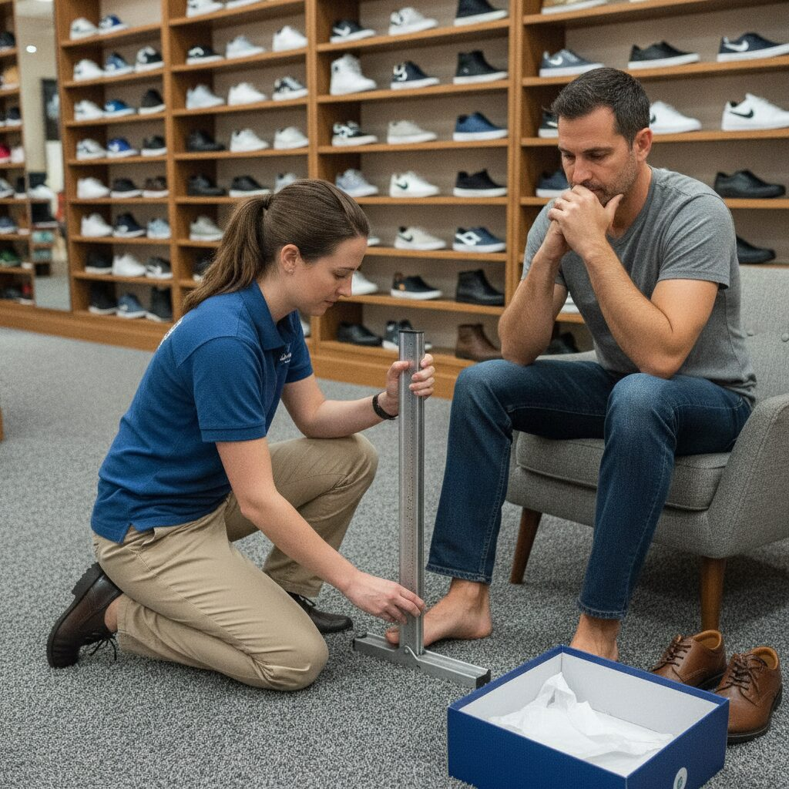

# TOEIC® Listening Practice Test 10

> 100 题 · Part 1（6）+ Part 2（25）+ Part 3（39）+ Part 4（30）· 约 45 分钟
> 音频为电脑合成（TTS），非真人录音。音频文件见 `audio/m10/`。

## PART 1 — Photographs（1–6）

For each question, you will listen to four short statements about a photograph. Select the statement that best describes what is happening in the picture.

### Q1

*照片内容*：At a narrow workbench in a small jewelry shop, a jeweler wearing a magnifying eyepiece repairs the inside of an open wristwatch with fine tweezers, while tiny screwdrivers and watch parts are laid out on a cloth in front of him.

音频：`audio/m10/p1-1.mp3`

- (A) He's putting a watch on his wrist.
- (B) He's polishing a glass display case.
- (C) He's repairing a watch.
- (D) He's handing a ring to a customer.

**答案：C**

解析：The jeweler is working on the inside of a wristwatch with tweezers, so (C) is correct. He is not wearing the watch (A), cleaning a display case (B), or serving a customer (D).

### Q2

*照片内容*：In a forest clearing surrounded by tall pine trees, three dome-shaped tents have been pitched on the grass around a ring of stones for a campfire, with a few folding chairs set up nearby; no people are visible.

音频：`audio/m10/p1-2.mp3`

- (A) Some tents have been set up in a clearing.
- (B) Campers are cooking over a fire.
- (C) A tent is being taken down.
- (D) Trees are being cut down in the forest.

**答案：A**

解析：Three tents stand pitched on the grass, so (A) is correct. Nobody appears in the photo, so no one is cooking (B), taking down a tent (C), or cutting trees (D).

### Q3

*照片内容*：In a shoe store, a saleswoman kneels beside a seated male customer and measures the length of his foot with a metal sizing device, while an open shoebox sits on the carpet next to them and shelves of shoes line the wall.

音频：`audio/m10/p1-3.mp3`

- (A) The saleswoman is tying her shoelaces.
- (B) The customer is paying at the register.
- (C) Shoes are being placed on a shelf.
- (D) A customer's foot is being measured.

**答案：D**

解析：The saleswoman is using a sizing device on the customer's foot, so (D) is correct. She is not tying her own laces (A), no one is paying (B), and the shoes on the shelves are not being moved (C).

### Q4

*照片内容*：On a city street closed to traffic, a large group of runners wearing numbered bibs jogs past a row of tall office buildings, while a few spectators stand behind a metal barrier at the edge of the road.

音频：`audio/m10/p1-4.mp3`

- (A) Cars are lined up at a traffic light.
- (B) Some people are taking part in a race.
- (C) The runners are stretching on the grass.
- (D) A barrier is being set up across the road.

**答案：B**

解析：A crowd of runners wearing numbers is jogging down the street, so (B) is correct. The street is closed to cars (A), the runners are not stretching (C), and the barrier is already in place rather than being set up (D).

### Q5

*照片内容*：At a gas station on a clear afternoon, a woman in a denim jacket stands beside her silver car holding a fuel nozzle that is inserted into the car's tank, next to a pump with a digital display.

音频：`audio/m10/p1-5.mp3`

- (A) She's checking the air in a tire.
- (B) She's washing the car's windshield.
- (C) She's refueling her car.
- (D) She's paying inside the station.

**答案：C**

解析：The woman is holding a fuel nozzle in her car's tank, so (C) is correct. She is not checking a tire (A) or washing the windshield (B), and she is outside at the pump, not paying inside (D).

### Q6

*照片内容*：In an office hallway, a man in a short-sleeved shirt uses a pushpin to attach a printed notice to a cork bulletin board that is already covered with flyers and schedules.

音频：`audio/m10/p1-6.mp3`

- (A) He's tearing a poster off the wall.
- (B) He's posting a notice on a board.
- (C) He's writing on a whiteboard.
- (D) He's reading a newspaper in the hallway.

**答案：B**

解析：The man is pinning a printed notice to the bulletin board, so (B) is correct. He is adding a sheet rather than tearing one off (A), and he is not writing on a whiteboard (C) or reading a newspaper (D).

## PART 2 — Question-Response（7–31）

You will hear a question or statement followed by three responses. Select the best response to the question or statement.

### Q7

问句/陈述：Where's the closest place to get a key copied?

音频：`audio/m10/p2-1.mp3`

- (A) There's a shop right by the subway entrance.
- (B) I made two copies of the report.
- (C) Please close the door behind you.

**答案：A**

解析：'Where' asks for a place, so (A), a shop by the subway entrance, is correct. (B) repeats 'copy' in a different context, and (C) uses 'close', which sounds like 'closest'.

### Q8

问句/陈述：Does this jacket come in a larger size?

音频：`audio/m10/p2-2.mp3`

- (A) It's a large company.
- (B) It came yesterday afternoon.
- (C) I'll check in the stockroom for you.

**答案：C**

解析：Instead of a direct yes or no, (C) offers to check the stockroom, a natural reply from a sales clerk. (A) repeats 'large' in an unrelated sentence, and (B) repeats 'come' in the past tense.

### Q9

问句/陈述：Who's taking over Mr. Quintero's clients while he's on leave?

音频：`audio/m10/p2-3.mp3`

- (A) He took two weeks off.
- (B) About twenty clients.
- (C) They'll be shared among the team.

**答案：C**

解析：'Who' asks for the person responsible, and (C) explains that the whole team will share the clients. (A) repeats 'take' and only talks about the leave, and (B) gives a number instead of a person.

### Q10

问句/陈述：The restaurant is fully booked on Friday night.

音频：`audio/m10/p2-4.mp3`

- (A) I'm reading a good book.
- (B) How about Saturday instead?
- (C) The food was excellent.

**答案：B**

解析：The speaker reports a problem with the reservation, and (B) suggests a solution: going on Saturday. (A) plays on 'booked' with 'book', and (C) comments on a past meal.

### Q11

问句/陈述：How do you usually get to work?

音频：`audio/m10/p2-5.mp3`

- (A) I cycle unless it's raining.
- (B) At about eight-thirty.
- (C) I work in the sales department.

**答案：A**

解析：'How' asks about the way the listener travels, so (A), cycling, is correct. (B) gives a time, and (C) repeats 'work' to describe a job.

### Q12

问句/陈述：Would you like a window seat or an aisle seat?

音频：`audio/m10/p2-6.mp3`

- (A) Yes, please, I'd like that.
- (B) Whichever is closer to the front.
- (C) Please have a seat over there.

**答案：B**

解析：The choice question is answered by (B): either seat is fine as long as it is near the front. (A) wrongly answers with 'yes', and (C) repeats 'seat' as an invitation to sit down.

### Q13

问句/陈述：Didn't Ms. Kowalski reply to the invitation?

音频：`audio/m10/p2-7.mp3`

- (A) Yes, invite her too.
- (B) Only to say she might be late.
- (C) It's an invitation-only event.

**答案：B**

解析：The negative question checks whether Ms. Kowalski responded, and (B) confirms that she did, though only to say she might be late. (A) and (C) repeat forms of 'invite' without answering the question.

### Q14

问句/陈述：When does the fireworks display begin tonight?

音频：`audio/m10/p2-8.mp3`

- (A) As soon as it gets dark.
- (B) Down by the river.
- (C) It was a great display.

**答案：A**

解析：'When' asks for a time, and (A) gives one: as soon as it is dark. (B) gives a location, and (C) repeats 'display' but uses the past tense.

### Q15

问句/陈述：Could you gift-wrap this for me, please?

音频：`audio/m10/p2-9.mp3`

- (A) We wrapped up the meeting at noon.
- (B) It's for my sister's birthday.
- (C) Of course, would you like a card with it?

**答案：C**

解析：The clerk agrees to the request in (C) and offers a card. (A) repeats 'wrap' in the phrase 'wrap up', meaning to finish, and (B) is something the customer, not the clerk, would say.

### Q16

问句/陈述：What's the soup of the day?

音频：`audio/m10/p2-10.mp3`

- (A) Every day at noon.
- (B) Let me ask the chef.
- (C) Just a small bowl, please.

**答案：B**

解析：The question asks which soup is offered, and (B), checking with the chef, is a natural indirect reply from a server. (A) repeats 'day' to give a time, and (C) is what a customer would say when ordering.

### Q17

问句/陈述：You've been to our Montreal office before, haven't you?

音频：`audio/m10/p2-11.mp3`

- (A) Only once, for a training course.
- (B) Before ten o'clock.
- (C) No, he hasn't.

**答案：A**

解析：The tag question checks past experience, and (A) confirms a single visit. (B) repeats 'before' to give a time, and (C) refers to the wrong person.

### Q18

问句/陈述：Why is the water being shut off in our building today?

音频：`audio/m10/p2-12.mp3`

- (A) Turn it off when you leave.
- (B) About two liters a day.
- (C) Some old pipes are being replaced.

**答案：C**

解析：'Why' asks for a reason, so (C), replacing old pipes, is correct. (A) repeats 'off' in an instruction, and (B) gives an amount of water.

### Q19

问句/陈述：Do you need any help carrying those bags to your car?

音频：`audio/m10/p2-13.mp3`

- (A) Thanks, but I'm parked right outside.
- (B) I'll carry on working.
- (C) The bags were on sale.

**答案：A**

解析：The offer of help is politely declined in (A) because the car is close by. (B) repeats 'carry' in the phrase 'carry on', and (C) mentions the bags without responding to the offer.

### Q20

问句/陈述：How much is a one-day pass for the city trams?

音频：`audio/m10/p2-14.mp3`

- (A) Every fifteen minutes.
- (B) It depends on how many zones you need.
- (C) I passed the station.

**答案：B**

解析：'How much' asks for a price, and (B) explains that the price depends on the number of zones. (A) answers 'how often', and (C) repeats 'pass' in another sense.

### Q21

问句/陈述：The online registration form keeps showing an error message.

音频：`audio/m10/p2-15.mp3`

- (A) In a different format.
- (B) It keeps the room cool.
- (C) Have you filled in every required field?

**答案：C**

解析：The speaker reports a problem, and (C) responds with a useful question about the required fields. (A) uses 'format', which sounds like 'form', and (B) repeats 'keeps' in an unrelated sentence.

### Q22

问句/陈述：Do you know if Dr. Rahimi is accepting new patients?

音频：`audio/m10/p2-16.mp3`

- (A) She was very patient with me.
- (B) You'd have to call her office to ask.
- (C) Yes, I accepted the offer.

**答案：B**

解析：The embedded yes/no question is answered indirectly by (B): the doctor's office has to be called. (A) uses 'patient' as an adjective meaning calm, and (C) repeats 'accept' about a different matter.

### Q23

问句/陈述：Which of the two apartments is closer to the subway?

音频：`audio/m10/p2-17.mp3`

- (A) The one on Dorset Road, by a few minutes.
- (B) Close the windows before you leave.
- (C) Yes, I take the subway.

**答案：A**

解析：'Which' asks the listener to choose one, so (A), the apartment on Dorset Road, is correct. (B) uses 'close' as a verb, and (C) wrongly answers with 'yes'.

### Q24

问句/陈述：Let's leave early to beat the traffic.

音频：`audio/m10/p2-18.mp3`

- (A) I left it in the car.
- (B) We beat them three to one.
- (C) Good idea, the highway gets busy after four.

**答案：C**

解析：The suggestion is accepted in (C), which adds a reason. (A) repeats 'leave' as 'left' in another sense, and (B) uses 'beat' to mean winning a game.

### Q25

问句/陈述：Have you checked in for your flight yet?

音频：`audio/m10/p2-19.mp3`

- (A) A checked bag costs extra.
- (B) Gate twelve, I think.
- (C) I'll do it on the way to the airport.

**答案：C**

解析：Instead of a plain yes or no, (C) says the check-in will be done on the way to the airport. (A) repeats 'checked' in another sense, and (B) names a gate, which relates to flights but does not answer.

### Q26

问句/陈述：Who's going to welcome the visitors from Cairo tomorrow?

音频：`audio/m10/p2-20.mp3`

- (A) Leticia from sales will meet them in the lobby.
- (B) You're welcome, any time.
- (C) They're staying for three days.

**答案：A**

解析：'Who' asks for a person, so (A), Leticia, is correct. (B) repeats 'welcome' as a reply to thanks, and (C) tells how long the visitors are staying.

### Q27

问句/陈述：Are you having that here, or would you like it to go?

音频：`audio/m10/p2-21.mp3`

- (A) It's a long way to go.
- (B) I'm meeting a friend here in a few minutes.
- (C) Yes, I've already eaten.

**答案：B**

解析：The choice question is answered indirectly by (B): the customer is meeting someone there, so the order will be eaten in. (A) repeats 'go' in another sense, and (C) wrongly answers with 'yes'.

### Q28

问句/陈述：How long does it take to walk to the stadium from here?

音频：`audio/m10/p2-22.mp3`

- (A) About twenty minutes.
- (B) It holds forty thousand people.
- (C) Take the second exit.

**答案：A**

解析：'How long' asks for an amount of time, so (A), about twenty minutes, is correct. (B) gives the stadium's size, and (C) repeats 'take' but gives directions.

### Q29

问句/陈述：The street festival starts on the twelfth, doesn't it?

音频：`audio/m10/p2-23.mp3`

- (A) It was a wonderful festival.
- (B) Twelve tickets, please.
- (C) They moved it to the fifteenth.

**答案：C**

解析：The tag question checks a date, and (C) corrects it: the festival now starts on the fifteenth. (A) uses the past tense, and (B) uses 'twelve', which sounds like 'twelfth'.

### Q30

问句/陈述：What should I bring to your housewarming party?

音频：`audio/m10/p2-24.mp3`

- (A) It's on Saturday evening.
- (B) Just yourself, really.
- (C) We bought the house in May.

**答案：B**

解析：The question asks what to bring, and (B) politely says nothing is needed. (A) answers 'when', and (C) gives background about the house instead.

### Q31

问句/陈述：My doctor told me to rest for a few days.

音频：`audio/m10/p2-25.mp3`

- (A) Then don't worry about tomorrow's meeting.
- (B) The rest of the team is here.
- (C) She's a family doctor.

**答案：A**

解析：The speaker shares health news, and (A) responds supportively by saying not to worry about work. (B) repeats 'rest' with the meaning 'the remaining part', and (C) repeats 'doctor' without responding to the news.

## PART 3 — Conversations（32–70）

You will hear several conversations between two or more people. You will be asked to answer three questions about what the speakers say. Select the best response.

### Questions 32–34

音频：`audio/m10/p3-1.mp3`

**录音原文：**

> W: Thanks for seeing me. As I mentioned on the phone, my embroidery business has grown a lot this year, and I'd like to finance a second machine. It's a twelve-head model that costs about forty thousand dollars.
> M: Congratulations on the growth. For equipment loans, we usually lend up to eighty percent of the purchase price, with the machine itself as security. So you'd need to cover the remaining twenty percent.
> W: That's fine. I've already set aside some savings for a down payment.
> M: Excellent. Then I'll need your business tax returns for the last two years, plus a written quote from the equipment supplier. Oh, and if you set up automatic monthly repayments from your account here, we take a quarter of a percent off the interest rate.
> W: That's definitely worth doing. I'll bring the tax returns in tomorrow morning.

**Q32.** What does the woman want to do?
- (A) Borrow money to buy equipment
- (B) Open a business savings account
- (C) Sell part of her company
- (D) Hire more employees

答案：**A**　解析：She wants 'to finance a second machine' for her embroidery business (A). She mentions her savings only as a down payment (B), and selling the company (C) or hiring (D) is not discussed.

**Q33.** What does the man ask the woman to provide?
- (A) Tax documents
- (B) A business plan
- (C) A list of clients
- (D) References from suppliers

答案：**A**　解析：He needs 'your business tax returns for the last two years' (A), along with a price quote from the supplier. A quote is not a reference (D), and a business plan (B) or client list (C) is not requested.

**Q34.** According to the man, how can the woman get a lower interest rate?
- (A) By making a larger down payment
- (B) By choosing a shorter loan period
- (C) By setting up automatic payments
- (D) By buying insurance through the bank

答案：**C**　解析：He says automatic monthly repayments take 'a quarter of a percent off the interest rate' (C). The down payment is a requirement, not a way to reduce the rate (A), and loan length (B) and insurance (D) are not mentioned.

### Questions 35–37

音频：`audio/m10/p3-2.mp3`

**录音原文：**

> M: Esme, I've just had a call from the owner of the diner we were filming in on Thursday. A pipe burst in their kitchen last night, and they've closed for repairs.
> W: Oh no. The whole commercial is set in a diner. Is there anywhere else we could use on short notice?
> M: I've already called the Starlight Diner out on Route Nine. They're happy for us to film there, but only after they close, so from eight P.M. onward.
> W: Shooting at night means we'll need extra lighting, and the crew will be on overtime rates.
> M: True, but it'd still cost less than pushing the shoot back. The client wants the final cut by the end of the month.
> W: You're right. Go ahead and confirm the Starlight, and I'll tell the crew about the new call time.

**Q35.** What problem does the man report?
- (A) A client has canceled a contract
- (B) Some filming equipment was damaged
- (C) A crew member is unavailable
- (D) A filming location cannot be used

答案：**D**　解析：The diner where they planned to film has 'closed for repairs' after a pipe burst (D). The pipe, not any filming equipment, was damaged (B), the client still wants the commercial (A), and no crew member is said to be unavailable (C).

**Q36.** What does the woman say about filming at night?
- (A) It will improve the look of the commercial
- (B) It will increase some costs
- (C) It needs the client's approval
- (D) It is not permitted at the new location

答案：**B**　解析：She says they will 'need extra lighting, and the crew will be on overtime rates,' so costs will rise (B). The Starlight Diner allows filming after it closes (D), and the client's approval (C) and the look of the commercial (A) are not mentioned.

**Q37.** What will the woman most likely do next?
- (A) Call the owner of the first diner
- (B) Inform the crew of a schedule change
- (C) Ask the client for more time
- (D) Rent lighting equipment

答案：**B**　解析：She says, 'I'll tell the crew about the new call time' (B). The man will confirm the new location, the client's deadline stays the same (C), and although extra lighting is needed, she does not say she will rent it now (D).

### Questions 38–40

音频：`audio/m10/p3-3.mp3`

**录音原文：**

> W: Hiroshi, I've just run last month's figures. Forty-one patients didn't turn up for their appointments and never called to cancel.
> M: Forty-one? That's nearly two full days of the doctors' time.
> W: Exactly. And most of those appointments were booked more than three weeks in advance, so I think people simply forget.
> M: We do send reminder letters, but they arrive a week or more before the visit.
> W: That's what I wanted to propose. Our scheduling software can send a text message two days before each appointment, and patients can reply to confirm or cancel. It's included in our current subscription; we just have to switch it on.
> M: Let's try it. Although I suspect a lot of the mobile numbers in our system are out of date.
> W: Good point. I'll ask the reception staff to check everyone's number when they arrive.

**Q38.** What problem are the speakers discussing?
- (A) Doctors arriving late
- (B) Errors in patient records
- (C) Long waits in the reception area
- (D) Patients missing appointments

答案：**D**　解析：Forty-one patients 'didn't turn up for their appointments' (D). Out-of-date phone numbers are a side issue raised later, not the main problem (B), and late doctors (A) and waiting times (C) are not mentioned.

**Q39.** What does the man mean when he says, "That's nearly two full days of the doctors' time"?
- (A) The doctors need more time off
- (B) The problem is a serious one
- (C) Appointments should be shorter
- (D) The figures were calculated incorrectly

答案：**B**　解析：He is stressing how much time the missed appointments wasted, showing that the problem is serious (B). He is not asking for time off (A), suggesting shorter visits (C), or questioning the woman's figures (D).

**Q40.** What does the woman say she will ask the reception staff to do?
- (A) Mail reminder letters earlier
- (B) Call patients who miss appointments
- (C) Check patients' phone numbers
- (D) Install new software

答案：**C**　解析：She will ask reception 'to check everyone's number when they arrive' (C). The text messages replace the letters rather than sending them earlier (A), and the software is already in place and only needs switching on (D).

### Questions 41–43

音频：`audio/m10/p3-4.mp3`

**录音原文：**

> M1: Thanks for coming in, Yasmin, Rohan. We've received an offer on your house from the couple who viewed it twice last week. They're offering eight thousand below the asking price.
> W: Hmm. That's lower than we'd hoped. Did they give a reason?
> M1: They mentioned that the kitchen needs updating. But the offer has no conditions attached, and they can complete the purchase in thirty days.
> M2: Thirty days? Our new apartment won't be ready until the end of June.
> W: That's true. We'd have nowhere to live for almost a month.
> M1: Then we could make a counteroffer: accept their price, but ask to move the closing date to the first of July.
> M2: I'd be comfortable with that. Could you contact them today?
> M1: Certainly. I'll call their agent this afternoon.

**Q41.** What are the speakers mainly discussing?
- (A) An offer to buy a home
- (B) Repairs to a kitchen
- (C) A rental agreement
- (D) A property inspection

答案：**A**　解析：The agent has 'received an offer on your house,' and they discuss how to respond (A). The kitchen is only the buyers' reason for the lower price (B), and no rental (C) or inspection (D) is discussed.

**Q42.** Why does Rohan say, "Our new apartment won't be ready until the end of June"?
- (A) To explain why they want a higher price
- (B) To point out a problem with the buyers' timeline
- (C) To suggest staying in a hotel
- (D) To complain about a construction company

答案：**B**　解析：He is reacting to the buyers' plan to complete the purchase in thirty days, which would leave the couple without a home (B). The agent then suggests moving the closing date. Price (A), a hotel (C), and the builder (D) are not his point.

**Q43.** What does the agent say he will do this afternoon?
- (A) Lower the asking price
- (B) Arrange another viewing
- (C) Prepare a sales contract
- (D) Contact the buyers' representative

答案：**D**　解析：He says, 'I'll call their agent this afternoon' (D). The sellers will accept the buyers' offer price, but they are not lowering the asking price for other buyers (A), and no viewing (B) or contract (C) is mentioned.

### Questions 44–46

音频：`audio/m10/p3-5.mp3`

**录音原文：**

> W: Okay, we need to close the books for September by Friday. Obinna, how are the bank reconciliations going?
> M1: Nearly done, but there's one gap. Larkhill Builders say they paid their eighteen-thousand-dollar invoice on the twelfth, but it never showed up in our account.
> W: That's a lot of money. Do we know what happened?
> M2: I think so. I asked them for the payment details, and they sent it to the account we closed in July, when we switched banks. The invoice we sent them still had the old account number printed on it.
> W: So our invoice template was never updated? Mehmet, can you fix that today, before anything else goes out?
> M2: Of course. And I'll contact our old bank. Since that account's closed, they should send the money back to Larkhill within a few days.
> W: Good. Obinna, make a note of it for the auditors, so they know why the payment's late.

**Q44.** What problem does Obinna mention?
- (A) An invoice contains a pricing error
- (B) A client has refused to pay
- (C) A payment has not been received
- (D) The bank has charged an extra fee

答案：**C**　解析：Obinna says Larkhill Builders paid their invoice, 'but it never showed up in our account' (C). The client did pay, so it has not refused (B), and pricing errors (A) and bank fees (D) are not mentioned.

**Q45.** According to Mehmet, what caused the problem?
- (A) An invoice showed old bank details
- (B) The client's bank made a mistake
- (C) A check was lost in the mail
- (D) The payment deadline was changed

答案：**A**　解析：Mehmet says 'the invoice we sent them still had the old account number printed on it,' so the money went to a closed account (A). The client simply followed the invoice, so its bank was not at fault (B), and lost mail (C) and deadlines (D) are not mentioned.

**Q46.** What does the woman ask Mehmet to do today?
- (A) Update a document
- (B) Call Larkhill Builders
- (C) Meet with the auditors
- (D) Open a new bank account

答案：**A**　解析：She asks him to fix the invoice template 'today, before anything else goes out' (A). Mehmet will contact the old bank, not the client (B), Obinna will make a note for the auditors (C), and the company already switched banks in July (D).

### Questions 47–49

音频：`audio/m10/p3-6.mp3`

**录音原文：**

> M: Great work on chapter six, Philippa. Before we go on, I should mention that the next three chapters are set in a small fishing village in Portugal, so there are a lot of Portuguese names for places and characters.
> W: Yes, I noticed that when I was preparing. I've marked about thirty names I'm not sure how to pronounce.
> M: The author has offered to help with that. She's traveling this week, but she could join a video call tomorrow morning to go through the list with you.
> W: That would be ideal. Could she also record herself saying the names? Then I could play them back while I'm reading.
> M: I'll ask her. In the meantime, let's skip ahead to chapter ten, which is set back in the city, and return to the village chapters after you've spoken with her.
> W: Sounds good. Just give me five minutes to read through chapter ten first.

**Q47.** Who most likely is the woman?
- (A) An author
- (B) A narrator
- (C) A translator
- (D) A sound engineer

答案：**B**　解析：She is recording the book's chapters and wants to hear the names 'while I'm reading,' so she is the narrator (B). The author is a different person who has offered to help (A), and nothing suggests she translates (C) or runs the equipment (D).

**Q48.** What does the man say the author has offered to do?
- (A) Rewrite some chapters
- (B) Visit the recording studio
- (C) Send a printed copy of the book
- (D) Help with pronunciation

答案：**D**　解析：The author will join a video call 'to go through the list' of difficult names (D). She will join by video rather than in person (B), and no rewriting (A) or printed copy (C) is mentioned.

**Q49.** What does the man suggest?
- (A) Recording the chapters in order
- (B) Hiring a language coach
- (C) Working on a different chapter
- (D) Ending the session early

答案：**C**　解析：He suggests they 'skip ahead to chapter ten' and come back to the village chapters later (C). That is the opposite of recording in order (A), and a coach (B) or ending early (D) is not proposed.

### Questions 50–52

音频：`audio/m10/p3-7.mp3`

**录音原文：**

> M: Hello, this is Barnaby calling from Westvale Medical Supplies about the order your clinic placed on Monday.
> W: Oh, hi. Is something wrong?
> M: Just one item. The examination table paper, the twenty-one-inch rolls, is on back order from the manufacturer until the middle of next month.
> W: That's a problem. We go through about four rolls a day, and we're down to our last box.
> M: I understand. We do stock another brand in the same size. It's a little thinner, but it's the same price, and I could deliver it with the rest of your order on Thursday.
> W: Thinner paper does tear more easily, but we can't do without it. Send two boxes of the other brand for now, and please keep my original order open so we get our usual paper when it's back in stock.
> M: Will do. I'll email you an updated invoice this afternoon.

**Q50.** Why is the man calling?
- (A) To confirm a delivery address
- (B) To ask about a late payment
- (C) To offer a discount
- (D) To report that an item is unavailable

答案：**D**　解析：He calls because the table paper 'is on back order from the manufacturer' (D). He mentions an updated invoice, but not a late payment (B), and the other brand costs the same, so no discount is offered (C).

**Q51.** What does the woman say about the examination table paper?
- (A) The clinic uses a lot of it
- (B) It was sent to the wrong address
- (C) It costs more than it used to
- (D) It must be stored carefully

答案：**A**　解析：She says, 'We go through about four rolls a day' (A). Delivery addresses (B), price increases (C), and storage (D) are not mentioned.

**Q52.** What does the woman decide to do?
- (A) Cancel her original order
- (B) Order from a different supplier
- (C) Accept a substitute product
- (D) Pick up the order herself

答案：**C**　解析：She asks for 'two boxes of the other brand for now' (C). She keeps her original order open rather than canceling it (A), she stays with the same supplier (B), and the order will be delivered on Thursday (D).

### Questions 53–55

音频：`audio/m10/p3-8.mp3`

**录音原文：**

> M: Hello, is this Ms. Quiroga? My name's Neville, and I'm calling from Linwood Appraisal Services. Your bank has asked us to assess the value of your house as part of your refinancing application.
> W: Oh, yes, they told me to expect your call.
> M: Great. I'd like to arrange a visit sometime next week. It normally takes about an hour, and I'll need to see every room, including the attic and the garage.
> W: Next week's tricky. I'm away for work from Monday to Thursday. Could you come on Friday?
> M: I'm afraid Friday's fully booked. Is there anyone who could let me in earlier in the week?
> W: My neighbor has a spare key, and she works from home. I'll ask her and call you back this evening.
> M: Perfect. And if you've made any improvements recently, like a new roof or windows, please have the receipts ready. They can raise the value.

**Q53.** Why does the man need to visit the woman's house?
- (A) To repair the roof
- (B) To install new windows
- (C) To show it to buyers
- (D) To estimate its value

答案：**D**　解析：The bank asked his firm 'to assess the value of your house' (D). A roof and windows are only examples of improvements that can raise the value (A, B), and the house is being refinanced, not sold (C).

**Q54.** What problem does the woman mention?
- (A) Her neighbor is moving away
- (B) She will be out of town
- (C) She has lost a key
- (D) Her bank has delayed her application

答案：**B**　解析：She says, 'I'm away for work from Monday to Thursday' (B). Her neighbor has a spare key (C), and nothing suggests the neighbor is moving (A) or the bank is causing a delay (D).

**Q55.** What does the man ask the woman to prepare?
- (A) A copy of her bank statement
- (B) A floor plan of the house
- (C) A spare key
- (D) Records of home improvements

答案：**D**　解析：He asks her to 'have the receipts ready' for recent improvements such as a new roof (D). The spare key belongs to the neighbor and is not something he requests (C), and bank statements (A) and floor plans (B) are not mentioned.

### Questions 56–58

音频：`audio/m10/p3-9.mp3`

**录音原文：**

> M: Hi, Ayumi, sorry to bother you. I just checked my pay statement, and the twelve hours of overtime I worked during the inventory count aren't on it.
> W: Let me have a look. You're right, they're not there. It seems your manager approved your timesheet on Tuesday, but payroll closed on Monday at noon.
> M: So I have to wait until the next pay date? That's three weeks away.
> W: Normally, yes. But we run a small extra payment on the fifteenth for corrections like this one.
> M: Oh, that would help a lot. Is there anything I need to do?
> W: Just forward me the approval email from your manager so I have it on file. And you might remind her that the payroll deadline is Monday at noon.
> M: I'll send it right now.

**Q56.** What is the man's problem?
- (A) He was paid at the wrong hourly rate
- (B) He cannot access his pay statement
- (C) Some of his work hours were not paid
- (D) His manager rejected his timesheet

答案：**C**　解析：His overtime hours 'aren't on' his pay statement (C). He has already checked the statement (B), and the timesheet was approved, just too late (D). His hourly rate (A) is not questioned.

**Q57.** Why does the man say, "That's three weeks away"?
- (A) To request some time off
- (B) To correct the woman's mistake
- (C) To indicate that he does not want to wait that long
- (D) To suggest a different deadline

答案：**C**　解析：He is unhappy at the idea of waiting until the next pay date (C), and the woman responds with a faster option on the fifteenth. He is not asking for leave (A), correcting her (B), or proposing a deadline (D).

**Q58.** What does the woman ask the man to send her?
- (A) An approval message
- (B) A new timesheet
- (C) A bank account number
- (D) A signed request form

答案：**A**　解析：She says, 'forward me the approval email from your manager' (A). The timesheet has already been approved (B), and bank details (C) and forms (D) are not mentioned.

### Questions 59–61

音频：`audio/m10/p3-10.mp3`

**录音原文：**

> M: So, the broadcaster has confirmed our documentary for the Sunday evening slot, which is fifty-two minutes. Rosalie, how long is the current cut?
> W1: Just under an hour, so we need to lose about eight minutes.
> M: Any thoughts on where?
> W1: The section on the lighthouse restoration runs twelve minutes, and much of it repeats points from the earlier interviews. I could cut it down to five without losing anything important.
> W2: If you do that, please send me the new timing as soon as possible. The music for that section was written to fit the current edit, so I'll have to rework it.
> M: Mariko, when would you need it by?
> W2: Wednesday at the latest, if the final sound mix is still on the twentieth.
> W1: I can have the shorter version ready by Tuesday afternoon.

**Q59.** What problem are the speakers discussing?
- (A) A broadcast date has changed
- (B) An interview was poorly recorded
- (C) The music budget has been cut
- (D) A program is too long

答案：**D**　解析：The slot is fifty-two minutes but the current cut is 'just under an hour,' so they 'need to lose about eight minutes' (D). The broadcast slot is confirmed, not changed (A), and recording quality (B) and budgets (C) are not mentioned.

**Q60.** What does Rosalie suggest?
- (A) Removing an interview
- (B) Adding new footage
- (C) Shortening a section
- (D) Changing the program's title

答案：**C**　解析：She could cut the lighthouse section 'down to five' minutes (C). The section repeats the interviews, but she does not suggest removing an interview (A), and new footage (B) and a new title (D) are not proposed.

**Q61.** What will Mariko need to do?
- (A) Revise some music
- (B) Interview another expert
- (C) Contact the broadcaster
- (D) Edit the documentary

答案：**A**　解析：Mariko says the music 'was written to fit the current edit, so I'll have to rework it' (A). Rosalie, not Mariko, will edit the film (D), and new interviews (B) or calls to the broadcaster (C) are not mentioned.

### Questions 62–64

音频：`audio/m10/p3-11.mp3`

**Invoice: November services**：Service Amount Monthly bookkeeping $450 Payroll processing $120 Year-end tax filing $600 Accounting software license $45

**录音原文：**

> W: Hi, this is Lorena Pacheco from Pacheco Interiors. I'm looking at the invoice you sent us for November, and I have a question about one of the charges.
> M: Of course, Ms. Pacheco. Which one is it?
> W: The tax filing. When we renewed our contract, we agreed that work would be billed in January, after the filing is actually done.
> M: Let me pull up your contract. Yes, you're absolutely right. It was added by mistake. I'll take it off and send you a corrected invoice today.
> W: Thank you. Also, we're hiring two more designers next month. Will that change anything on our bill?
> M: Your payroll charge will go up slightly, since it's based on the number of employees. I'll email you the new rate so you can include it in your budget.

**Q62.** What type of business does the man most likely work for?
- (A) An interior design company
- (B) An accounting firm
- (C) A bank
- (D) A recruitment agency

答案：**B**　解析：He handles bookkeeping, payroll, and tax filing for Ms. Pacheco's company (B). Interior design is the woman's business (A), and nothing suggests a bank (C) or a recruitment agency (D).

**Q63.** Look at the graphic. Which amount will be removed from the invoice?
- (A) $450
- (B) $120
- (C) $600
- (D) $45

答案：**C**　解析：The woman says the tax filing should be billed in January, and the man agrees to take it off. The invoice lists the year-end tax filing at $600 (C). The payroll charge of $120 (B) will rise later but is not removed.

**Q64.** Why will the payroll charge increase?
- (A) The company is hiring more staff
- (B) A new tax law has been passed
- (C) The contract has been renewed
- (D) The software license has expired

答案：**A**　解析：The man says the payroll charge is 'based on the number of employees,' and the woman's company is 'hiring two more designers next month' (A). The contract was renewed earlier and is not the reason (C), and tax laws (B) and the software license (D) are not mentioned as causes.

### Questions 65–67

音频：`audio/m10/p3-12.mp3`

**Dr. Maalouf: open appointments next week**：Day Time Monday 9:15 A.M. Tuesday 10:30 A.M. Wednesday 11:00 A.M. Thursday 7:45 A.M.

**录音原文：**

> W: Kestwick Family Clinic, Talia speaking. How can I help you?
> M: Hello, I'd like to make an appointment with Dr. Maalouf. I'm a regular patient, and I've had a sore shoulder for about two weeks now.
> W: I'm sorry to hear that. Dr. Maalouf has four openings left next week. Do you have a preferred time?
> M: Mornings suit me best, but not too early. I drop my daughter at school at half past eight, so I couldn't get there before nine. And I'm away on business on Monday and Tuesday.
> W: Then there's just one that works. I'll book it for you now. Before your visit, could you also fill out our online pain questionnaire? It helps the doctor prepare.
> M: Of course. Is it on your website?
> W: I'll text you the link right after this call.

**Q65.** Why does the man want to see a doctor?
- (A) He needs a prescription renewed
- (B) He wants a routine checkup
- (C) He needs a form signed
- (D) He has a painful shoulder

答案：**D**　解析：He says, 'I've had a sore shoulder for about two weeks' (D). He is a regular patient, but he is not asking for a checkup (B), a prescription (A), or a signature (C).

**Q66.** Look at the graphic. When will the man most likely see Dr. Maalouf?
- (A) Monday at 9:15 A.M.
- (B) Tuesday at 10:30 A.M.
- (C) Wednesday at 11:00 A.M.
- (D) Thursday at 7:45 A.M.

答案：**C**　解析：He is away on Monday and Tuesday (A, B) and cannot arrive before nine, which rules out Thursday at 7:45 (D). The only suitable opening is Wednesday at 11:00 A.M. (C).

**Q67.** What does the woman ask the man to do?
- (A) Arrive fifteen minutes early
- (B) Bring his insurance card
- (C) Call back to confirm
- (D) Complete a questionnaire

答案：**D**　解析：She asks him to 'fill out our online pain questionnaire' (D). She books the slot during the call and will text him the link, so he does not need to call back (C), and arriving early (A) and an insurance card (B) are not mentioned.

### Questions 68–70

音频：`audio/m10/p3-13.mp3`

**Available rentals**：Address Bedrooms Monthly rent Walk to station 9 Garnet Street 1 $1,400 4 min. 52 Bellamy Road 2 $1,950 6 min. 310 Sutton Avenue 2 $1,700 25 min. 77 Rowley Court 3 $2,300 8 min.

**录音原文：**

> M: Here are the four rentals I mentioned on the phone, Ms. Haugen. They're all available from the first of next month, which is when your transfer starts.
> W: Thanks. Well, my husband works from home, so we'll need at least two bedrooms. And we're not bringing a car, so I'd like to be able to walk to the train station in ten minutes or less.
> M: That leaves two options. The one on Rowley Court is the most spacious, with three bedrooms.
> W: It does look lovely, but my company's housing allowance only covers up to two thousand a month. We'll go with the other one.
> M: Good choice. The landlord's showing it this Saturday morning. Shall I book you a viewing at ten?
> W: Yes, please. Saturday suits us perfectly.

**Q68.** Why is the woman looking for an apartment?
- (A) She is being transferred for work
- (B) Her current lease is ending
- (C) She wants to live closer to family
- (D) Her current apartment is too small

答案：**A**　解析：The agent mentions 'your transfer,' which starts next month (A). Her husband works from home, but nothing is said about her current lease (B), family (C), or the size of her present home (D).

**Q69.** Look at the graphic. Which apartment will the woman most likely view?
- (A) 9 Garnet Street
- (B) 52 Bellamy Road
- (C) 310 Sutton Avenue
- (D) 77 Rowley Court

答案：**B**　解析：She needs two or more bedrooms, a walk of ten minutes or less, and rent within her $2,000 allowance. Garnet Street has one bedroom (A), Sutton Avenue is a 25-minute walk (C), and Rowley Court costs $2,300 (D), which leaves 52 Bellamy Road (B).

**Q70.** What does the man offer to do?
- (A) Lower the rent
- (B) Schedule a viewing
- (C) Send a lease agreement
- (D) Recommend a moving company

答案：**B**　解析：He asks, 'Shall I book you a viewing at ten?' (B). He does not offer to change the rent (A), and a lease (C) and movers (D) are not mentioned.

## PART 4 — Talks（71–100）

You will hear several talks given by a single speaker. You will be asked to answer three questions about what the speaker says. Select the best response.

### Questions 71–73 · Announcement

音频：`audio/m10/p4-1.mp3`

**录音原文：**

> Good morning, and thank you for your patience. This is an announcement for patients waiting to see Dr. Nasreen Siddiqui. Dr. Siddiqui has been called to the hospital to help with an urgent case, and she's now expected back at about eleven thirty. That means appointments with her are running roughly ninety minutes behind schedule. If you'd prefer not to wait, our front desk staff can move your appointment to another day this week. They can also book you in with Dr. Lindgren, who has a few openings this afternoon. If you came by car, please remember to have your parking ticket stamped at reception before you leave, so you won't be charged for the extra time. We're very sorry for the delay.

**Q71.** Why is Dr. Siddiqui delayed?
- (A) She is stuck in traffic
- (B) She is assisting with an emergency
- (C) She is attending a training session
- (D) She is meeting with another doctor

答案：**B**　解析：Dr. Siddiqui 'has been called to the hospital to help with an urgent case,' so (B) is correct. Traffic (A), training (C) and a meeting (D) are not mentioned.

**Q72.** What does the speaker offer patients who do not want to wait?
- (A) A partial refund
- (B) A free parking pass for their next visit
- (C) A video consultation
- (D) An appointment with a different doctor

答案：**D**　解析：Staff can reschedule patients or 'book you in with Dr. Lindgren, who has a few openings this afternoon,' so (D) is correct. No refund (A) or video consultation (C) is offered, and the parking reminder concerns today's ticket, not a free pass (B).

**Q73.** What are patients who drove reminded to do?
- (A) Have their parking ticket validated
- (B) Move their cars to another lot
- (C) Pay for parking in advance
- (D) Show their license at reception

答案：**A**　解析：Drivers should 'have your parking ticket stamped at reception before you leave,' that is, validated, so (A) is correct. Moving cars (B), paying in advance (C) and showing a license (D) are not mentioned.

### Questions 74–76 · Telephone message

音频：`audio/m10/p4-2.mp3`

**录音原文：**

> Hi, Ms. Varga, it's Darius Webb from Corbel Realty. I have news about the townhouse on Sutter Lane. The sellers have responded to your offer. They won't accept the price you proposed, but they've come back with a counteroffer that's about eight thousand dollars higher. Now, here's the good part. Last week's inspection found that the roof needs repairs, and the sellers have agreed to pay for all of that work before you move in. Honestly, that could save you more than the difference in price. The sellers need an answer by noon tomorrow, though, because another buyer is viewing the property in the afternoon. Call me back tonight if you can, and we'll go through the numbers together.

**Q74.** What is the purpose of the call?
- (A) To arrange a property viewing
- (B) To request an inspection report
- (C) To pass on a response to an offer
- (D) To announce that a sale is complete

答案：**C**　解析：Mr. Webb calls because 'the sellers have responded to your offer' with a counteroffer, so (C) is correct. The viewing he mentions is for another buyer (A), the inspection has already happened (B), and nothing is final yet (D).

**Q75.** Why does the speaker say, "Now, here's the good part"?
- (A) To indicate that the inspection found no problems
- (B) To suggest that the listener make a lower offer
- (C) To introduce information that makes the counteroffer more appealing
- (D) To announce that the sellers accepted the original price

答案：**C**　解析：He follows the phrase by explaining that the sellers will pay for the roof repairs, which 'could save you more than the difference in price,' so he is introducing a point in the counteroffer's favor (C). The inspection did find a problem (A), he never suggests a lower offer (B), and the sellers rejected the original price (D).

**Q76.** Why does the listener need to respond by noon tomorrow?
- (A) The sellers are leaving the country
- (B) Another person will view the property
- (C) The bank requires an answer
- (D) Roof repairs are scheduled to begin

答案：**B**　解析：An answer is needed by noon 'because another buyer is viewing the property in the afternoon,' so (B) is correct. Travel (A), a bank (C) and the repair schedule (D) are not given as reasons.

### Questions 77–79 · Radio advertisement

音频：`audio/m10/p4-3.mp3`

**录音原文：**

> If you work for yourself, you already know the feeling. You're great at what you do, but every spring, sorting out a year's worth of receipts eats up whole weekends. That's where Tallyhouse comes in. Our bookkeepers specialize in freelancers and one-person businesses, from photographers to translators. Simply forward us your bank statements at the end of each month, and we'll do the rest: sorting your expenses, chasing unpaid invoices, and preparing everything your accountant needs at tax time. Plans start at just thirty-five dollars a month, and there's no long-term contract, so you can cancel whenever you like. Book a free fifteen-minute call this week, and we'll show you how much time you could save.

**Q77.** Who is the advertisement intended for?
- (A) Professional accountants
- (B) Large companies
- (C) Photography students
- (D) Self-employed people

答案：**D**　解析：The ad begins 'If you work for yourself' and says the bookkeepers 'specialize in freelancers and one-person businesses,' so (D) is correct. Accountants receive the finished paperwork rather than being the audience (A), large companies (B) are not targeted, and photographers are just one example of freelancers (C).

**Q78.** What does the speaker say customers need to do?
- (A) Send their bank statements every month
- (B) Download accounting software
- (C) Visit the company's office
- (D) Hire an accountant

答案：**A**　解析：Customers 'forward us your bank statements at the end of each month, and we'll do the rest,' so (A) is correct. No software download (B) or office visit (C) is required, and the service prepares documents for the customer's existing accountant (D).

**Q79.** What does the speaker say about the plans?
- (A) They include a free phone
- (B) They can be canceled at any time
- (C) They require a one-year contract
- (D) They cost less in the spring

答案：**B**　解析：'There's no long-term contract, so you can cancel whenever you like,' so (B) is correct and (C) is the opposite. A free phone (A) and spring discounts (D) are not mentioned; spring is only when receipts become a problem.

### Questions 80–82 · Tour information

音频：`audio/m10/p4-4.mp3`

**录音原文：**

> Good afternoon, and welcome to the show apartment at Quillon Wharf. I'm Philippa, and I'll be taking you round today. Before we go in, may I ask everyone to slip on a pair of the shoe covers from the basket by the door? The floors were only finished last week. This apartment is identical to the two-bedroom homes on floors four to nine, so what you see here is exactly what you'd be buying. As we walk through, notice the floor-to-ceiling windows in the living room. Every two-bedroom apartment faces the river. Afterwards, we'll take the lift to the rooftop garden, which all residents share. Then we can sit down in the sales office, where I'll go through prices and our reservation process.

**Q80.** Who most likely are the listeners?
- (A) Construction workers
- (B) Interior designers
- (C) Potential home buyers
- (D) Current residents

答案：**C**　解析：The speaker says 'what you see here is exactly what you'd be buying' and will explain 'prices and our reservation process,' so the listeners are potential buyers (C). The work is finished (A), no design work is discussed (B), and residents are mentioned only as people who will share the garden (D).

**Q81.** Why are the listeners asked to wear shoe covers?
- (A) The building is still under construction
- (B) The floors have just been completed
- (C) It is raining outside
- (D) The carpets are being cleaned

答案：**B**　解析：She asks for shoe covers because 'the floors were only finished last week,' so (B) is correct. Nothing suggests ongoing construction (A), rain (C) or carpet cleaning (D).

**Q82.** What will the listeners do after visiting the rooftop garden?
- (A) Watch a video about the area
- (B) Tour a three-bedroom apartment
- (C) Meet the building manager
- (D) Discuss prices in an office

答案：**D**　解析：After the rooftop garden, 'we can sit down in the sales office, where I'll go through prices,' so (D) is correct. A video (A), a three-bedroom apartment (B) and a building manager (C) are not mentioned.

### Questions 83–85 · News report

音频：`audio/m10/p4-5.mp3`

**录音原文：**

> In local news, filming for a new period drama series begins in the old town on Monday, and residents should expect some disruption. The producers, Seventh Lantern Pictures, say Tanner Street and the market square will be closed to traffic for up to ten days while scenes are shot. Shops in the area will stay open, and the company has promised to pay for extra signs directing customers to them. There's also an opportunity for anyone who's ever wanted to appear on screen. The production needs around two hundred local people to work as extras in crowd scenes. Applicants must be available for at least three full days. Details on how to apply are on the town council's website.

**Q83.** What is the news report mainly about?
- (A) A television series being filmed locally
- (B) A new film opening at a local theater
- (C) The renovation of a market square
- (D) A festival celebrating local history

答案：**A**　解析：The report says 'filming for a new period drama series begins in the old town on Monday,' so (A) is correct. Nothing is opening at a theater (B), the square is closed for filming, not renovation (C), and no festival is mentioned (D).

**Q84.** What has the production company promised to do?
- (A) Repair damaged roads
- (B) Give shop owners free tickets
- (C) Provide parking for residents
- (D) Pay for signs that direct customers to shops

答案：**D**　解析：The company 'has promised to pay for extra signs directing customers to' the shops, so (D) is correct. Road repairs (A), free tickets (B) and parking (C) are not mentioned.

**Q85.** What is required of people who want to be extras?
- (A) Previous acting experience
- (B) An address in the old town
- (C) Availability for at least three days
- (D) A recent photograph

答案：**C**　解析：'Applicants must be available for at least three full days,' so (C) is correct. Acting experience (A) and photographs (D) are not mentioned, and the production wants local people in general, not only old-town residents (B).

### Questions 86–88 · Excerpt from a meeting

音频：`audio/m10/p4-6.mp3`

**录音原文：**

> Before we finish, I want to talk about missed appointments. Last month, forty-two patients didn't show up and didn't call to cancel. I don't need to tell you what that does to our waiting list. So starting next week, we're changing how we send reminders. Instead of calling patients the day before, which takes the front desk most of the afternoon, our scheduling system will send a text message three days ahead. Patients can reply with a single number to confirm or cancel, and any cancelled slot will be offered automatically to people on the waiting list. Keiko will train everyone on the new screens this Thursday at eight, before the clinic opens. Please bring any questions you have.

**Q86.** What problem does the speaker discuss?
- (A) Patients are waiting too long at reception
- (B) Patients are missing appointments without notice
- (C) The scheduling system often crashes
- (D) The clinic has too few staff in the afternoon

答案：**B**　解析：She reports that 'forty-two patients didn't show up and didn't call to cancel,' so (B) is correct. Waiting times at reception (A) and system crashes (C) are not mentioned, and the afternoon comes up only as the time phone reminders take (D).

**Q87.** Why does the speaker say, "I don't need to tell you what that does to our waiting list"?
- (A) She wants staff to update the waiting list
- (B) She is not sure how long the waiting list is
- (C) She thinks the effect of the problem is obvious to everyone
- (D) She plans to discuss the waiting list at another meeting

答案：**C**　解析：After giving the number of no-shows, she implies that everyone already knows how missed slots hurt the waiting list, so (C) is correct. She is not asking for an update (A), expressing uncertainty (B) or postponing the topic (D).

**Q88.** What will happen on Thursday?
- (A) Staff will be trained on a new system
- (B) The clinic will open late
- (C) Patients will receive text messages
- (D) A new receptionist will start work

答案：**A**　解析：'Keiko will train everyone on the new screens this Thursday at eight,' so (A) is correct. The training is before opening, so the clinic does not open late (B), the texts start next week (C), and no new receptionist is mentioned (D).

### Questions 89–91 · Award speech

音频：`audio/m10/p4-7.mp3`

**录音原文：**

> Thank you so much. I'm honored to accept this year's Community Lender Award on behalf of the small-business team at Penmore Savings Bank. Three years ago, we noticed that many people with excellent business ideas were being turned down for loans simply because they'd never borrowed money before. So we changed our approach. We now judge first-time applicants on their business plans and work experience rather than their borrowing history, and every borrower gets free monthly workshops on managing cash flow. Since then, we've approved more than three hundred loans to first-time business owners, and almost all of those businesses are still open today. The award comes with a five-thousand-dollar prize, and our team has decided to donate it to Fenmoor Community College for student scholarships. Thank you.

**Q89.** Who most likely is the speaker?
- (A) A college professor
- (B) A government official
- (C) A first-time business owner
- (D) A bank employee

答案：**D**　解析：She accepts the award 'on behalf of the small-business team at Penmore Savings Bank,' so (D) is correct. The college only receives a donation (A), no government role is mentioned (B), and first-time business owners are the bank's customers (C).

**Q90.** According to the speaker, what problem did the team notice?
- (A) Applicants without a borrowing history were being rejected
- (B) Small businesses were closing too quickly
- (C) Loan interest rates were too high
- (D) Few people were applying for loans

答案：**A**　解析：Applicants 'were being turned down for loans simply because they'd never borrowed money before,' so (A) is correct. Almost all of the businesses are still open (B), and interest rates (C) and the number of applicants (D) are not mentioned.

**Q91.** What will happen to the prize money?
- (A) It will fund new workshops
- (B) It will be shared among the team
- (C) It will be given to a college
- (D) It will be loaned to new businesses

答案：**C**　解析：The team will 'donate it to Fenmoor Community College for student scholarships,' so (C) is correct. The workshops are already free for borrowers (A), and the team is not keeping (B) or lending (D) the money.

### Questions 92–94 · Podcast

音频：`audio/m10/p4-8.mp3`

**录音原文：**

> You're listening to The Quiet Booth, the podcast about the people behind the voices you hear every day. I'm Rupert Gale. My guest this week is Chiamaka Eze, who has narrated more than one hundred and fifty audiobooks, including last year's best-selling mystery series. Most of us can barely read a bedtime story without stumbling, so I'll be asking Chiamaka how she manages eight hours in a recording booth without losing her voice. She'll also explain how a single book is produced, from the first rehearsal to the final edit. And if you've ever wondered whether narration could be a career for you, stay tuned. Chiamaka has agreed to listen to short recordings sent in by listeners and give her honest feedback.

**Q92.** Who is Chiamaka Eze?
- (A) A mystery writer
- (B) A recording engineer
- (C) An audiobook narrator
- (D) A radio producer

答案：**C**　解析：Chiamaka 'has narrated more than one hundred and fifty audiobooks,' so (C) is correct. She reads mystery novels but did not write them (A), and nothing suggests she is an engineer (B) or a radio producer (D).

**Q93.** Why does the speaker say, "Most of us can barely read a bedtime story without stumbling"?
- (A) To recommend a children's book
- (B) To show admiration for the guest's skill
- (C) To explain why he is nervous
- (D) To admit that he made a mistake

答案：**B**　解析：He contrasts most people's trouble reading aloud with Chiamaka's ability to record for eight hours, so he is showing admiration for her skill (B). He does not recommend a book (A) or talk about his own nerves (C) or a mistake (D).

**Q94.** What does the speaker say Chiamaka will do for some listeners?
- (A) Send them signed books
- (B) Invite them to a recording session
- (C) Help them find a publisher
- (D) Comment on recordings they submit

答案：**D**　解析：Chiamaka 'has agreed to listen to short recordings sent in by listeners and give her honest feedback,' so (D) is correct. Signed books (A), recording sessions (B) and publishers (C) are not mentioned.

### Questions 95–97 · Workshop introduction

音频：`audio/m10/p4-9.mp3`

**Mortgage products**：Product Minimum deposit Classic Fixed 20% Key Start 5% Green Home 15% Flexi Rate 10%

**录音原文：**

> Good morning, and welcome to Thistledown Building Society's workshop for first-time buyers. I'm Maeve Dunne, one of our mortgage advisers. Over the next three hours, we'll look at how much you can realistically borrow, what fees to expect when you buy, and the mortgage products we offer. You should all have a copy of our product sheet. When you registered, most of you told us you've saved about a tenth of the price of the home you'd like to buy. So we'll spend most of this morning on the product designed for buyers at exactly that level. After the break, a local solicitor will join us to explain the legal side of buying a home. And please do ask questions as we go along.

**Q95.** Who most likely are the listeners?
- (A) People planning to buy their first home
- (B) Mortgage advisers in training
- (C) Real estate agents
- (D) Property investors

答案：**A**　解析：This is a 'workshop for first-time buyers,' and the speaker refers to 'the home you'd like to buy,' so (A) is correct. The speaker, not the audience, is a mortgage adviser (B), and nothing suggests agents (C) or investors (D).

**Q96.** Look at the graphic. Which product will the speaker mainly discuss?
- (A) Classic Fixed
- (B) Key Start
- (C) Green Home
- (D) Flexi Rate

答案：**D**　解析：Most listeners have saved 'about a tenth of the price,' which is 10 percent, and the graphic shows that Flexi Rate requires a 10% minimum deposit, so (D) is correct. Classic Fixed (A) needs 20%, Key Start (B) 5% and Green Home (C) 15%.

**Q97.** What will happen after the break?
- (A) Listeners will meet with advisers individually
- (B) A legal professional will give a talk
- (C) Listeners will fill out loan applications
- (D) A real estate agent will show a property

答案：**B**　解析：'After the break, a local solicitor will join us to explain the legal side of buying a home,' and a solicitor is a lawyer, so (B) is correct. Individual meetings (A), loan applications (C) and property viewings (D) are not mentioned.

### Questions 98–100 · Telephone message

音频：`audio/m10/p4-10.mp3`

**Quote: product launch video**：Item Cost Filming (one day) $1,800 Editing $1,200 Drone footage $650 Voice-over $400 Total $4,050

**录音原文：**

> Hi, Yolanda, it's Jasper Kessler from Parallax Video. I'm calling about the quote I sent you on Monday for your product launch video. I've just heard back from the park where we're planning to film. Unfortunately, they don't allow drones without a special permit, and getting one takes at least six weeks. Since your launch is next month, I'm going to take that item off the quote, so your total will come down. The good news is that our camera operator can get some great wide shots from the hotel rooftop across the road instead, at no extra cost. I'll send a revised quote this afternoon. If everything looks right, could you sign it and send it back by Friday so we can book the crew?

**Q98.** What is the speaker mainly calling about?
- (A) Booking a hotel for a film crew
- (B) A change to a price estimate
- (C) The date of a product launch
- (D) Hiring a new camera operator

答案：**B**　解析：He is calling 'about the quote I sent you on Monday' and explains that one item will be removed, so (B) is correct. The hotel is only a filming spot (A), the launch date is unchanged (C), and the camera operator already works for him (D).

**Q99.** Look at the graphic. By how much will the total be reduced?
- (A) $1,800
- (B) $1,200
- (C) $650
- (D) $400

答案：**C**　解析：Drones are not allowed at the park, so he will 'take that item off the quote,' and the graphic lists drone footage at $650, so (C) is correct. Filming (A), editing (B) and the voice-over (D) stay on the quote.

**Q100.** What does the speaker ask the listener to do?
- (A) Return a signed document by Friday
- (B) Apply for a filming permit
- (C) Choose a different filming location
- (D) Call the hotel to arrange access

答案：**A**　解析：He asks her to 'sign it and send it back by Friday so we can book the crew,' so (A) is correct. The permit would take too long, so no one will apply for it (B), he has already found another place to shoot from (C), and calling the hotel is not requested (D).

---

题目来源：toeicmocktests.com（公开免费练习材料）。TOEIC® / ETS® 为 ETS 注册商标，本项目与 ETS 无关联。仅供个人学习使用。
